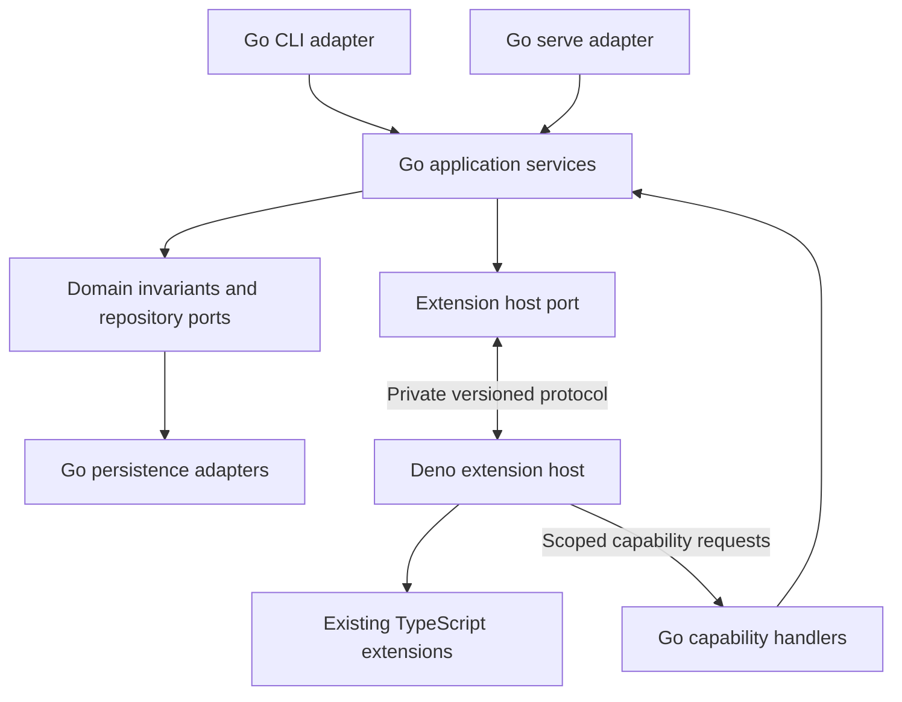

# Gradual migration to a Go core with TypeScript extensions

**Status: proposed architecture and implementation sequence.** The verification
reference above identifies the code used to check the starting assumptions. It
does not mean the proposed stages are implemented.

Start with the existing TypeScript application. Establish its compatibility
contract, isolate application operations from their delivery mechanisms, and
prove a process boundary before moving domain behavior into Go. These are the
prerequisites even if no Go implementation exists yet. The experimental Go serve
work can supply parts of that foundation; its relationship to this plan is
described near the end.

The intended result is a Go application that runs existing TypeScript extensions
in a managed Deno host. Users retain their commands, definitions, installed
extensions, and repositories. Each stage should deliver a usable release and
have an explicit way to return to its previous implementation.

**1. Establish the baseline and compatibility contract**

Begin by inventorying observable behavior and the code that owns it. Use the six
primitives as the organizing model: behaviors, data, workflows, vaults,
extensions, and serve. Record which contracts are public, which are internal,
and which extensions can nevertheless reach today.

| Surface                 | Contract to capture                                                                                                                          |
| ----------------------- | -------------------------------------------------------------------------------------------------------------------------------------------- |
| CLI and agent interface | Commands, behavior/model aliases, flags, help schemas, environment variables, exit codes, JSON output, logging, prompts, and signal handling |
| Repository              | Definition interpretation, lookup precedence, mounts, worktrees, path expansion, configuration, and supported datastore formats              |
| Extensions              | Package layout, source loading, dependency resolution, runtime APIs, context members, schemas, hooks, assets, and provider interfaces        |
| Execution               | Validation order, checks, reports, events, output versions, cancellation, failure settlement, and rollback-on-failure                        |
| Workflows               | DAG semantics, expressions, fan-out, retries, pinned inputs, nested execution, suspension, approval, signals, and resume                     |
| Serve and workers       | Authentication, grants, capability negotiation, reconnect, detach, remote placement, leases, and audit                                       |
| Secrets                 | Resolution timing, sentinel behavior, refused destinations, sensitive schema handling, redaction, and persisted representation               |

Build a representative corpus of existing repositories and unmodified
extensions. Include old published bundles, locally authored source, all runtime
provider kinds, custom Zod logic, binary outputs, and nested method calls. Use
synthetic secrets and controlled external services in reusable fixtures.

Characterize current behavior before replacing it. Correctness fixes discovered
here should be explicit changes with their own compatibility assessment. A
language migration should not quietly redefine existing semantics.

Measure cold CLI startup, warm and cold serve requests, idle memory, active-run
memory, throughput, installation size, and extension-loading cost. Record
platform, workload, cache state, and distribution method. Set acceptance budgets
from these measurements. Go does not automatically improve performance when
every command still starts the complete TypeScript application.

**Exit criterion:** a compatibility matrix, representative fixtures, and a
repeatable baseline exist. The first migrated operation has identified callers,
observable outputs, dependencies, and a rollback strategy.

**2. Establish application boundaries inside TypeScript**

Use the existing libswamp operations as the starting seams. They already expose
inputs, injected dependencies, cancellation, and event streams. Do not first
rewrite the entire application into a new framework.

For the first selected operation, separate delivery concerns from application
behavior. CLI parsing and rendering stay in adapters. Server connection handling
and authentication stay in server adapters. The application operation accepts
explicit input and an execution context, and produces typed progress and
terminal events.

The execution context must distinguish cancellation, deadlines, tracing,
repository identity, and trusted authority. Existing libswamp context is not
itself a serialized authorization contract. Add only the explicit context needed
at the new boundary; do not serialize live loggers, repositories, AbortSignals,
or units of work. See [libswamp](../../contributing/libswamp.md) and
[its context](../../src/libswamp/context.ts).

Keep authorization checks attached to the operation they protect. Remote callers
cannot supply their own principal. Local execution must preserve the existing
operator account and repository policies rather than manufacture a remote
session. A generic dispatcher must not become a route around resource-level
authorization or audit.

Identify aggregates and their consistency boundaries before splitting services.
Application services coordinate work; domain types own invariants; repository
ports expose the persistence needed for those invariants. Use the existing DDD
layer rules to prevent new dependencies from domain logic into transport or
concrete persistence.

**Exit criterion:** the selected operation runs through a transport-independent
interface in TypeScript with unchanged observable behavior. Its authority and
transaction boundaries are documented and tested.

**3. Define the private process contract and build the Go host**

Introduce a small Go program that starts and supervises the existing TypeScript
engine. Initially, TypeScript continues owning all application behavior. A Go
serve listener is a useful first delivery surface because it exercises a
long-lived process and allows existing clients to remain unchanged. A local test
harness should also invoke the application boundary without a network listener,
so the design remains suitable for a future CLI.

Keep public CLI and server contracts separate from private engine protocols. The
private protocol should negotiate a version and explicit capabilities. Pin and
test compatible Go/engine release pairs. Do not require users to supply an
arbitrary runtime from their PATH.

Start with bounded, length-prefixed structured messages over dedicated inherited
pipes. Define request IDs, process generations, parent invocation IDs,
deadlines, errors, progress events, and terminal outcomes. Public request IDs,
durable run IDs, and private RPC IDs have different lifetimes and must remain
distinct.

Define serialization deliberately. Absent fields, null, integers outside the
JavaScript safe range, bytes, timestamps, and durations need explicit mappings.
Use contract fixtures consumed by both implementations. Generate wire types
where practical, but retain runtime validation and semantic tests.

The host must handle startup failure, incompatible engines, EOF, partial frames,
timeouts, cancellation, bounded queues, slow consumers, graceful drain, forced
exit, and process cleanup. Extension stdout and stderr must not share the
control channel. Diagnostics must pass through the applicable redaction policy.

Treat process isolation as an operational boundary. It does not make trusted
extensions an OS sandbox or contain every process an extension can launch.
Preserve existing permissions and command behavior during this migration.

Keep the first host opt-in. If it supports only a subset of configurations,
validate that subset before admitting work. Unsupported configurations continue
using ordinary Swamp. Do not advertise the host as a general replacement until
its compatibility coverage supports that claim.

**Exit criterion:** the TypeScript application behaves correctly under the Go
supervisor, including crash and shutdown cases, on supported native platforms.
The result proves the process boundary, not yet a migrated domain core.

**4. Move one application read into Go**

Introduce an explicit operation router. Initially, all entries target the
TypeScript implementation. Add a Go handler for one existing operation, with the
same public input, errors, events, and result.

Reading an existing behavior definition through `model.get` is a useful
candidate. It is not merely reading YAML: the current operation loads type
metadata, redacts sensitive arguments using schemas, describes methods, and
reports version staleness. Keep schema-dependent work in a TypeScript adapter at
first. See [the existing operation](../../src/libswamp/models/get.ts).

The first Go handler can own lookup orchestration, missing-definition behavior,
event production, and result assembly. Its TypeScript dependencies can return
definition information and safe, serializable type descriptions. Raw Zod objects
do not cross the boundary. Keep existing redaction ahead of any new diagnostic
or presentation surface.

Support correlated callbacks while the original request is pending. The
transport reader must continue serving replies and callbacks; it cannot block
waiting for an operation that itself needs the other process. Bound concurrency
and propagate cancellation through both directions.

Compare both implementations against the same captured fixtures. Extension
loading can execute module initialization, so do not assume every nominally
read-only operation is safe to run twice against a live repository.

**Exit criterion:** an unchanged client receives compatible results from a real
Go application handler backed by TypeScript dependencies. Selection can return
to TypeScript before execution. This is the first application migration
milestone.

**5. Establish the TypeScript extension host contract**

Separate two logical roles in the TypeScript process: the remaining application
compatibility engine and the extension host. They may share one process during
transition. Their APIs should remain distinct so application code can be retired
without changing extension author APIs.

Retain Deno initially. Existing extensions can use Deno APIs, web APIs, npm and
Node compatibility, subprocesses, packaged files, and the current bundle loader.
Replacing the JavaScript runtime is a separate project with a separate
compatibility burden. Existing loading and bundling behavior is described in
[extensions](../primitives/extensions.md).

Define host operations for loading and describing types, invoking behavior
methods, executing checks and reports, and calling vault and datastore
providers. Preserve extension discovery precedence and module lifetime. Do not
assume a fresh process per method or arbitrary pooling preserves extensions that
retain state between calls. Begin with the existing execution scope and measure
before changing residency or pooling.

Implement the current MethodContext with compatibility adapters:

| Context behavior                      | Initial implementation across the boundary                                                            |
| ------------------------------------- | ----------------------------------------------------------------------------------------------------- |
| Async data reads and queries          | Call explicit capabilities owned by the application or its TypeScript repository bridge               |
| Resource and file writes              | Use invocation-scoped writer handles with explicit write, finish, abort, and acknowledgement behavior |
| Synchronous file and CEL helpers      | Preserve local TypeScript implementations and required local assets                                   |
| Logging and progress                  | Emit structured, redacted events with bounded delivery                                                |
| Nested invocation                     | Call the application with inherited authority, cancellation, and parent provenance                    |
| Secrets                               | Retain reference and sentinel semantics; resolve values only at the established execution boundary    |
| Legacy repository and service members | Provide faithful local adapters or retain the complete TypeScript execution path                      |

The existing [remote context](../../src/worker/remote_method_context.ts)
provides patterns, but intentionally refuses capabilities available locally.
Those refusals cannot silently become new restrictions on local extensions.
Inventory every exposed member of
[MethodContext](../../src/domain/models/model.ts).

Keep Zod validation, coercion, transformations, and extension execution in the
same host when parsed values are arbitrary JavaScript objects. JSON Schema is
descriptive metadata, not a replacement for executable validation. Use opaque,
generation-scoped handles when a later phase must refer to a host-resident
value. Never re-run a custom transformation merely to reconstruct a value in Go.

Preserve sensitive-input handling for both global and method arguments,
including record, array, and scalar shapes. Validation errors must pass through
the existing masking policy before they become IPC diagnostics or user output.

Large artifacts need bounded transfer outside ordinary control messages. Define
chunking or private staging handles, checksums, cancellation, cleanup ownership,
and when durability is acknowledged. Avoid buffering whole artifacts as JSON.

Vault and datastore providers need an explicit bootstrap sequence. Some are
required before the repository can open. Load the minimum provider configuration
and bundles needed for initialization, and avoid a cycle where starting the host
requires the datastore that the host must provide. Preserve current eager or
lazy loading behavior where it affects compatibility.

**Exit criterion:** representative unmodified extensions execute through the
host with their existing context behavior. Uncovered cases are selected onto the
compatibility engine before side effects, and remain visible in the migration
inventory.

**6. Move behavior invocation ownership into Go**

Move one complete application invocation path, starting with an existing local
definition. Go owns the invocation state machine, admission, cancellation,
dependency sequencing, and terminal outcome. TypeScript initially retains
expression evaluation, schema validation, extension code, and persistence.

Derive the execution order from current behavior rather than inventing a new
sequence. Preserve checks, validation, secret resolution, method execution,
reports, output settlement, and failure handling. Direct type execution,
definition creation, nested calls, and remote placement can follow as explicit
coverage increments.

At this stage, TypeScript remains the transaction and persistence owner. Go
requests semantic operations against an invocation-scoped repository session; it
must not reconstruct transactions from unrelated save calls. One invocation has
one durable run identity and one lifecycle owner. Remove duplicate TypeScript
orchestration from the migrated path while retaining its adapters.

An accepted request is not proof of durable start. Preserve the point at which
detach can report success, the meaning of cancellation, and the relationship
between terminal results and persisted history. A client disconnect can end
observation without cancelling an accepted run.

If a process dies after a mutation was admitted, its outcome can be unknown.
Reconcile persisted state and report uncertainty when necessary. Never retry a
method automatically because its reply was lost. Existing method or workflow
retry policy remains a separate domain decision.

**Exit criterion:** existing behavior commands run through Go with unchanged
extensions and compatible histories, output versions, errors, cancellation,
checks, reports, and secret handling. Fault tests establish the ownership of
partially completed work.

**7. Transfer persistence ownership by consistency boundary**

Keep storage-format changes separate from language changes. First implement Go
repository adapters against existing formats and prove their conformance on
isolated copies. Cover version allocation, latest markers, rollback-on-failure,
catalog consistency, locks, units of work, output history, and recovery.

Format 3 requires its complete writer lifecycle: leases and fencing, commit
records, replication, outbox handling, and flush/disposal behavior. Copying SQL
statements does not transfer that contract. See [datastores](datastores.md) and
[replication](datastore-litestream.md).

For each migrated consistency boundary, stop new admission, settle pending work,
confirm the old owner has released its resources, and transfer ownership.
TypeScript extensions then access that state through Go capabilities. Existing
TypeScript datastore providers may continue supplying storage, locking, or
replication capabilities behind adapters.

One authority coordinates each transaction. Multiple supported CLI or server
processes must continue obeying the existing cross-process locking and fencing
rules. A language-level routing flag is not a writer fence. If a boundary cannot
be transferred independently without weakening invariants, migrate the larger
boundary together.

Audit persistence belongs in this ownership analysis. Preserve ordering, chain
integrity, flush behavior, and configured failure policy through the handoff.

**Exit criterion:** Go can read and write supported existing stores, recover
from faults, and hand control back to the compatible previous implementation
without repair. Formats or providers without that evidence stay on TypeScript.

**8. Move expression evaluation and workflow execution**

Internal CEL evaluation can remain in TypeScript while other operations move.
Before replacing it, build parity fixtures for custom arithmetic, large
integers, null and missing values, optional values, timestamps, durations,
short-circuit behavior, errors, and Swamp namespace functions.

Treat internal expressions, grant conditions, and extension-facing environments
as separate surfaces. Authorization conditions have stricter visibility and
determinism requirements. `ctx.createCelEnvironment()` may remain TypeScript
indefinitely even if internal evaluation becomes Go. See
[expressions](expressions.md).

Move workflow execution in groups with their own admission checks and gates:

1. Local DAG execution, dependency ordering, conditions, fan-out, failure
   propagation, and existing retry semantics.
2. Nested workflows, suspended runs, approvals, signals, pinned inputs, replay,
   and resume.
3. Scheduling, triggers, remote workers, leases, dispatch, and HA coordination.

Select one engine for a run before it begins. That engine may call TypeScript
extension services, but two engines must not independently schedule the same
run. Retain the old engine for active and suspended runs until completion or
until a verified state-transfer path exists. Persist the necessary ownership
information in a backward-compatible form before relying on it for restart.

Scheduler rollout must preserve existing coordination and fencing. Disabling a
Go route alone does not stop an already-running scheduler or revoke a worker
lease. Exercise failover and duplicate-delivery cases against controlled
external effects.

**Exit criterion:** each supported workflow group passes parity and fault tests,
including resume across upgrades and rollback. Unsupported groups continue
executing completely under the compatibility engine.

**9. Complete the public Go application and release packaging**

Once the application boundary is proven, introduce a Go `swamp` entry point. It
can initially delegate whole commands to the TypeScript CLI, preserving argument
parsing, terminal behavior, and rendering. Migrate parsing and presentation
separately from domain behavior. This step can overlap later domain migration;
it is not a prerequisite for the first Go-owned operation.

Preserve one installation experience. Bundle the compatible extension runtime,
host code, assets, and any compatibility engine still required. A release
manifest should identify the artifacts and protocol compatibility. Install into
versioned locations and switch the active version atomically, retaining the
previous pair for rollback. Existing installed extensions should work offline
under the same conditions they do today.

Migrate administration, extension lifecycle policy, authorization, and remaining
serve surfaces through the same operation-by-operation gates. Keep extension
bundling and executable metadata inspection in TypeScript as long as they need
it. Preserve registry authorization contracts and publication behavior.

CLI and serve should eventually call the same Go application services. If the
TypeScript libswamp programming interface has supported external consumers,
retain a client adapter or a separately versioned compatibility package. Confirm
that support obligation in the initial inventory before deleting its code.

Retire each TypeScript application subsystem only when every supported caller
has a replacement and no retained run needs it. The extension host remains a
supported part of Swamp, with its own tests, runtime updates, and compatibility
policy.

**Exit criterion:** Go is the default application owner for supported use cases.
TypeScript application fallbacks have explicit remaining owners and retirement
criteria. TypeScript extensions remain supported without mandatory rewrites.

**Target ownership and dependency direction**

The diagram shows the eventual runtime call structure. Domain code depends on
ports, while concrete persistence and host adapters implement those ports.
During migration, some adapters call the TypeScript compatibility engine.

| Concern                                 | Initial owner | Transitional owner                   | Intended owner                        |
| --------------------------------------- | ------------- | ------------------------------------ | ------------------------------------- |
| Application operations                  | TypeScript    | Explicit Go or TypeScript route      | Go                                    |
| Invocation and workflow state machines  | TypeScript    | One engine per accepted run          | Go                                    |
| Transactions and repository persistence | TypeScript    | One owner per consistency boundary   | Go                                    |
| Extension methods and hooks             | TypeScript    | Managed Deno host                    | Managed Deno host                     |
| Executable extension schemas            | TypeScript    | Managed Deno host                    | Managed Deno host                     |
| Vault and datastore provider code       | TypeScript    | Host adapters                        | TypeScript providers remain supported |
| Internal CEL                            | TypeScript    | TypeScript service until parity      | Go if compatibility is demonstrated   |
| Extension-facing CEL objects            | TypeScript    | TypeScript                           | TypeScript compatibility API          |
| Public rendering and interactive UI     | TypeScript    | Whole-command delegation or adapters | Go or retained presentation adapters  |

**Compatibility selection and rollback**

Maintain an explicit support matrix keyed by operation, repository capabilities,
extension requirements, and relevant run state. Promote routes through internal
testing, opt-in use, canary adoption, and default use. Emit diagnostic ownership
and version information without changing established result payloads.

Fallback is a pre-execution decision. It is not an exception handler that runs
the other implementation after a timeout. Once admitted, work remains with its
owner until settlement or explicit reconciliation.

Old extensions will not necessarily declare which context members they use.
Static analysis cannot reliably classify dynamic JavaScript behavior. During
transition, use conservative compatibility routing for uncertain packages and
additive capability declarations for new packages. Default migration cannot
depend on authors republishing every existing extension. Retire fallback only
when the supported legacy API is faithfully implemented or an explicit
deprecation process has completed.

Rollback must account for active runs, suspended runs, writers, and schedulers.
Stop admission, drain or retain compatible owners, confirm resource release,
then switch implementations. If a later change requires an incompatible data
format, it needs a separate migration, backup, and rollback decision. Do not
describe binary replacement alone as rollback in that case.

**Verification and promotion evidence**

Use the existing TypeScript implementation as the reference for supported
behavior. Normalize only intentionally variable fields such as fixture IDs or
timestamps. Preserve meaningful event ordering and error semantics.

- Unit and property tests cover domain invariants, serialization, and state
  transitions.
- Contract fixtures cover wire messages, capabilities, errors, cancellation, and
  version skew.
- Provider conformance suites cover behavior exposed to extension authors.
- In-process integration tests cover repository contracts and component wiring.
- Go transport and supervisor tests cover races, queue bounds, child failure,
  and resource cleanup.
- Compiled process and CLI acceptance tests live in `swamp-uat`, including the
  cross-runtime failure cases that require spawning binaries.
- Architecture fitness tests enforce dependency direction, public libswamp
  exports, and the current persistence ownership boundary.

Test mutations separately on cloned stores with mocked or controlled external
systems. Never compare engines by performing the same real deployment twice. For
read comparison, account for extension initialization and other incidental side
effects.

Exercise native Linux, macOS, and Windows behavior. Cross-compilation does not
prove signal delivery, file handles, path semantics, atomic installation, or
process cleanup. Keep performance measurements outside correctness assertions
that would become timing-sensitive tests.

Each promotion needs compatibility evidence, resource measurements, a tested
rollback procedure, and an updated list of unsupported cases. Use the repository
verification workflows for pre-PR attestation as described in
[verification conventions](../../agent-constraints/verification-conventions.md).

**Initial implementation sequence**

The first reviewable changes should be small enough to establish or reject the
design before broad translation begins:

| Change             | Deliverable                                                   | What it establishes                                      |
| ------------------ | ------------------------------------------------------------- | -------------------------------------------------------- |
| Baseline           | Compatibility inventory, extension corpus, and measurements   | The behavior and resource costs to preserve or improve   |
| TypeScript seam    | One operation isolated from server sessions and CLI rendering | Application logic can move without replacing its callers |
| Engine contract    | Versioned messages and conformance fixtures                   | Both languages agree on values, authority, and lifecycle |
| Go host            | Supervised TypeScript engine and native failure tests         | The process boundary is operationally sound              |
| First Go read      | Existing operation with TypeScript dependency adapters        | Application ownership can move incrementally             |
| Host compatibility | Unmodified extensions exercised through context adapters      | Extension APIs can survive the boundary                  |
| Go invocation      | One complete invocation lifecycle with TypeScript persistence | Go can own meaningful execution behavior safely          |

Estimate and schedule these changes after the inventory reveals dependency size.
The first read has relatively limited scope; extension compatibility,
transaction ownership, and workflow recovery carry more uncertainty. Avoid
committing to a whole-repository rewrite schedule before those boundaries are
proven.

**How the existing Go serve experiment fits**

The [Go serve experiment](go-serve.md) already implements useful parts of stage
3: a listener, bounded private transport, process supervision, idle shutdown,
drain, generation tracking, and managed process cleanup. Reuse those parts where
their contracts fit. Existing tests and measurements are evidence to carry
forward, not work to repeat without reason.

Its `local-v1` profile currently supports a restricted local configuration. It
leaves authentication, grants, CEL, execution, audit, and persistence in
TypeScript. The documented native macOS/Windows acceptance and representative
workload gates remain prerequisites for promoting that profile.

Its application dispatch is tied to existing serve session handling. The broader
migration needs the transport-independent seam in stage 2 and the explicit
operation ownership in stage 4. Expanding the listener's request allowlist alone
does not move application behavior into Go.

Preserve its current prohibition on Go persistence access until stage 7
explicitly transfers a consistency boundary and updates the architecture tests.
Treat its configuration exclusions as experimental scope, not permanent limits
on the eventual Go application.

**Why this sequence**

The first stages establish compatibility and operational evidence before moving
state ownership. The middle stages let Go own real application behavior while
existing TypeScript services retain difficult runtime and storage semantics. The
later stages transfer those semantics only after their contracts are testable.
Progress is measured by independently owned, compatible use cases and verified
resource improvements, rather than by the percentage of files written in Go.
