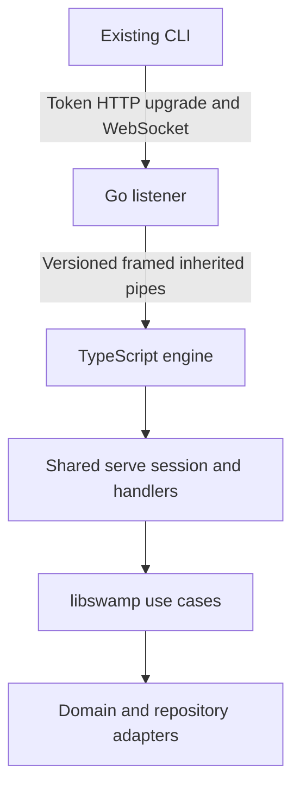

# Experimental Go serve engine

`swamp-serve` is a separate Go listener for sporadic CLI use against one local
repository. It starts a compatible installed `swamp` executable as a private
TypeScript engine. Authentication, grants, CEL, vault access, execution, audit,
and repository persistence remain in TypeScript. The existing `swamp serve`
remains the general server and rollback path.

This is the implementation of the experimental `local-v1` profile from Agenda
item 78. It is not a supported replacement for every serve deployment. Linux
compiled CLI acceptance and resource measurements are recorded below. Native
macOS/Windows acceptance and representative workload validation remain release
gates. A successful cross-build does not establish those results.

## Validated scope

Tracing the existing CLI established this request contract:

| CLI journey                        | Requests                                                            |
| ---------------------------------- | ------------------------------------------------------------------- |
| Version discovery                  | `server.version`                                                    |
| Read a definition                  | `workflow.get`, `model.get`                                         |
| Query data                         | `data.query`                                                        |
| Run an existing workflow           | `workflow.run`                                                      |
| Run an existing behavior method    | `model.method.run`; `server.version` first under `--literal-inputs` |
| Reconnect during a run             | `run.attach` with the durable run ID and last sequence number       |
| Inspect recent runs                | `run.history`                                                       |
| Inspect persisted workflow history | `workflow.history.get`, `workflow.history.logs`                     |
| Inspect persisted behavior history | `model.method.history.get`, `model.method.history.logs`             |
| Detach the request being observed  | `cancel` with the original public request ID (detach subscription)  |

The executable allowlist and transport limits live in
`packages/serve-go/protocol.json`. Excluded requests return
`unsupported_operation`. `server.version` preserves the TypeScript engine
version and applicable capabilities. The `literal-inputs` capability remains
necessary: older CLI servers silently interpret expressions without it.

`--detach` belongs to the workflow CLI. It returns only after the root workflow
`started` event; accepting a private RPC does not establish a persisted start.
Public request IDs are scoped to their authenticated session. They are distinct
from private RPC IDs and durable run IDs.

The first adapter deliberately supports only format 2 filesystem datastores
without shared namespaces or managed configuration. Current format 3 datastores
have a separate writer and replication lifecycle; treating them as ordinary
local directories would weaken persistence guarantees. Custom/remote datastores
and environment datastore overrides are refused before construction.

Filesystem paths and routing expressions use the same normalization as the CLI,
including environment and home-directory expansion. Relative mounted sources
resolve from the main checkout in a linked worktree. Conflicting
`SWAMP_MODELS_DIR`/`SWAMP_BEHAVIORS_DIR` values and a nonempty
`SWAMP_EXTENSIONS_DIR` override are refused explicitly.

A manually selected workflow may contain local method and assertion steps,
including ordinary DAG dependencies, guards, and finite fan-out. The exact
canonical workflow selected for execution is validated. Worker placement at any
workflow, job, or step level, nested workflow steps, approval gates, signal
waits, and automatic continuation are refused. A dormant cron declaration can
remain in a stored workflow; this profile never schedules it. Unrelated dormant
workflows are not rejected at startup.

Direct type execution that creates a behavior definition is excluded from the
public method-run operation. Existing definitions, installed TypeScript behavior
and vault extensions, reports/checks, and sensitive-input handling use the
shared engine paths. Install and repair extensions locally before starting the
server.

## Ownership and session boundary



The Go process owns TLS, host/origin checks, connection and byte limits, bounded
mailboxes, child supervision, and health responses. It forwards sanitized domain
replies and never reads swamp YAML, SQLite, grants, or run data.
HTTP reads, including unread request bodies, and response writes have
ten-second deadlines. WebSocket upgrades clear both deadlines before serving
long-lived sessions.

The shared session port carries reply delivery and connection authority. Both
the existing Deno WebSocket adapter and the stdio engine use it. The engine does
not manufacture a WebSocket or accept a client-supplied principal.
Before repository or extension initialization, the engine runs the same operator
account gate as the CLI and the existing token-serve `serve:*` scope checks.
It uses the operator's normal login or `SWAMP_API_KEY`/`SWAMP_API_KEY_FILE`, with
the same signed-proof and scope-cache policy. Each new engine generation is
checked again; best-effort account refresh shares the shutdown disposal budget.
Authentication uses the existing token record, secret, expiry, revocation, and
binding checks before Go upgrades the HTTP connection. Raw credentials travel
only in the private pipe, never process arguments or diagnostics.

Authentication has at most 64 pending attempts and runs independently of the
control loop for established sessions. Each attempt has a deadline. Closing or
timing out an attempt prevents its publication; Go closes any session returned
after its caller abandons authentication. Token records are checked before
initializing vault providers.

A vault provider may ignore cancellation. Its unfinished call remains in a
bounded quarantine, and an authentication timeout retires that engine
generation: readiness becomes false, new authentication and execution stop,
and existing sessions can still read, observe, and cancel accepted runs.
Once accepted work completes, Go quiesces and reaps the engine even if sockets
remain open or idle shutdown is disabled. A later connection starts a fresh
generation. Retirement does not cancel an accepted run, so it has no fixed
completion deadline if that run never finishes; explicit server shutdown still
has its configured deadline.

A live authenticated socket keeps the engine resident. Closing the socket ends
its subscription and connection-scoped reads. An accepted execution remains in
the TypeScript run registry and completes independently. Reconnection uses the
existing authorization, sequence allocation, and bounded event replay.

## Private protocol and limits

Frames contain a four-byte unsigned big-endian byte length followed by UTF-8
JSON. The serve-engine protocol has its own version; worker RPC versions are
unaffected. Handshake negotiation checks the profile, supported operations and
required session-ID and authentication-deadline capabilities, without requiring
an exact matching git SHA.

Requests and replies use separate dedicated inherited pipes: extra file
descriptors on Unix or Win32 handles on Windows. The supervisor selects them in
private child arguments, and the engine makes both non-inheritable before loading
extensions. Ordinary stdin, stdout and stderr connect to the null device before
Deno starts, so commands cannot consume private authentication/request frames
and direct output cannot corrupt replies. This must happen before runtime
startup because Deno caches the streams inherited by child processes.

Control messages are `hello`, `session.open`, `session.close`,
`request.dispatch`, `engine.status`, `engine.quiesce`, and `engine.shutdown`.
Every frame identifies the engine generation. A session from an exited process
cannot authenticate to its replacement.

The manifest bounds frames and queued bytes, per-session messages, active
sessions, pending controls, and cold-start waiters. Lengths are validated before
allocation. Malformed JSON, truncation, incompatible versions, and oversized
frames fail the transport. Slow subscribers are detached from bounded queues;
they cannot stop other clients or cancel the underlying run. `cancel` with a
durable active run ID performs authorized execution cancellation. The original
public request ID cancels only the observation subscription, preserving legacy
detach semantics. `workflow cancel --server` sends `workflow.cancel`, which is
outside this profile. Neither gateway nor engine logs request bodies or tokens.

Replay uses pull delivery paced by pipe flushes. Each session has its own byte
budget, separate from control replies and session-close notifications; overflow
drops only that session's unsent frames. These buffers allocate on demand. At
the session limit their worst-case aggregate payload allowance is about 992 MiB
in the engine and 1 GiB in Go. The Go mailbox is bounded by both 8 MiB and 10,000
frames per session, matching the retained run-buffer event cap. Idle memory
measurements below do not represent this deliberately saturated case.

## Startup, idle and failure behavior

Startup validates the selected engine and repository before readiness is
advertised. A burst of authenticated arrivals shares one bounded startup
attempt. Liveness probes never start an engine. Readiness distinguishes a
validated sleeping engine from starting, failed, incompatible, retiring, or
draining states.

A status-probe timeout means the engine has not proved itself idle; it does not
terminate busy work. Public control timeouts abandon the caller's wait while
bounded correlation remains until the reply arrives. Quiescence gets the
configured drain budget independently of the shorter control-probe timeout.
Go gives the engine a shorter deadline to leave room for its final response and
process exit before forced termination.

The default idle grace is 60 seconds; zero disables idle shutdown. The engine is
eligible only when sessions, requests, runs, reservations, and pending work are
empty. Go pauses admission before requesting quiescence. TypeScript freezes
admission, disposes services and flushes persistence/audit and output before
acknowledging. Go drains the private output pipe and reaps the child. A later client starts a new
generation and authenticates again.

An engine exit fails outstanding reads. Once a mutating operation has been
handed to the engine, its outcome can be indeterminate; it is never
automatically resubmitted. Reconciliation interrupts only runs whose local owner
is proven dead. A new engine does not itself prove another process dead.

Completed histories survive an idle exit. The in-memory replay buffer does not:
`run.attach` after an engine restart may return not found. Query history
instead. Supervisor shutdown stops admission and drains accepted work to a
deadline, then cooperatively cancels and flushes. Parent-pipe EOF also stops
admission and gives TypeScript a bounded period for domain settlement and
persistence. Runs are not promised to survive either process crashing.

On Unix, each managed command has a guardian outside the engine process group.
A private lifetime pipe ends command ownership when the engine exits;
cancellation requests TERM then bounded KILL. Before starting its command, each
guardian registers through a private Unix socket with the Go supervisor.
Registration is bounded to 256 commands per generation. Engine exit seals
registration and waits for every admitted guardian to confirm command-group
cleanup before allowing replacement. Missing confirmation leaves the generation
unavailable for automatic restart. Confirm that prior commands have stopped
before restarting the supervisor after this error.

The guardian kills its command group before reaping the leader and confirms the
group has exited. Background work remaining in that group ends with its command;
use ordinary serve when such work should outlive the command. This covers the
managed executor, including built-in shell methods. Trusted extensions that
spawn native processes directly or deliberately escape the command group remain
outside this guarantee. This is process-group ownership, not an OS sandbox.
Loss of the supervisor's private socket kills managed commands immediately,
including supervisor SIGKILL. The engine's parent-EOF budget still allows domain
settlement and persistence, but native commands do not continue after supervisor
loss. Public client disconnects leave accepted executions running. On Windows,
the supervisor terminates the Job Object and keeps its handle until accounting
confirms zero active processes. Failed or timed-out confirmation prevents
automatic replacement. A shutdown deadline also bounds waiting for the engine
itself; an engine that has not exited retains its reaper and leaves cleanup
unconfirmed. Startup cleanup that exceeds its deadline likewise requires operator
confirmation before restarting the supervisor, even if reaping finishes later.

A managed command that cannot be spawned returns exit code 125 with a fixed
supervision diagnostic in this experimental profile; ordinary execution can
instead throw an OS spawn error. Actual command exit statuses, including a
command that itself returns 125, remain unchanged and do not acquire that
diagnostic.

When the supervisor disappears and its pipe closes, the engine uses a
30-second total drain budget, reserving five seconds for cooperative cancellation
and five seconds for persistence disposal. This is independent of the Go shutdown
flag because the parent can no longer send its configured deadline.

## Operator configuration

Build the Go module using the Go version in `.tool-versions`. The engine uses
the existing Deno pin. Both executables must be installed; the Go server does
not download or embed its engine.

```sh
cd packages/serve-go
go build -o swamp-serve ./cmd/swamp-serve
./swamp-serve --repo /absolute/repository --engine /absolute/swamp \
  --bind 127.0.0.1:9876 --idle-timeout 60s --json
```

Use `--tls-cert` and `--tls-key` together for operator-supplied TLS, and
`--trusted-hosts` for explicit hostnames. A bind host other than `127.0.0.1`,
`localhost`, or `::1` requires TLS, matching the existing server's guard.
Relative Go paths resolve once against the launch directory. Repo and executable
selection never come from a network
request. `--help` lists startup, control, idle, and drain timeouts.
The familiar names `--repo-dir`, `--cert-file`, `--key-file`, and
`--shutdown-drain-timeout` are accepted as aliases. Relative paths, including
the certificate aliases, resolve against the launch directory. The shutdown
alias accepts bare seconds as well as Go durations; local-v1 requires a positive
drain budget so persistence can flush. Budgets above five minutes are honored;
values above 2,147,483,647 ms (about 24.8 days) are rejected because the engine
cannot safely schedule them. The startup record includes the connection
URL, host and port in both output modes.
Authentication rate limits use the direct TCP peer address, so clients behind
one reverse proxy share that peer's quota.

The TypeScript engine reads the existing serve configuration for token access
policy, grants, run limits, and local audit. It supplies profile defaults of
token authentication, automatic grant reload, detached runs, and disabled
schedules. Explicit unsupported YAML or environment settings fail validation.
Listener/TLS/timing settings belong to the Go flags and are refused in serve
YAML rather than silently ignored.

Installed model, vault and report types use the shared extension catalog and
precedence index. Local definitions override mounted and pulled definitions;
source mounts keep their configured order. Winning types and built-in add-ons
load eagerly, including wrapped or computed exports and configured source
directories.

Local audit retains its WAL, hash chain, policy, batching, fail-open setting,
and local stores. Custom stores, external sinks, alerts, and HMAC are excluded
and explicitly refused. OAuth, browser sessions, dashboard access, triggers,
worker services, HA coordination, token GC, and remote administration are
excluded.

To roll back, drain and stop `swamp-serve`, then start the existing
`swamp serve` against the same repository. Do not use simultaneous listeners as
a rollback. This adapter introduces no data migration.

## Verification and release evidence

`verify-build` calls `scripts/serve_go.ts check` for the pinned Go version,
formatting, dependency checksums, vet, tests with the race detector where
available, and artifact compilation. Go and engine source paths participate in
code/security review. Architecture rules enforce the engine/CLI boundary,
libswamp's public surface, Go license headers, toolchain pins, and the absence
of Go persistence adapters.

An explicit `workflow_dispatch` with `experimental_go: true` builds Linux and
macOS amd64/arm64 and Windows amd64 CI artifacts, plus `swamp-serve-pair.json`
identifying the engine revision and protocol and matching engine binaries.
Native Go tests on Linux, macOS, and Windows gate that job. These opt-in
artifacts expire after seven days; automatic releases and the promoted channel
do not contain the experimental server. Compiled end-to-end CLI acceptance
belongs in `swamp-uat`; it is separate from these unit and integration checks.

The Linux compiled-pair suite in `swamp-uat` covers:
token/TLS reads and runs in both CLI output modes; session ID isolation and
excluded operations; disconnect/attach and persisted history after idle exit;
both cancellation ID meanings; installed behavior/vault/report execution,
redaction and audit recovery; revoked and expired tokens; concurrent cold
arrivals; crash handling without mutation replay; parent-pipe EOF; startup
profile refusal; slow-reader isolation; direct and inherited stdout isolation;
reconnect replay of 256 method events; structured startup diagnostics;
non-loopback TLS enforcement; legacy flag aliases; and incompatible-engine
guidance. Additional cases refuse missing or insufficient operator account
authority and check extension-override parity with ordinary serve. Startup and
workflow refusal matrices verify that excluded configurations and step types
leave no execution side effects. A stalled operator endpoint exercises the
startup deadline; POSIX cases kill the engine before admission and verify
graceful and forced shutdown of accepted work, including process cleanup and
persisted interruption without replay.

The optional native acceptance workflow checks the source revision and artifact
checksums before running this suite on Linux, macOS and Windows. Its
macOS/Windows results are still pending. The POSIX signal cases are skipped on
Windows, where console-control and native process cleanup require separate
acceptance coverage.

Benchmark the same engine revision, host, repository, auth, and extension set
under existing serve, Go with a warm engine, and Go after idle exit. Count the
whole process tree. Record cold and warm latency distributions, RSS and Linux
PSS, idle CPU, startup count, queue behavior, streaming, peak run memory, and
the combined installed/download size. Separate warmed module caches from cold
ones.

### Linux measurement, 2026-10-26

The [raw benchmark report](../benchmarks/go-serve-local-v1-linux.json) records
the exact binary hashes, source snapshot hashes, all samples, RSS/PSS, idle CPU,
observed workflow memory peaks and artifact sizes. The same compiled engine
runs both existing serve and the Go profile. Each fixture/mode has twenty
authenticated CLI reads and five measured single-step shell workflows after
warmup; client startup is included in latency. Caches are warm.

This tracked measurement uses the Go binary from the snapshot recorded in
`a481748b0`, before HTTP response-write deadlines were added. Each later binary
pair needs its own hash-bound measurement using the reproduction command below.

| Fixture and mode | Idle server-tree RSS (MiB) | Read median / p95 (ms) | Workflow median / p95 (ms) |
| --- | ---: | ---: | ---: |
| Builtins, existing serve | 271.7 | 431 / 520 | 460 / 519 |
| Builtins, warm Go engine | 221.9 | 423 / 515 | 465 / 534 |
| Builtins, sleeping Go then wake | 20.0 | 755 / 905 | 800 / 957 |
| Benign extension, existing serve | 266.1 | 473 / 504 | 461 / 497 |
| Benign extension, warm Go engine | 227.8 | 430 / 529 | 463 / 564 |
| Benign extension, sleeping Go then wake | 19.8 | 799 / 901 | 808 / 954 |

Both sleeping deployments had zero engine processes and used about 93% less
idle RSS. The small-fixture wake-up read p95 met the two-second target, and warm
read median and p95 overhead stayed within the larger of 10% or 20 ms. Observed
workflow peak RSS was 283–286 MiB for existing serve and 220–247 MiB for Go
plus its engine.

The required pair occupies 406,223,167 bytes installed (387.4 MiB), or
129,445,097 bytes when the two development binaries are independently compressed
with `gzip -6 -n` (123.4 MiB). The Go binary, built with `-trimpath` and
`-ldflags='-s -w'`, adds 7,753,991 installed bytes and 3,227,423 compressed bytes;
the engine is still required.

These are small fixtures on a shared Linux host in a fixed measurement order.
The benign extension is loaded, but the measured workflow uses a builtin shell
method. Five workflow samples make p95 equal the maximum; memory sampling can
miss short-lived processes. These results support the sporadic CLI-use
experiment, not production throughput, a representative extension workload or
cross-platform performance claims.

Reproduce from the sibling `swamp-uat` checkout with its benchmark script:

```sh
SWAMP_BINARY_PATH=/absolute/swamp \
SWAMP_SERVE_BINARY_PATH=/absolute/swamp-serve \
GO_SERVE_SOURCE_DIR=/absolute/swamp-source \
GO_SERVE_BENCH_SAMPLES=20 GO_SERVE_BENCH_WORKFLOW_SAMPLES=5 \
deno run -A scripts/benchmark_go_serve.ts /tmp/go-serve-benchmark.json
```

Deno requires full permissions to read Linux `/proc` counters. The sampler
reads process statistics; its permission preflight runs before creating fixtures.
