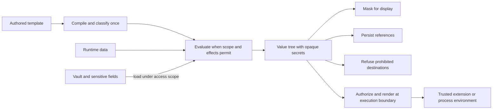

# Typed Secrets for Expressions

**Status:** implementation plan; engine 2 remains gated on the executable
adapter, boundary, and recovery tests below.\
**Reviewed:** 2026-10-15 against swamp
`dd09473593ea55df83500d798ba096b34c94d6c1`, its pinned
`@marcbachmann/cel-js@7.6.1`, and the repository's current Zod 4 APIs.
Dependency behavior described here is supported by source inspection and
isolated review probes. Phase 1 must commit reproducible tests; this document is
not a passing implementation attestation. Dependency upgrades require the same
conformance gate.

## Outcome

Swamp's internal expression engine will carry secrets as opaque values from
source to destination. Authored templates will compile into an execution plan;
evaluating them will produce values, never another automatically evaluated
template. A destination-specific renderer will decide whether to deliver,
persist, mask, or refuse each secret.

This enables behaviors, workflows, vaults, and serve. Extensions continue to
receive plaintext through `MethodContext`, with an additive validated-arguments
field for checks. The existing vault-backed sensitive-output storage contract is
preserved (`${{ vault.get('v', 'k') }}` reference text plus the
`_swamp.sensitiveFields` tag). It introduces a versioned expression engine, an
evaluated-artifact format, and a remote execution protocol revision. Those are
separate compatibility boundaries.

The implementation ships incrementally: released reader guards, an executable
CEL feasibility gate on the pinned dependency, dormant components, local
execution, complete workflow and worker support, new-repository opt-in, explicit
migration, and finally new-repository defaults. Existing repositories retain
their selected engine until an explicit migration succeeds.



## 1. Scope and success criteria

### 1.1 Security contract

The contract applies to values known to be secrets: `vault.get` results, fields
named by a record's `_swamp.sensitiveFields` tag, and arguments classified as
sensitive by schema metadata before framework persistence or display.

1. Secret plaintext does not enter CEL source text, ordinary CEL bindings,
   compiled templates, or intermediate template strings. It exists only in the
   private storage of an opaque value, in authorized declassifier
   implementations while they compute an allowed result, and at authorized
   delivery boundaries.
2. Swamp's evaluated caches, workflow run records, run indexes, method output
   records, reports, events, diagnostics, lease records, and dispatch records
   contain references, explicit unavailable markers, or masked representations,
   never secret plaintext.
3. Identifiers, routing fields, and schema fields that refuse secrets reject
   secret-bearing values recursively before any plaintext is delivered or
   written anywhere. Loading a secret into private memory under the run's access
   scope is not a delivery.
4. Swamp never places a typed secret in the command string or argv of its direct
   `command/shell` invocation (`sh -c` on POSIX, `powershell.exe
   -Command` on
   Windows). The supported delivery path is the child environment.
5. Ordinary data cannot become a template or acquire secret-resolution authority
   because it resembles expression syntax, a vault reference, or a serialized
   engine node.
6. Unsupported operations fail with a value-free error. Identity comparisons,
   promise truthiness, empty-container iteration, and silent fallback results
   are not acceptable implementations of operations on a secret. Secret/string
   comparisons use the explicit declassifier; other direct mixed-type secret
   comparisons are refused consistently.
7. Every load of a secret observes the run's principal policy, the workflow
   `vaults:` restriction, and cancellation. A reference, a cache hit, or a
   worker request is not an authorization grant.

Plaintext necessarily exists in vault providers, private opaque-value storage,
trusted schema/coercion callbacks, extension arguments and pre-flight check
inputs, authorized process environments, and protected delivery to an authorized
worker. Vault storage itself is outside the prohibition on plaintext in
evaluated artifacts.

The plaintext extension API, including user-supplied Zod callbacks, is a trust
boundary. Parsed values stay in the private execution snapshot; arbitrary
JavaScript transforms are not tracked by CEL's secret type. Extensions and
user-authored scripts can transform values, send them to other services, write
files, or put them in descendant process arguments. Typed expressions do not
sandbox these consumers. Documentation must distinguish the direct shell
invocation from its descendants.

Keep output/log redaction after the plaintext boundary as defense in depth.
`SecretRedactor` ignores values shorter than three characters and cannot
establish complete secrecy for arbitrary extension output, transformations, or
short secrets. Structured framework output must be masked by type or schema,
independently of substring matching.

### 1.2 Functional acceptance criteria

- All supported structured sensitive-data accessors return the same opaque
  representation: `data.latest`, `data.version`, `findBySpec`, `findByTag`,
  `query` records and projections, wildcard and cross-namespace reads, live and
  reconstructed `steps.<name>.outputs`, `model.<name>.resource`, and
  parent-visible child outputs. They share the authorization and explicit
  loaded/unloaded rules in Section 1.3.
- Plaintext method arguments delivered locally and remotely match, including
  merged global and method arguments. Pre-flight checks run on the local
  orchestrator before local method execution and read the same validated values
  the method will receive. They remain skipped for remote placement.
- Skipping a guarded task does not load its argument secrets or invoke their
  refresh hooks. A guard that itself examines a secret may load it.
- Guards keep their truthiness semantics: a truthy guard means the step is
  already done and is skipped. A secret, or a container holding one, is refused
  as a guard result; a declassifier's `bool` is accepted. Direct record guards
  work for secret-free records. For a possibly sensitive record, use an explicit
  existence test such as `data.latest(...) != null`; this tests record presence
  without comparing its fields. Doctor explains this distinction.
- Failed, pending, unavailable, unloaded, and secret values remain distinct.
  None silently becomes an ordinary string or an empty container at an execution
  boundary.
- Each authored expression is compiled once per compiler cache entry. The
  bounded compilation pipeline parses authored source for analysis/lowering and
  generated source for execution; neither parsing pass repeats per iteration.
  Pure primitive delegate programs compile once per environment. Evaluation
  stages reuse compilation without sharing mutable execution state.
- Migration is explicit, previewable, idempotent, recoverable after
  interruption, and refuses activation when required manual changes remain.
- Every supported entry point selects one engine and policy for the entire run,
  including child workflows, resume, serve, dispatched execution, and the
  `swamp behavior evaluate` / `swamp workflow evaluate` cache writers.

### 1.3 First-release boundaries

The first release supports secret strings and their concatenation. Existing
sensitive outputs that store a non-string value by JSON-encoding it in the vault
retain their current string-on-read behavior. This project does not infer a new
plaintext type from vault contents. Inline classification accepts sensitive
strings, including empty strings. A schema-sensitive non-string literal is
refused before display or persistence with `sensitive_input_type_unsupported`;
it is never stringified merely to fit `Secret`. Container schemas may mark
individual string credential fields. Whole-container or non-string inline
sensitivity needs a separate delivery-only value design before support is
claimed. Vault-backed strings retain the existing destination coercion rules.

Declassifiers are scalar string equality (`==` and `!=`) and `size`. They
operate on **loaded** secrets. `vault.get` and asynchronous point reads
(`data.latest`, `data.version`) load sensitive fields when their selected call
executes. Set reads (`findBySpec`, `findByTag`, `query`) and ordinary property
views (`steps.*.outputs`, `model.*.resource`, including resumed/child views)
produce **unloaded** references. Their values can be concatenated, passed
through, and delivered by a renderer. A declassifier on an unloaded reference
fails with a diagnostic naming an explicit point read. Live and reconstructed
views have the same rule; incidental cache contents cannot change it.

The property views remain synchronous. cel-js does not generally await a Promise
returned by a property getter, so asynchronous loading cannot be added by
changing a getter alone. `context.readResource` is a separate trusted plaintext
delivery API, not a CEL load mechanism.

Secret-bearing membership and structural list/map/Optional equality are
deferred. They fail explicitly even when object identity, an empty collection,
or a length check could otherwise return a result. Authors can compare selected
scalar leaves, or use a normal-list macro with an explicit scalar comparison,
such as `values.exists(x, x == 'expected')`, when those leaves are loaded.
Presence comparisons of ordinary containers against `null` remain ordinary CEL
tests; they do not inspect secret leaves.

Defer general secret transforms, splitting a secret into a list, secret-bearing
JSON stringification, secret regex matching, and a persisted derived-operation
language. Defer cross-engine resume and automatic engine downgrades. Do not add
a platform-neutral shell language or a production shadow evaluator to the
critical path.

`env.*` retains its runtime-only behavior. It is not automatically a secret
source. Environment-derived values are **non-cacheable**: they are never written
to the evaluated definition or workflow caches or to deferred bindings, and are
re-read on every run. They are not non-persistable: today `env` reaches run
records through forEach step identities, guards, assert predicates, and webhook
`trigger.inputs`, and engine 2 keeps those positions. A destination's sensitive
schema can additionally classify an `env` value as an inline secret. Undeclared
literal credentials and arbitrary unmarked data are outside automatic secret
recognition.

The extension CEL factory (`createExtensionCelEnvironment`,
`packages/testing/_cel_environment.ts`), the grant-condition environment, the
`DataQueryService` predicate environment, and the datastore config's regex
`env`/`vault.get` resolver keep their own contracts. Opaque-secret registrations
are added only to the internal evaluator and to the typed query view; the other
environments must pass their regression suites unchanged.

## 2. Implementation decisions

| Area                 | Decision                                                                                                                                                                                                                                                                   |
| -------------------- | -------------------------------------------------------------------------------------------------------------------------------------------------------------------------------------------------------------------------------------------------------------------------- |
| Repository marker    | `expressions.engine: 2` plus required `expressions.secrets: strict` or `compat`, validated with a Zod schema; an absent mapping selects engine 1. `repo init --force` carries the block over or refuses.                                                                   |
| Default policy       | Strict for new engine-2 repositories. Existing repositories migrate explicitly to a selected policy.                                                                                                                                                                       |
| Compatibility policy | A bounded syntax/placement aid with the same security floor as strict. No plaintext routing or unsafe shell fallback.                                                                                                                                                      |
| CEL implementation   | Pinned cel-js plus AST-guided lowering to private policy helpers. Synchronous scalar declassifiers use loaded secrets. No runtime monkeypatch or dependency upgrade is required; the adapter gate proves complete coverage.                                                |
| Secret source        | Vault reference with origin metadata, or an execution-local inline value. A reference never carries authority. A loaded reference holds plaintext privately for one evaluation attempt.                                                                                    |
| Reveal timing        | Selected `vault.get` and asynchronous point-read calls, or authorized delivery. Set reads and synchronous property views remain unloaded.                                                                                                                                  |
| Reveal operations    | Scalar string equality/inequality and size on loaded secrets. Secret-bearing membership, structural equality, and regex matching are deferred.                                                                                                                             |
| Other operations     | Refuse implicit conversions, string transforms, comprehension over a secret, secret map keys, and interpolation of a secret-bearing container into text.                                                                                                                   |
| Secret composition   | Concatenation and scalar template interpolation preserve opacity; a composed secret is one CEL type (`Secret`) whose pieces are tracked internally.                                                                                                                        |
| Query boundary       | Wrap sensitive attributes before expression-facing projection/filtering. Query predicates and selectors cannot declassify in the first release.                                                                                                                            |
| Persistence          | A versioned, fully tagged value codec (`evaluatedFormat: 2`) decoded only at trusted engine boundaries. Ordinary maps are encoded as data nodes.                                                                                                                           |
| Replay               | Re-load vault references under the current access scope; inline secrets require explicit rebinding. No promise of historical secret snapshots.                                                                                                                             |
| Remote execution     | A new `REMOTE_PROTOCOL_VERSION` with matching serve/worker implementations; no engine-2 fallback to legacy plaintext dispatch.                                                                                                                                             |
| Migration            | `swamp doctor expressions` reports; init/upgrade accept `--expressions 2` and a strict or compat `--secrets` policy. Upgrade previews with `--dry-run`; apply requires confirmation (JSON requires `-y`). Journaled, scoped, quiescent activation commits the marker last. |
| Default transition   | New repositories only. Plain `repo upgrade` never silently changes expression semantics.                                                                                                                                                                                   |
| Retirement           | Separately gated removal of engine 1 after a published support window. Retain bounded compat until separately deprecated.                                                                                                                                                  |

## 3. Architecture and domain model

### 3.1 Building blocks

| Building block                                   | Responsibility and location                                                                                                                                                                      | Required verification                                                    |
| ------------------------------------------------ | ------------------------------------------------------------------------------------------------------------------------------------------------------------------------------------------------ | ------------------------------------------------------------------------ |
| `Template`, `ExpressionId`, `ExpressionMetadata` | Immutable value objects in `src/domain/expressions/template/`; authored origin, scope requirements, effect classification, source ranges.                                                        | Deterministic compilation and identity/property tests.                   |
| `Secret`, `SecretSource`                         | Opaque value object in `src/domain/secrets/`; single-source or composed; loaded or unloaded; enforce valid construction and composition.                                                         | Coercion, recursive containment, composition, and opacity properties.    |
| Secret-refusal schema metadata                   | New `.meta({ secrets: "refuse" })` on Zod fields, read the way `sensitive` is, extending the metadata walker with branded-value handling, root policy, and conservative union/wrapper traversal. | Metadata walk tests beside `sensitive`.                                  |
| `ValueTree` and codec DTOs                       | Explicit value algebra; separate executable state from ordinary records and lists.                                                                                                               | Round trips, adversarial decoding, bounds, unavailable-state tests.      |
| Evaluation frame                                 | Per-evaluation record of policy errors, loads, and invocations, kept outside CEL's error flow so an absorbed error still fails the evaluation.                                                   | Absorption and short-circuit tests.                                      |
| Compiler/evaluator ports                         | Domain-facing contracts; dependency and stage policy remain domain logic.                                                                                                                        | Compiler corpus and staged evaluation integration tests.                 |
| CEL adapter                                      | Parser, compiled programs, registrations, and runtime hooks in `src/infrastructure/cel/`. Domain types do not depend on cel-js AST classes.                                                      | Executable CEL conformance matrix (Section 4).                           |
| `SecretResolver` port                            | Load and deliver within one evaluation/execution attempt. The vault adapter uses `VaultService`, which already checks the ambient `RunVaultAccess` on every `get`.                               | Scoped access, refresh, cancellation, and concurrency integration tests. |
| Destination policies/renderers                   | Pure traversal and policy in the domain, using the resolver port only where plaintext is permitted.                                                                                              | One internal contract suite per destination family.                      |
| Engine application service                       | `src/libswamp/` orchestration of compile, evaluate, persistence, and execution. Adapts existing services incrementally.                                                                          | Real component integration tests.                                        |
| Artifact and dispatch adapters                   | Infrastructure persistence and transport of validated DTOs. No independent secret policy.                                                                                                        | Version guards, crash recovery, and protocol tests.                      |

Use existing repositories for definitions, workflow runs, and evaluated
artifacts; these value objects do not need their own repositories. Wire ports in
the composition layer. Respect `cli → libswamp → domain ← infrastructure`. Add
new libswamp public exports to `src/libswamp/mod.ts`, import their defining
files, and extend architecture fitness tests when introducing a boundary or
export.

### 3.2 Opaque values

cel-js decides a value's CEL type by exact constructor identity
(`objectTypesByConstructor`), so `Secret` is one concrete class registered with
`registerType("Secret", { ctor, fields: {} })`. A subclass instance is
`unsupported_type`; a plain object of the same shape is a `map`. The registered
name must be at least two characters.

`fields: {}` makes `s.x` fail with `no_such_key` and `has(s.x)` return `false`,
but it does **not** stop comprehension macros: `toIterable` falls back to
`Object.keys(value)` for any object, so a `Secret` with an own enumerable
property iterates its property names, and `s.map(x, s[x])` reveals them.
Therefore:

- All state lives in `#private` fields or a module-private `WeakMap`; the object
  has no own enumerable properties. With that, comprehension over a secret
  yields an empty range, which the contract also forbids, so the adapter must
  make it fail (Section 4.3).
- `toString`, `toJSON`, `valueOf`, and `Symbol.toPrimitive` throw a value-free
  `UnrenderedSecretError`. `structuredClone` of such an object silently produces
  `{}`, so every clone path must brand-check first.
- Inspection returns `<secret>` without loading. Display renderers produce
  `***`; diagnostic paths may identify the authored location, and authorized
  audit records may identify the source without including a value.

Construction uses module-owned factories and identity checks, not recognition of
a user-supplied object shape. Secrets and sources are immutable value objects;
loading produces a new scoped value. The evaluation frame owns mutable attempt
and cancellation state. Reference identity never substitutes for comparison of
secret contents.

All recursive utilities must recognize branded values before generic object
handling. The current inventory of paths that rebuild objects from
`Object.entries`, clone, or stringify is: `coerceBigInts` and `unwrapOptional`
(`src/infrastructure/cel/cel_evaluator.ts`); `sentinelizeValues`,
`rehomeDataSentinels`, `resolveDeep` (`vault_secret_bag.ts`);
`withPlaceholdersDeep`, `maskDeep` (`run_sensitive_values.ts`);
`replaceExpressionsRecursive`, `replaceTracked`, `stripExpressionFields`,
`extractExpressionsRecursive`, and the splice renderer's
`String()`/`JSON.stringify` (`expression_parser.ts`); `toPersistedForm` and the
`structuredClone` in `rehydratePersistedForm` (`persisted_sensitive_form.ts`);
`redactSensitiveValues` and the data-writer snapshot (`structuredClone`); the
`JSON.parse(JSON.stringify(...))` in `captureDeferredBindings`;
`coerceMethodArgs`; `jsonSafeClone` (`src/serve/serializer.ts`); and
`canonicalJson`. Each either handles the branded value explicitly or is replaced
by a codec-aware walk.

`containsSecret` is a structural operation over supported value kinds. It does
not stringify values, invoke getters, or search text. Bound traversal depth and
size, refuse cycles and unsupported host objects, and construct records without
prototype setters. The internal CEL environment enables Optional values, whose
payload is private and invisible to `Object.entries`. Walk known Optional values
explicitly: `optional.of(secret)` is secret-bearing, `.value()` and `.orValue()`
preserve the leaf, and `.hasValue()` may disclose presence only. Refuse secret
structural equality through Optional too. Never call its generic inspect or JSON
hooks on a secret-bearing payload. Normalize/encode Optional using the value
algebra at controlled boundaries; reject unknown host wrappers.

### 3.3 Sources, loading, and resolver lifetime

| Source                    | Origin                                                                          | Loaded when                                                               | Persisted representation                                          |
| ------------------------- | ------------------------------------------------------------------------------- | ------------------------------------------------------------------------- | ----------------------------------------------------------------- |
| Vault reference           | Authored `vault.get(vault, key)`.                                               | The call executes in a selected branch of an evaluation.                  | Validated vault/key reference.                                    |
| Sensitive-field reference | A record's `_swamp.sensitiveFields` path, with data identity and its reference. | An async point read returns the record; set/property views stay unloaded. | Reference plus origin needed for diagnostics and access checks.   |
| Inline                    | A schema-sensitive runtime argument without a durable source.                   | Bound before evaluation.                                                  | Unavailable marker and required rebind path; never its plaintext. |

`vault.get` becomes a real CEL receiver function (Section 4.3). Its arguments
must evaluate to non-secret strings; the lowered argument-policy check records
and refuses a secret argument before native overload resolution. Dynamic
arguments are checked at runtime against both principal grants and the workflow
`vaults:` restriction when used; static reference extraction is an early
diagnostic, never an access grant.

The resolver has separate authorize, load, and render operations. A provider
read uses `VaultService.get` inside the run's ambient `RunVaultAccess` scope.
Bind each loaded value to its evaluation, principal/access scope, and attempt.
Synchronous declassifiers verify that ownership and liveness against the current
frame; they cannot call an asynchronous principal policy. Perform asynchronous
authorization at load (including post-await), scope transfer, and delivery,
without pretending a second `get` is a cache hit. A value crossing to another
frame is reauthorized before binding or reduced to its unloaded reference. A
child with narrower access must authorize again and must not inherit a parent's
grant. Record declassifier audits in observed frame tasks and await them before
publishing evaluation success. Enter ambient scope around the actual
async-generator `next()` execution as required by `run_vault_access.ts`.

Start without a cross-expression fulfilled-value cache. Concurrent reads may
share an in-flight operation only within the same scope and attempt. The
execution boundary prepares one private argument snapshot for checks and method
delivery; it never re-resolves between those consumers. Retry/refresh creates a
new attempt and snapshot. Clear references at completion; JavaScript strings
cannot be promised secure erasure.

Introduce cancellation options through the resolver and `VaultService`, and
propagate signals/timeouts to first-party provider network calls and refresh
process execution. The existing `VaultProvider.get(key)` contract has no signal:
use a compatible optional options parameter, document capability limits, and
extend provider conformance tests for implementations that advertise
cancellation. For providers that cannot cancel, stop accepting their result,
observe the outstanding promise to settlement, and discard late values; do not
claim their I/O or refresh effects were undone. Cancellation must not become a
successful stale-value fallback. Recheck attempt liveness and authority after an
awaited load and before delivery.

Keep the documented refresh fallback to a stale value for ordinary refresh
failures where configured, with value-free diagnostics at the refresh boundary.
Never log refresh stdout, stderr, or arbitrary causes. Register loaded strings
with the existing redactor before trusted callbacks/checks/methods, and preserve
`expression:vault-resolve` audit context. Audit callbacks and promises are
awaited/observed; cancelled or rejected work cannot populate a later attempt.

Loading at entry means a `vault.get` whose value only reaches a refused
destination still performs one authorized read and audit entry before the
refusal. That is the same cost as today's eager resolution and is not a
delivery.

## 4. CEL semantics and feasibility

### 4.1 Required runtime behavior

Let `S` mean a `Secret`, single or composed. Strict and compat share these
rules.

| Operation                                                                                   | Result                                                                        |
| ------------------------------------------------------------------------------------------- | ----------------------------------------------------------------------------- |
| `S + string`, `string + S`, `S + S`, scalar template interpolation                          | Composed `Secret`; no additional loading.                                     |
| Full-expression list/map containing secrets; field selection on ordinary containers         | Preserve structure and leaf types.                                            |
| Scalar `S == string`, `string == S`, `S == S`, and `!=`                                     | Synchronous string comparison; unloaded operands fail `secret_not_loaded`.    |
| `size(S)` and `S.size()`                                                                    | Code-point count of a loaded string as CEL `int`.                             |
| `in` with a secret-bearing operand; list/map structural equality with secret leaves         | Explicit unsupported-operation error before identity or structural shortcuts. |
| Direct `S ==` / `!=` a non-string, non-secret value                                         | Value-free type refusal, in both operand orders, including maps and null.     |
| Ordinary record/list compared to `null`                                                     | Native presence semantics without inspecting secret leaves.                   |
| Secret as map key, query source, regex pattern, routing value, or comprehension range       | Refuse.                                                                       |
| Secret conversion, transform, regex matching, split, or secret-bearing join/stringification | Refuse. Pass structured arguments instead of stringifying containers.         |
| `type(S)`, `has(S.x)`                                                                       | Type/presence only; `has` is false and exposes no secret fields.              |

Macros over an ordinary list may carry secret leaves through. Every operation on
a leaf follows this table. Unsupported operations fail even inside CEL error
absorption. Unselected branches perform no loads or runtime policy checks;
compile-time validation still checks the whole authored expression.

Equality, size, and control flow based on them deliberately release information.
They require read authority and have value-free audit records. Repeated allowed
queries can disclose a secret; this is not an information-flow sandbox for an
author already authorized to read it. Compat adds no declassifiers.

### 4.2 Dependency facts that determine the design

Verify these against the exact pinned package in the committed Phase 1 suite:

- Async custom function inputs are awaited, but derived `!=`, container
  `isEqual`, and `listIncludes` consume equality-handler returns synchronously.
  Async equality is therefore unsuitable. Rejecting async handlers can also
  leave unobserved promises.
- Container equality has identity/type shortcuts. It does not reliably call a
  `Secret == string` overload for secret/string leaves, and the same unloaded
  object can compare equal by identity. Membership has the same issue.
- Direct unmatched dyn equality falls back to identity; other missing-overload
  errors can be absorbed by `||`, `all`, or `exists`. An evaluation frame
  populated only by custom operator handlers cannot see a handler never called.
- `==` creates derived `!=` and mirrored mixed-type equality. Register `==`
  only. Addition needs both operand orders. The `map` type alias is valid in
  custom signatures; spelling a parameterized type with a comma is a different
  signature-parser limitation. Overlapping built-in list/map registrations do
  not supply a reliable override mechanism.
- `fields: {}` hides secret fields, but comprehension can use `Object.keys` and
  return an empty range. An opaque class alone is insufficient for refusal.
- Async namespace calls and async property getters are different mechanisms. A
  getter-returned Promise can reach member access as an unsupported value.
- `cel.bind(v, vault, v.get(...))` can call a registered receiver through an
  alias. Receiver typing does not enforce scope/effect restrictions.
- Parsed programs contain mutable checker/comprehension state. Successful
  concurrent examples are evidence for a test case, not a concurrency contract.
- `size(string)` counts code points. Ordinary `matches` uses JavaScript RegExp;
  secret matching remains excluded from the first release.

### 4.3 Adapter and lowering

Use the dependency's public parser/AST for analysis and source ranges. Validate
the authored AST with the engine's registered static types before lowering;
replacing a typed operator with a dyn helper must not make `1 == '1'` valid.
Syntax, static-type, and namespace checks cover even unselected source branches.
Carry authored type and source information through lowering. Lower recognized
operations into private policy helpers, then parse the generated source into the
executable program. Maintain a source map back to the authored expression. Keep
cel-js AST types inside `src/infrastructure/cel/`; do not mutate undocumented
evaluator handles or expose generated names to authors.

The compiler rejects use of its reserved helper namespace and any shadowing or
aliasing of privileged namespace roots (`vault`, `data`, `model`, and other
registered effectful roots). These roots are available only through recognized
access/call forms. Ordinary values returned by those forms may be bound and
passed freely. Doctor reports unsupported namespace-as-value expressions.

The lowering inventory covers every exposed operator, function, macro receiver,
index/key, and dynamic map key. Private wrappers examine branded operands before
native dispatch. Allowed concatenation and scalar declassifiers use explicit
registrations. Equality/membership helpers refuse the unsupported secret-bearing
container cases in 4.1 before native shortcuts; secret-free operations delegate
to precompiled native CEL primitives so their numeric, optional, list/map, and
heterogeneous semantics stay unchanged. `has`, short-circuit operators,
ternaries, and comprehension binders retain their lazy semantics. Operands are
evaluated once with native start order and concurrency. Use the supported
custom-macro API for ordered binary helpers, or an equivalent proven lowering:
native binary operands start left then right, while ordinary function arguments
can start in reverse order, so replacing `a() == b()` with an ordinary
`helper(a(), b())` is not sufficient. A new exposed CEL operation requires a
policy and conformance case before registration.

Register one `Secret` concrete type and a per-evaluation
`CelVaultNamespace.get(string, string): Secret` async receiver. Bind each run's
resolver in namespace instances, never environment-global handlers. Async point
reads wrap and load tagged fields; set reads and synchronous property views only
wrap references. Scalar equality and size are synchronous and use private loaded
storage. A composed secret is loaded only if every secret component is loaded in
the current attempt.

All private policy checks record a sticky value-free fault in the evaluation
frame **before** throwing. Every effectful namespace operation checks that frame
and cancellation before starting work and after awaited work. Attach rejection
observers and track each asynchronous call immediately: cel-js may start one
operand and then throw synchronously in a sibling, without observing the first
Promise. Do not assume a universal left-to-right argument order. A fault
prevents later branches such as `badSecretOperation || model.method(...)` from
launching an effect. Discard the evaluation result on any recorded fault; cancel
where supported and await the bounded adapter tasks. Underlying non-cancellable
provider promises retain rejection observers and discard late results; no task
can mutate an ended frame. Already-started external effects cannot be undone.
Ordinary CEL errors keep their documented absorption behavior.

Wrap comprehension ranges with a private type check: an ordinary list/map may
contain secrets, but `Secret` itself is never a range. A Proxy with an `ownKeys`
refusal trap is additional defense if adopted; its private state needs WeakMap
unwrapping and tests for constructor identity and inspection. A static guess
about known sensitive paths is not a substitute for the runtime check.

Enable this adapter only in the engine-2 internal evaluator and its restricted
typed-query view. Extension, grant-condition, and raw-query environments retain
their contracts. Query predicates/selectors use the same refusal checks with
secret-string declassifiers disabled; ordinary container size/presence tests
retain their documented non-secret semantics.

### 4.4 Executable dependency gate

Commit a reusable test harness, fixtures, and exact dependency/runtime versions.
The suite must cover:

- Every exposed operation on loaded/unloaded and composed secrets, both operand
  orders, dyn/typed inputs, nested containers, identity aliases, and empty
  lists.
- Scalar equality/inequality and Unicode size; explicit refusal of
  secret-bearing membership/structural equality, including `[s] == [s]` and
  `s in [s]`.
- Native non-secret semantics, including optional values, maps, numeric types,
  heterogeneous comparisons, authored static-type failures, and unselected
  invalid source branches, before and after lowering. Assert operand-start
  events and concurrency using controlled promises rather than elapsed time.
- Missing-overload failures under `||`, `all`, and `exists`; no subsequent
  invocation/load after a sticky fault; ordinary error absorption unchanged.
- Dynamic map keys, index expressions, conversions, macro ranges, `has`, `type`,
  and reserved-helper/namespace-alias rejection without bypasses.
- Selected/unselected branches, exact operand/load counts, rejection,
  cancellation, async-start/synchronous-failure siblings, and no unobserved
  promises. No side-effecting operand is duplicated during lowering.
- Concurrent/nested reuse, heterogeneous bindings, cancellation, and reuse after
  failure. If shared program state is unsafe, retain cached immutable
  compilation and use per-evaluation executable state or a tested bounded
  program pool; account for its parse/allocation budget explicitly. Do not
  serialize an entire workflow behind a lock that can deadlock on nested
  evaluation.
- Unchanged extension/grant/raw-query environments and type registration.

Phase 1 must prove lowering, refusal, and program isolation on the pinned
library. If its public APIs cannot support them, stop this design's dependency
path and review a minimal maintained dependency change before Phase 2. No public
opt-in, accepted silent-result exceptions, or uncommitted probe claims satisfy
the gate.

## 5. Templates, scopes, and evaluation

### 5.1 Code enters through explicit authoring boundaries

Compile definition and workflow fields declared to accept templates, plus CLI
inputs under their existing expression/literal-input rules. Treat literal
inputs, webhook payloads, file contents, signal payloads, model output, and
ordinary decoded data as values. Parent-authored expressions crossing into a
child retain an explicit compiled binding and parent scope identity, as the
`__swamp_deferred_<id>` records do today.

Use one scanner for template boundaries (`scanExpressions`). Apply
foreign-template and `literal()` classification once, preserving their existing
supported forms, including the `KNOWN_FOREIGN_ROOTS` pass-through in step
arguments. Keep source ranges and definition identity for diagnostics. A
recognized swamp expression with a parse error produces a diagnostic/error node;
it does not become inert text merely because parsing failed. Foreign and
explicitly literal text remains text and is never reevaluated after splicing.

Today `vault.get` is not a CEL function: `resolveVaultExpressions` rewrites each
call to a sentinel string literal before CEL sees it, bare-token arguments
without a `.` are literal names, bare tokens with a `.` are evaluated
synchronously, and any other read of the `vault` namespace is refused by
`assertNoUnresolvedVault`. Engine 2 binds `vault` as a receiver type with one
method, so arguments are ordinary CEL. Consequences: compat normalizes legacy
bare-token arguments whose literal meaning is unambiguous under the legacy
grammar (`isDynamicVaultArgument` false) into quoted literals; strict requires
quoted literals or genuine CEL expressions; subtraction-like names
(`prod-vault`) and ambiguous tokens are doctor findings; the forEach limitation
on `vault.get(self.item.x, ...)` disappears because the call evaluates in the
iteration scope; namespace aliases such as `cel.bind(v, vault, ...)` are
rejected by the compiler's explicit namespace-use rule.

Constant folding is limited to an allowlist of pure, deterministic operations
and `literal()`. Absence of free variables is not enough: a call can perform I/O
or invoke a method. The compiler never contacts a vault, queries data, reads an
environment variable, or invokes a behavior.

Explicit APIs such as `data.query(predicate, select)` intentionally accept a
second language. Their query strings are compiled in `DataQueryService`'s own
restricted environment, with their own cache and policy. The invariant is **no
automatic reinterpretation of evaluated data as a swamp template**. It does not
abolish explicit query-language APIs. Secret values are refused as query source,
and a query string never authorizes access to an additional namespace or vault.

### 5.2 Cache compilation, isolate execution

Cache compilation by document content/revision, expression identity,
normalization version, CEL dependency version, registration schema/options, and
engine policy. Use a bounded cache with invalidation when any of those change.
Cache no principal, plaintext, per-step result, or mutable namespace instance
globally.

Reuse of parsed cel-js programs is conditional on the Phase 1 isolation gate.
JavaScript run-to-completion alone does not establish safety across awaits. The
tests cover concurrent runs with heterogeneous inputs, loops, nested
comprehensions, cancellation, and reuse after failure. Do not freeze a cel-js
AST or register anything on an environment after programs were compiled from it.

The performance gate records the authored/lowered parse budget per cache entry,
allocations, evaluator concurrency, and provider reads. A representative corpus
must demonstrate bounded compile overhead and no per-loop reparse. A
process-lifetime promise of one parse is unnecessary after eviction, code
changes, new query strings, or a new process.

### 5.3 Stage and effect scheduling

Availability of a variable and permission to perform an effect are distinct.
Compiled metadata records required scopes, data dependencies, and effect
classes: pure computation, data/file read, secret load, environment read, and
behavior invocation.

Today's run-start pass evaluates every non-deferred expression of every step,
guarded steps included; only runtime (`vault`, `env`, deferred), `self`, `run`,
`steps`, `forEach.in`, guards, `trigger.inputs`, step-output-dependent
`task.inputs`/`task.message`, and deferred task targets wait. Engine 2 widens
the deferred class to any expression that may load a secret or invoke a
behavior, including asynchronous point reads whose sensitive metadata is known
only at runtime, so no secret is loaded for a step whose guard later skips it.

| Stage                          | Work allowed                                                                                                                                                                                                                               |
| ------------------------------ | ------------------------------------------------------------------------------------------------------------------------------------------------------------------------------------------------------------------------------------------ |
| Load/validate/evaluate preview | Compile and analyze; evaluate only the preview's documented pure/read operations. Never run a method or load a secret to render a preview.                                                                                                 |
| Workflow start                 | Bind inputs and workflow scope; prepare execution state. Do not evaluate expressions with load or invocation effects before their task is selected.                                                                                        |
| `forEach` expansion            | Evaluate the collection at job start (already async) and bind item/index scopes. Step identities come from the authored name template; a secret in an identity is refused (today it becomes `sensitive-<index>`).                          |
| Step guard                     | Evaluate once dependencies are available, truthiness decides, truthy skips. Secret-bearing, pending, failed, and unavailable results are refused. The `step_skipped` event and debug log carry a safe display projection of `guardResult`. |
| Selected step                  | Resolve target/placement/selectors under secret-refusal policy (today they receive plaintext through `resolveDeep`), then evaluate inputs and definition expressions in their bound scopes.                                                |
| Execution attempt              | Bind runtime environment, run permitted secret-loading expressions, enforce destination policies, render arguments, validate, check, and execute.                                                                                          |
| Persistence/checkpoint         | Encode the durable tree and pending bindings, excluding non-cacheable environment values and plaintext.                                                                                                                                    |

Invocation effects such as `model.method(...)`, which today run a synthetic step
through the full `executeModelMethod` path from a guard or assert, execute at
most once per intended invocation, never in a static analysis, comparison run,
or repeated evaluation pass.

This does not promise exactly-once external effects across a process crash.
Record invocation identity and durable completion using the run's existing
execution contract. An interrupted invocation with unknown outcome requires
explicit reconciliation or its documented idempotency/retry policy; never replay
it automatically merely to reconstruct an expression value.

Every entry point that permits a load must await evaluation. Today's synchronous
entry points are the available-expression passes
(`resolveAvailableExpressionsTracked`/`Pair`), forEach step-name templates,
dynamic vault arguments, `swamp workflow evaluate`, and `DataQueryService`
predicates and projections. The first three already skip runtime expressions and
keep doing so; `workflow evaluate` is unified with the run path (below); query
evaluation may remain synchronous only because it forbids loads and propagates
attempted ones as fatal policy errors.

Use explicit nodes for pending bindings, failed evaluation, unavailable inline
secrets, and unloaded references. Before execution, required arguments must be
fully evaluated. Preserve the existing ability for an unused deferred global
argument to remain unavailable, with a typed access guard rather than the
current text scan behind the `context.globalArgs` Proxy.

Engine-2 resume requires the pinned engine/policy and matching semantic source
and dependency fingerprints. Record the workflow, referenced behavior/child
workflow sources, extension bundle/lock identities, and schemas needed by the
run, including the binding's parent scope. Resolve dynamic targets against that
verified dependency snapshot. Expression IDs identify locations; they are not
proof of unchanged meaning. Refuse drift before effects and require explicit
restart/reconciliation; rebasing a suspended run is outside the first release.
Reconstruct pending bindings from verified source and completed results without
rerunning completed invocations. Current vault/environment values may differ on
resume under Section 8; code and authority cannot change implicitly.

`swamp workflow evaluate` currently has its own evaluator: synchronous CEL with
a lenient catch, forEach expansion into the saved workflow, `String(item)` step
suffixes, and a different deferral rule for `task.globalArgs`. The cache it
writes is what `--last-evaluated` replays. Under engine 2 both
`behavior
evaluate` and `workflow evaluate` must produce their caches through
the same compiler and stage rules as a run, or the replay path cannot be
trusted.

## 6. Sensitive data and input classification

### 6.1 Structured accessors

Introduce one adapter that converts a trusted data record's sensitive fields to
opaque references, using the `_swamp.sensitiveFields` tag (`"*"` or a list of
dot-paths). The resource-schema fallback for records written before the tag
exists only in `createResourceReader` behind `context.readResource`; the
expression-facing accessors have no fallback today and engine 2 adds none.
Preserve record identity and field paths through projection; reference-looking
text outside a tagged path stays ordinary text. Metadata alone never bypasses
vault access checks.

Distinguish an absent tag from a present malformed tag. Reject invalid tag JSON,
unsupported shapes, invalid/unsafe field paths, and traversal beyond bounds
before any data enters CEL. Use the writer's path grammar and prototype-safe
traversal. At a valid tagged path, preserve absent/null behavior. If a present
non-null value does not satisfy the writer's stored-reference contract (the
anchored `${{ vault.get('v', 'k') }}` form), fail with a value-free repair
diagnostic before exposing it to CEL. A parser miss must not silently downgrade
a tagged value to ordinary data. A vault read failure other than access denial
currently leaves the reference text in place; engine 2 returns an explicit
unavailable node instead.

Cover all of these before opt-in, with the loaded/unloaded distinction from
Section 1.3:

- `data.latest` and `data.version`, including the own-namespace, wildcard, and
  cross-namespace forms, which today differ in whether they resolve.
- `findBySpec`, `findByTag`, and `data.query` full records and projections,
  including aliases, nested maps, lists, and selection of one sensitive scalar,
  as unloaded references.
- Live `steps.<name>.outputs` (built from `fromResourceHandle`), reconstructed
  outputs through `StepOutputResolver`, lazy `model.<name>.resource` (which
  today resolves only for records merged in during the same run), resumed steps,
  and every supported level of parent-visible child-output nesting, as unloaded
  references with identical live/reconstructed semantics.
- Extension `context.readResource`, whose plaintext API remains an authorized
  renderer boundary, both locally and remotely.

For JSON resources `.content` is the same object as `.attributes`; both views
carry the same typed value. Use the references already stored by the data writer
for live outputs. Do not fetch a sensitive value only to wrap it as a reference
afterward.

### 6.2 Expression-facing queries

`DataQueryService` evaluates predicates and projections synchronously in its own
cel-js environment (no optional types, no `literal`, no arithmetic overloads),
with lazy `attributes`/`content` getters over the stored record, and turns a
per-record projection error into `null`. It returns projected values without
their originating field metadata. Add a separate expression-facing typed view
before projection/filter evaluation; wrapping only the returned value is
insufficient.

Keep metadata/catalog filtering where it is safe. Apply data authorization
before secret-sensitive attribute evaluation, preserve control-plane exclusions,
and wrap tagged attributes before they enter the expression-facing predicate or
selector. A projection may return an opaque leaf or a container of leaves. The
first release refuses operations that would declassify inside a
predicate/selector; users select a typed value and apply a declassifier in the
outer expression after a point read, or pass the value through.

Policy, access, and malformed-secret errors must propagate; query filtering must
not turn them into `false`, missing rows, or `null`. Avoid comparing stored
reference strings in an index and presenting that as a comparison of secret
values. Leave the public raw data-query/read contract separate and documented.

Raw resource `content` for non-JSON types, binary/file content, and explicit raw
data reads remain stored-byte views. Vault reference text returned through those
views is inert. This plan does not infer sensitive field provenance by reparsing
arbitrary JSON strings or file bytes. Document that typed secret access uses
structured attributes.

### 6.3 Sensitive arguments and schema order

Preserve the existing refusal to save literal sensitive global arguments
(`YamlDefinitionRepository.save`, `model create`, direct execution,
`doctor
secrets`). Method arguments have no such refusal today, and `--input`
overrides are written straight into them; inline secret support does not
authorize storing such literals in authored YAML or auto-definitions.

At argument ingress, use the applicable global/method schema metadata to protect
literal sensitive arguments before previews, run records, or events are built.
Keep method-input schema classification separate from undeclared workflow-input
values. Do not claim arbitrary workflow input strings are automatically secret;
recommend vault references for credentials. Any extension of workflow input
sensitivity needs an explicit JSON-schema contract and ingress tests.

Prepare arguments once per attempt through a boundary service, keeping a typed
durable tree separate from all rendered and parsed objects:

1. Classify literals at ingress and evaluated values before any sink. Combine
   global and method policies using the existing override precedence and
   object/record schema rules. Check both the global view and effective method
   view before revealing anything. A global secret is still delivered through
   `context.globalArgs` even when a method argument overrides its key.
2. Walk root policy, objects, arrays, records, tuples, unions/intersections,
   defaults, and wrappers. Extend `findValuesWithMetadata` rather than assuming
   it accepts opaque objects unchanged: branded `Secret` has logical string type
   for branch selection. Apply the most restrictive plausible policy for
   ambiguous branches. Metadata after shape-changing preprocessing cannot be
   inferred safely from the input shape; refuse ambiguous secret paths until a
   supported explicit policy is supplied. A field marked sensitive and refusing
   secrets fails. Metadata on omitted/defaulted fields is also considered.
3. Enforce recursive refusal and shell placement on the typed trees first.
   Render authorized globals into private memory and perform the existing global
   coercion/lenient validation, including defaults, unknown-key rejection, and
   guards for unused deferred globals. Preserve the separately validated global
   view. Render permitted method overrides into private memory, merge them over
   parsed globals, then run the method's coercion/schema validation once. Do not
   parse that final result again in `execute()` or on the worker. Pure
   structural policy checking runs before trusted schema callbacks; arbitrary
   callback transformations are within the trusted extension boundary, not a
   promise of JavaScript taint tracking.
4. Keep default/transform results private. A sensitive default cannot enter an
   artifact via the parsed snapshot. Register supported sensitive default values
   with the redactor before checks/methods. Reject unsupported inline sensitive
   types; never derive a persistable tree by copying a parsed plaintext object.
   Schema metadata authors attach `.meta(...)` to the final intended schema
   instance and test wrappers/transform placement. Zod metadata belongs to
   schema instances, as documented in
   [Zod's metadata guide](https://zod.dev/metadata).
5. Add an optional, additive `MethodContext.methodArgs` field carrying the
   validated merged plaintext arguments for checks and methods. Update bundled
   check consumers to use it; retain `unresolvedMethodArgs` only for engine 1
   and report extension consumers that require its sentinel behavior. Checks
   receive `MethodContext`, so this field is an explicit API change with SDK,
   fixture, and compatibility tests. The method receives the same prepared
   values. Protect the prepared snapshot from mutation by a check using isolated
   copies of supported argument types, or a documented immutable view; one check
   cannot change what another check or the method receives.
6. Sanitize validation/check errors by authored location and stable code. Custom
   messages, rejected values, and causes do not become framework diagnostics.
   Reauthorize and check cancellation before invoking the method.

The plaintext boundary and parsing owner are the same locally and remotely.
Remote preparation must not run user transforms a second time. Transport limits
apply to typed pre-parse DTOs; parsed output types stay on the executing host
and follow the snapshot-copy/immutability policy above. Unsupported input host
types fail explicitly, never through an implicit JSON conversion. The Phase 3/5
parity gate covers defaults, transformations, and missing/unavailable globals.

Ingress adapters that log/audit before a target schema is known omit argument
and input values by default, retaining names and routing metadata.
Classification cannot retroactively scrub a CLI command log, serve request
audit, webhook queue, or pending-run payload. Undeclared workflow inputs remain
outside automatic sensitivity recognition, as specified above; never claim later
method metadata protects earlier unclassified workflow persistence.

## 7. Destinations and shell behavior

### 7.1 Destination contract

| Destination                                                                            | Engine-2 policy                                                                                                                                |
| -------------------------------------------------------------------------------------- | ---------------------------------------------------------------------------------------------------------------------------------------------- |
| Method arguments, `context.globalArgs`, orchestrator pre-flight checks, `readResource` | Authorized plaintext at the trusted extension boundary.                                                                                        |
| Shell `env` values                                                                     | Authorized strings in the child environment. Refuse unsupported values such as embedded NUL without echoing them.                              |
| Shell `run`, `workingDir`, environment keys                                            | Refuse secrets; compat may use the bounded placement adapter for `run`.                                                                        |
| Other fields with `.meta({ secrets: "refuse" })`                                       | Recursively refuse; no generic compat exception.                                                                                               |
| Tags, labels, names, data-name suffixes, task selectors, placement, paths              | Refuse secrets before delivery.                                                                                                                |
| Guards/assert predicates                                                               | Truthiness on available non-secret values; secret-bearing or unresolved/failed/unavailable nodes are refused; declassifiers may return `bool`. |
| Assert messages, logs, reports, previews, history, telemetry, events                   | Mask typed secret leaves. Value-free errors; retain post-boundary redaction.                                                                   |
| Evaluated caches, run records, run index, pending scopes                               | Encode references/unavailable nodes; never serialize the rendered execution object.                                                            |
| Auto-definitions                                                                       | Serialize authored references safely; escape literal expression-like text through the supported literal grammar. Refuse inline secrets.        |
| Lease, pending-dispatch, and worker records; serve audit; `run_tracker` payloads       | References and dispatch-scoped handles only; no embedded secret-value map; error strings masked.                                               |
| Protected worker delivery                                                              | Plaintext only for the current authorized dispatch attempt, kept in worker memory.                                                             |

Keep one implementation per destination family, shared across CLI/libswamp,
workflow, serve, and worker entry points. Inventory actual sinks rather than
assuming an architecture rule can detect every file write or process spawn. The
inventory at review time, beyond the obvious caches and run records: the
`step_skipped` event and debug log (raw `guardResult`), `stepRun.error` and
`assertResult`, `failureReason`, `.runs-index.json` (`inputs`, `tags`,
`failureReason`), `outputs/*.yaml` (`error`, no format field), step-lease
`error` (the worker's unredacted `result.error`), the worker's debug log of
runner stderr, `run_tracker.db` pending-run payloads, control-plane wait
records, `_catalog.db` tags, the serve audit WAL and store at request/response
detail levels, the CLI command audit, and on v3 every record's copy in
`commits.db` and `_blobs/`. Rules tests pin imports/callers; integration tests
demonstrate behavior. The checked-in inventory,
integration/secret_sink_inventory.json, is the list every phase gate is
measured against. Its rules test fails when this section or the code names a
destination the inventory lacks.

### 7.2 Strict shell usage

The shell behavior has exactly two strategies: POSIX `sh -c` and Windows
PowerShell 5.1 `powershell.exe -NoProfile -Command`. There is no bash, pwsh, or
cmd strategy. Mark `run` (today `foreignTemplate`) and `workingDir` with
secret-refusal metadata. Environment keys are identifiers and also refuse
secrets. An example using a client's native credential environment variable:

```yaml
methods:
  execute:
    arguments:
      env:
        PGPASSWORD: ${{ vault.get('prod', 'DB_PASS') }}
      run: psql --host=db --username=app --dbname=app --command='select 1'
```

Swamp supplies the secret only through the environment. Scripts that use shell
tracing, print credentials, or expand them into another program's argv remain
responsible for those effects. Examples should prefer tools' native environment
or stdin credential interfaces.

### 7.3 Bounded compat placement

Compat reuses the shipped placement machinery (`VaultSecretBag.resolveForShell`
and `resolveForPowerShell` over `classifyShellPositions` and `getQuoteContext`)
with one change of input: it places typed secret pieces by known offsets in the
rendered `run` text instead of scanning for sentinel text. The POSIX scanner
already handles unquoted, double-quoted, single-quoted (break-out), `$'...'`,
comment, command-substitution, arithmetic, here-string, and here-document
contexts; PowerShell handles quote state only. Generated names stay
`__SWAMP_VAULT_<n>`, must not collide with authored environment keys, and user
environment precedence is explicit.

The two places where today's code substitutes the raw value into the command (a
data-origin value in a quoted-delimiter here-document, and any value inside
PowerShell single quotes) become refusals with a doctor finding; compat never
pastes plaintext into a script. A `vault.get` occurrence inside POSIX single
quotes keeps today's behavior (a literal reference and a warning), which
delivers nothing.

Shell policy runs before ordinary argument rendering so an entire command is
never rendered speculatively. Retain legacy `context.vaultSecrets` and
`context.unresolvedMethodArgs` only in engine-1 execution during the transition.
Document their deprecation and audit extension consumers before removal; do not
invent partial sentinel objects for engine 2.

## 8. Persistence, replay, and trust

### 8.1 Versioned value codec

Use an envelope carrying artifact kind, `evaluatedFormat: 2`, engine/policy,
authored source hash, and scope identities. Represent **every** value as a
tagged node, including ordinary records, lists, strings, and numeric values.
This avoids reserved-key ambiguity without interpreting a user object's fields
as tags.

Illustrative fragment:

```json
{
  "evaluatedFormat": 2,
  "engine": 2,
  "policy": "strict",
  "sourceHash": "<authored-document-hash>",
  "tree": {
    "kind": "record",
    "entries": [
      ["apiKey", {
        "kind": "secret",
        "source": { "kind": "vault", "vault": "prod", "key": "API_KEY" }
      }],
      ["userData", {
        "kind": "record",
        "entries": [["kind", { "kind": "string", "value": "secret" }]]
      }]
    ]
  }
}
```

The codec includes composed secrets (pieces of text and sources), verified
pending-expression references, unavailable inline values, unloaded references,
and value-free failures. Specify lossless handling for supported CEL scalars,
including bigint outside the safe-number range and optional values. Reject
unsupported values explicitly instead of accepting whatever `JSON.stringify`
happens to do. Bound depth, node count, source size, string lengths, and scope
references; reject cycles, duplicate record keys, unknown tags/versions, invalid
sources, and malformed pending scopes.

Artifact guards apply before permissive legacy deserialization: the evaluated
definition and workflow repositories and `WorkflowRunSchema` accept any positive
`sensitiveFormat` and strip unknown keys, so an engine-1 binary handed a
format-2 file would parse a tagged `{ "kind": "secret", ... }` leaf as an
ordinary argument object and pass it to a method as data. `outputs/*.yaml` has
no format field at all. Phase 0 therefore ratchets every reader to a explicit
supported-version set (positive integers, no unknown or contradictory
engine/format combinations) with a stable error, and that ratchet must be in a
released binary before any format-2 writer exists.

Only engine artifact readers and authenticated typed-protocol readers invoke
this decoder. Ordinary YAML, resources, CLI JSON, webhook input, and extension
results use data decoders. A tag is a serialization convention, not
authenticity. A forged payload must not acquire authority through a different
entry point.

Persist pending nodes as IDs plus validated authored source/scope information,
not arbitrary data strings that a decoder executes. Verify source hashes before
compiling on resume. A copied artifact cannot silently attach a different parent
scope, principal, or workflow vault list.

### 8.2 Durable state and current values

Persist vault references without plaintext. Existing providers do not promise
historical secret versions: sensitive-output keys may be reused and vault values
may rotate. Resume reads current values under current authorization. Completed
step results and effects remain completed; they are not recomputed to pretend
that a replay reproduces a historical secret snapshot.

An inline secret becomes an unavailable node with a stable binding identity and
required input path, never an identifier derived from its plaintext. A live run
retains it only in its private runtime store. Rebinding maps to the originating
named input through the supported resume input API. If a derived/ephemeral
binding has no supported rebind path, the diagnostic requires an explicit
restart instead of promising resumability. Resume that requires it fails before
side effects until the caller supplies an explicit replacement. Never pass `***`
to a method as a replacement credential. Display projections and resumable
records are different outputs.

Keep runtime environment values out of evaluated caches and deferred bindings.
Persist the authored binding needed to obtain them again, not the value.
Non-cacheable status propagates through the entire environment-dependent result,
including concatenation, containers, secret composition, and captured parent or
child inputs; excluding the `env` namespace alone does not protect derived
values. A result depending on the runtime environment remains non-cacheable even
if it is otherwise an ordinary scalar or an allowed declassifier result.
Positions that record such values today (forEach step identities, trigger-mapped
inputs) keep recording them in run records. Declassified results may be
persisted as ordinary values under the documented disclosure policy; audit
records omit their values.

### 8.3 Legacy state, shared fences, and downgrade

Engine 2 starts new runs from authored source. It invalidates/rebuilds engine-1
evaluated caches and refuses engine-1 `--last-evaluated` execution. Legacy
history remains readable through its existing safe display reader. Engine-1
suspended runs must be completed or explicitly abandoned/restarted before
repository migration; cross-engine resume is not part of the first release.

Ship artifact-version readers before any format-2 writer is enabled. Guard each
cache, run-record, run-index, output-record, checkpoint, import, sync, and
dispatch seam independently of the repository marker.

Each checkout has its own `.swamp.yaml`; shared storage does not inherit that
selection. Define an **expression-sharing scope** as the canonical backend plus
namespace/runtime-record identity actually shared by checkouts. Resolve it from
the storage adapter; `repoId` or a local cache path alone is not a sufficient
identity. Repositories writing the same scope must agree on engine/policy.
Different namespaces may select different engines.

Store append-only `expressions/scopes/<scope-id>/gen-<n>` activation records in
the shared control plane. Each records its predecessor, transaction ID, state
(`preparing`, `active`, or `restored`), engine/policy, artifact format, minimum
reader release, and journal location. Creation uses atomic `putIfAbsent` under
the scope's mutation lock. Never delete/reuse generation numbers. Missing,
malformed, unreadable, or conflicting transition state is a refusal once typed
activation is required; a locally cached absence cannot authorize a write.

Use the existing v2 namespace-scoped global `DistributedLock` for a matching
namespace activation and the datastore-wide v3 writer lease for v3. Include the
namespace's normal writers in the existing drain protocol. If coordination
records live at the datastore-wide root, namespace activation still changes only
its own scope's keys. A datastore-wide reader floor, if needed by a shared
reader, is a separate monotonic record and needs real datastore-wide
coordination; the v2 namespace lock cannot protect it. Phase 0 must establish
which shared readers need that floor. Do not change unrelated namespaces' engine
selection as a side effect of activation.

Generation checks occur at open, after acquiring a write lock, before effect or
dispatch boundaries, and around a multi-file source read: capture the
generation, read the source set, and recheck before using it. A preparing or
changed generation causes a retry/refusal. Long-lived serve contexts cannot
reuse the datastore-format guard's process-lifetime successful-read cache for
this check. Cross-namespace reads, sync/import/export, and shared indexes
consult the source scope and artifact versions too. Holding a validated
generation token without rechecking at its protected boundary is insufficient.

Phase 0 proves the required storage capabilities: atomic record creation,
consistent transition discovery/readback, authoritative scope identity, and
writer draining/fencing. The existing control-plane provider interfaces have
optional capabilities; engine 2 activates only where those contracts are
supported and tested. If provider contracts are extended, update the relevant
provider conformance suite. Otherwise use isolated supported runtime storage.
The existing format guard's permissive remote-read fallback is not an activation
policy for engine 2.

A binary released before these guards can ignore new fields. Record the actual
minimum guarded release and exclude pre-guard binaries from the sharing scope
operationally. Artifact guards remain independent of markers; no new field can
make an already released unguarded binary safe.

Before engine-2 execution, rollback restores source/marker from the journal,
removes only derived generated caches, and appends a `restored` generation
naming the previous engine/policy. Retain the minimum reader floor and
transition history. After engine-2 execution, keep an engine-2-capable binary.
An engine-1 downgrade requires a complete pre-migration snapshot, quiescent
services, and an explicit recovery procedure. Preserve subsequent data and vault
writes for reconciliation; changing the local marker alone is not rollback.

## 9. Serve and workers

Revise `REMOTE_PROTOCOL_VERSION` from 4 to the next available integer and
require exact agreement at enrollment, dispatch, and runner startup. Validate
both serve's and worker's reported versions. Test typed and legacy-engine runs
on the new protocol; older peers refuse with `protocol_mismatch`. Upgrade serve
and workers together and never downgrade typed dispatch to plaintext control
RPC.

Dispatch carries the typed argument tree, engine/policy, verified bundle/schema
identity, scope metadata, and opaque dispatch-bound handles. It carries no
plaintext `secretValues`, `secretBag`, or rendered argument object. The
`ActiveDispatch` registry holds attempt-local source bindings in memory. Durable
step leases, pending-dispatch records, bootstrap stdin, and control WebSocket
frames contain metadata/handles only.

Use a dedicated protected data-plane POST reveal endpoint, called directly by
the runner through its per-dispatch credential. Send handles in the body, not
URLs. Return plaintext only in the designated response, with
`Cache-Control:
no-store`, bounded body sizes, deadlines, and metadata-only
request/response auditing. Do not reuse artifact reads/caches or
`resolveSecret`'s control-RPC relay: that relay passes through supervisor/runner
stdio. Typed-mode secret writes and sensitive-output writes use protected
data-plane routes too, rather than plaintext `putSecret` control messages. These
read responses and authorized writes are explicit plaintext transport boundaries
in the canary oracle.

Bind each handle to `ActiveDispatch`, the current attempt/lease, the
`issueForDispatch` credential, and that attempt's `RunVaultAccess`. Authorize
before loading and recheck liveness, cancellation, lease ownership, and scope
before releasing a result. Completion, revocation, reassignment, or expiry
invalidates handles, including in-flight reads. A provider ignoring abort cannot
cause late disclosure. Use existing `assertOffLoopbackSecurity` requirements
(TLS plus an auth mode off loopback).

The orchestrator compiles/evaluates and checks typed destination policies. For
remote placement the worker owns the shared final preparation service: it
renders authorized values, performs global and method validation/defaults once,
and invokes the method. Pre-flight checks remain skipped remotely. Do not parse
on the orchestrator and then parse again on the worker. Both paths use the same
bundle/schema and coercion service; test exact plaintext parity with transforms,
defaults, and deferred globals. The worker retains its prepared snapshot only in
memory. Orchestrator reports consume safe results, never the worker's argument
snapshot.

Retry starts from typed references with a fresh attempt and fresh handles;
rendered arguments are never retry payloads. Inline values use an in-memory
handle provider. If its owner restarts, required values are unavailable until
explicitly rebound. Serve restart does not resurrect an old handle or runner;
reconcile the old attempt under the existing lease contract.

Initial handles come only from the authorized argument sources. For
`context.readResource`, serve separately authorizes the resource read, validates
the trusted sensitive-field metadata, and issues access for exactly those
references. For an absent tag only, local and remote `readResource` share the
existing legacy resource-schema fallback using the verified behavior bundle.
Malformed present tags fail. Expression-facing readers still add no fallback.
The runner uses the same protected reveal route. Sensitive writes retain the
server-side data writer and dispatch vault-access checks. A resource reference
or handle alone does not confer a new vault grant.

Redaction remains required after trusted extension execution. Register values at
both delivering and receiving boundaries, including values first retrieved by
`readResource`. Sanitize worker result errors and runner stderr before logs or
lease persistence, and give file-writer routes the relevant redactor. Arbitrary
extension output remains subject to the limits in Section 1.1; typed framework
records are protected structurally. Raw reveal replies and write request bodies
are excluded from serve audit payload capture at every detail level.

Until this phase passes, engine-2 testing is local-only and rejects remote
placement before checks or methods. There is no legacy dispatch fallback.

## 10. Compatibility, diagnostics, and migration

### 10.1 Engine selection and guards

```yaml
expressions:
  engine: 2
  secrets: strict
```

`RepoMarkerRepository.read` is a YAML parse cast to an interface with three ad
hoc checks; unknown keys are kept by every writer except `repo init --force`,
which rebuilds the marker from a fixed field list. Resolve the block once
through a repository-context/application seam with a Zod schema: validate the
mapping, supported numeric engine, required policy, and unknown fields;
malformed or unsupported configuration never falls back to engine 1. Make
`repo init --force` carry the block over, or refuse on an engine-2 repository.
Snapshot the selection for the run and record it in durable run state. A
repository marker change cannot switch a running process midway through a run.
Strict/compat policy changes use the same coordinated scope-generation protocol
as activation; editing the marker alone produces a mismatch refusal.

Place guards before evaluation, cache mutation, sync/import of incompatible
artifacts, or dispatch. The guard release recognizes a published `preparing`
generation and refuses normal source reads/evaluation until its transaction
completes or is restored. An unpublished prepared journal or a completed
transaction's leftover files are inert. This prevents readers and long-lived
serve instances from observing partially installed files, not just competing
writers.

A failed compatibility check reports a stable error code such as
`expressions_engine_unsupported` and the supported versions. Test read, write,
direct method, workflow, resume, preview, `evaluate`, and serve entry points.

| Situation                                            | Supported behavior                                                                                                      |
| ---------------------------------------------------- | ----------------------------------------------------------------------------------------------------------------------- |
| Guarded old binary sees engine 2                     | Refuses before execution or state mutation.                                                                             |
| Pre-guard binary sees engine 2                       | Unsupported; prevented operationally by coordinated upgrade or storage isolation.                                       |
| Engine 2 sees an engine-1 evaluated cache            | Rebuild from source, or refuse `--last-evaluated` with instructions.                                                    |
| Engine 2 sees an engine-1 suspended run              | Refuse cross-engine resume; complete it before migration or restart explicitly.                                         |
| Serve/worker protocol mismatch                       | Refuse at enrollment or dispatch; no downgrade of typed arguments.                                                      |
| Pulled extension workflow needs legacy-only behavior | Doctor reports the package/path; use an updated extension or retain engine 1.                                           |
| Strict/compat policy changes for future runs         | Use the same scoped preview/activation/recovery protocol; revalidate source and invalidate policy-specific compilation. |

### 10.2 Doctor and compatibility corpus

Add `swamp doctor expressions` following the existing doctor pattern: a libswamp
generator, `withRemoteOptions` with a serve `doctor.expressions` message, log
and JSON renderers, `overallStatus`, exit 1 on blockers. Report file, schema
path, expression location, stable finding code, required engine/policy/platform,
and a value-free remediation. Classify findings as safe automatic rewrites,
manual changes, unsupported operations, dynamic checks still required, and
state/version blockers. An inconclusive dynamic analysis is not a clean bill of
health.

The corpus must pin supported behavior and explicit intentional changes. Include
repository tests, documented examples, bundled skills, representative pulled
extension workflows, and swamp-uat fixtures. Use controlled fake providers for
behavior comparisons; no production secret fetches or behavior invocations.

Intentional engine-2 changes include real secret equality/size results,
consistent typed sensitive reads across every accessor, refusal of plaintext
secrets in placement, selectors, nested-workflow targets, and identifiers,
refusal of declassifiers on set/property-read references, refusal of
secret-bearing structural equality/membership, unsupported inline sensitive
types and namespace aliases, and data staying inert after evaluation. Compat
preserves a listed subset of legacy syntax and shell placement; it does not
promise that all legacy successes remain successes.

### 10.3 Migration transaction

The planned command surfaces are `swamp repo init --expressions 2`,
`swamp doctor expressions`, and `swamp repo upgrade --expressions 2`.
Init/upgrade accept `--secrets strict|compat`, defaulting to strict for a new
engine-2 activation. The selected policy is part of the preview identity.
Upgrade `--dry-run` is read-only and prints a value-free report and proposed
diff. Log-mode apply uses `promptConfirmation` unless `-y`; JSON apply requires
`-y` or returns a stable `confirmation_required` error without mutations. There
is no `--apply` flag.

Route expression migration through a dedicated libswamp use case before the
ordinary repo-upgrade path, which also refreshes skills and installs extensions.
Dry-run builds read-only dependencies and performs no install, pull, marker,
cache, or remote-state writes. Register help/schema and log/JSON renderers
before documenting these surfaces as available. They are not commands to run
while implementing the plan.

Migration is a journaled state machine:

1. Inventory authored files, dependencies, active/suspended runs, cache/artifact
   versions, sharing-scope identity, reader floor, and workers without loading
   secrets or invoking methods. Establish a target shell/platform for rewrites.
2. Produce a precise diff and stable findings. Redact any sensitive literal in
   diagnostics/diff context; detection must not copy it into logs. Quote only
   unambiguous vault literals and rewrite only placements with proven shell
   equivalence. Manual findings include unsupported operations, input types,
   namespace aliases, dynamic uncertainties, and unverified quoting. Do not edit
   pulled packages; require an updated dependency or maintained local source.
3. On confirmed apply, stop/drain services and runs in the affected sharing
   scope, resolve legacy suspended runs, and acquire its v2 lock or v3 lease.
   Recheck source/dependency hashes, active writers, generation, target policy,
   and compatible reader deployment. Refuse a stale preview. Also drain any
   broader readers affected by a datastore-wide floor change.
4. Prepare durable backups, staged edits, and a flushed journal **before**
   publishing a blocking generation. Record transaction ID, previous
   marker/generation, source and staged hashes, chosen policy, file operations,
   and recovery location. Backups containing existing authored credentials use
   restrictive access and are never part of a report or evaluated artifact.
5. Publish `preparing` with the journal identity using atomic record creation.
   This is the reader/writer barrier. Validate staged source without effects,
   journal each installation boundary, invalidate only derived caches, and
   install authored changes with atomic per-file replacement. Preserve history.
6. Commit `.swamp.yaml` last among authored files. Through a recovery context,
   verify installed hashes and policy, then append `active` and release the
   fence. Reopen through ordinary readers. Repeating apply makes no further
   edits.
7. Recovery holds the same lock/lease, checks transaction/generation identity
   and installed hashes, and either finishes or restores backups and appends
   `restored`. A prepared journal without a published generation is inert and
   can be cleaned up. A published transition with a missing/unreadable journal
   refuses normal execution and requires explicit recovery; it never assumes
   success. Never erase the last generation or reader floor to unblock a repo.

Test interruptions before/after journal publication, each installed file, marker
replacement, completion, and rollback. Test local, managed-config, shared
namespace, and supported custom-datastore layouts. Local source writes and
remote coordination cannot be one atomic transaction; the visible preparing
state and recovery journal bridge that boundary.

No activation occurs with blocking manual findings. Plain `repo upgrade`
continues to leave engine selection alone. Activation must not execute a user's
methods as an implicit verification step.

For shell migration, generate native POSIX `sh` or Windows PowerShell 5.1
environment syntax only for a known platform. Generated names cannot collide
with authored environment keys. Equivalence tests compare shell command/argument
semantics using hostile synthetic values, including quotes, newlines, dollar
signs, backticks, and Unicode. A data-derived sensitive piece and a
vault-authored piece have different legacy quoting behavior
(`resolveOccurrences` treats them differently); characterize them independently.

### 10.4 Observation and rollback policy

Production shadow execution is deferred. Compiling a second plan without effects
is safe for diagnostics; evaluating a second plan can repeat data/file reads,
secret loads, refresh hooks, or behavior calls. Value-free shape equality does
not prove result equality or correct authorization. Defaults are gated on
deterministic integration/UAT evidence and reviewed operational results, not
telemetry alone.

Publish the rollback procedure from Section 8 before migration is available.
Operational diagnostics report engine, policy, artifact format, protocol
version, and unsupported-operation counts without source expressions or secret
values.

## 11. Delivery phases

Phases are dependency gates, not estimates. Each consists of reviewable PRs with
its own tests. Phase 0 guard work and the Phase 1 feasibility spike may proceed
in parallel. Phase 2 requires both designs to be settled; public activation
requires the guard release to be deployed. Phases 3 and 4 establish local and
durable behavior before Phase 5 remote parity and new-repository opt-in. Phase 6
adds existing-source migration, followed by default and retirement decisions. No
phase emits user-visible engine-2 state before its prerequisite gates pass.

For each gate retain the supported capability matrix, passing test references,
remaining compatibility limits, and the exact engine/artifact/protocol versions.
A failing gate keeps the new engine dormant; it does not trigger a permissive
fallback. Design/CLI/skill documentation is updated with the slice that exposes
its behavior.

### Phase 0: baseline and released guards

Deliver a source/accessor/sink inventory (Sections 6.1 and 7.1 are the starting
list), a frozen initial compatibility corpus, and a canary helper that
distinguishes allowed plaintext boundaries from prohibited destinations.
Characterize current worker secret authorization (the post-resolution allowlist
and remote `readResource`) and control/data-plane secret traffic; any legacy
repair has its own regression and release notes. The inventory and the
allowed-boundary canary tests live in this repository; the engine-1
characterization of prohibited sinks runs in the swamp-uat acceptance suite,
where each baseline exception names the phase that removes it. The one
exception is the remote path: the worker-authorization and control/data-plane
characterization (`integration/remote_secrets_baseline_*`, swamp-club#3512)
runs in-process here, because its sinks (dispatch and bootstrap frames, runner
stderr, step-lease errors) sit between serve, the worker supervisor and the
runner, where a black-box scan cannot separate the hops. Those tests pin
current behavior as a baseline for Phase 5; they are not a zero-plaintext
gate, and each disclosure they pin names its own issue.

Implement and release the reader ratchets (`evaluatedFormat`/`sensitiveFormat`
validation in the evaluated definition and workflow repositories,
`WorkflowRunSchema`, the run index, and output records), the Zod-validated
marker block with `repo init --force` carry-over, the datastore scoped
`expressions/scopes/<scope-id>/gen-<n>` records and their fresh checks beside
the format guard, and the migration-in-progress guard, with named error codes
and marker round-trip tests. Cover stale engine-1 checkouts, multiple
namespaces, sync, waiting/in-flight writers, multi-file readers, long-lived
contexts, and interrupted/stale journals. Prove the provider capability and
lock-scope contracts before releasing guards. Keep engine 1 selected. Record the
actual minimum compatible release and deployment exclusion for pre-guard
binaries.

**Exit:** every inventoried reader either understands the new version or refuses
it before side effects; no engine-2 writer is enabled. Canary tests identify
baseline behavior without treating legacy exceptions as engine-2 allowances.

### Phase 1: executable CEL feasibility on the pinned dependency

Commit the probe harness. Implement the minimal opaque `Secret`, the
`CelVaultNamespace` receiver type, the AST lowering and reserved namespace
rules, overload/policy inventory, the evaluation frame and tracked async work,
dynamic comprehension/key refusal, and fake async loading. Prove the matrix in
Section 4.4, including reuse of compiled programs under concurrency. Pin secret
`matches` as an explicit unsupported operation.

**Exit:** allowed operations produce correct results on loaded secrets; unloaded
references and unsupported cases fail with the engine's own value-free errors
before any delivery; absorbed policy errors still fail the evaluation; async
rejection/cancellation of loads is observed; independent runs cannot share state
or authority. No accepted silent-result cells remain. If lowering, operation
refusal, or program isolation cannot be made reliable, review the dependency
path before Phase 2. The gate records the bounded parse budget and preserves
native non-secret CEL behavior.

### Phase 2: dormant value, compiler, and codec foundation

Build the domain value objects, ports, policy selection seam, compiler cache,
source/effect metadata, resolver lifecycle, the secret-refusal schema metadata
and walker, and the fully tagged codec. Add trusted artifact-reader adapters and
literal-safe auto-definition serialization. Make every utility in Section 3.2
brand-aware.

**Exit:** property tests prove codec round trips and collision resistance;
malformed/untrusted data cannot construct executable nodes; compilation performs
no effects; all supported clone/codec walks preserve or refuse opaque values,
including Optional, without silently flattening them;
normalization/classification differences in the corpus are reviewed. No
production engine switch is available.

### Phase 3: local behavior execution as a complete vertical slice

Wire a local method run through compilation, staged evaluation, typed sensitive
point reads, argument merge/classification in the Section 6.3 order,
orchestrator checks, plaintext rendering, shell env, reports/events, and safe
evaluated-cache persistence through the unified `behavior evaluate` writer.
Include `readResource`, the additive check-argument API, separate global/method
schema ownership, refresh/retry, provider cancellation capability, safe refresh
diagnostics, ingress audit omission, and `--last-evaluated` policy. Use injected
engine selection in tests while the public default stays engine 1.

**Exit:** local trusted consumers receive exact values; every framework-owned
prohibited sink remains clean; nested secret-refusal metadata is enforced before
delivery; legacy-engine suites still pass. No remote execution path is
accidentally reachable with typed values.

### Phase 4: workflows, queries, and durable execution

Implement in three dependent slices: typed accessor/query views; workflow
scheduling and child scopes; durable checkpoints/resume and invocation recovery.
Each slice passes its focused integration corpus before the next is wired in.

Integrate run-start/guard/iteration scopes with the widened deferral class,
guard truthiness with secret refusal, forEach identities, the typed query view
with error propagation, all structured accessors (loaded and unloaded), nested
workflows and deferred parent bindings through the codec, resume with pinned
engine/policy/source/dependency fingerprints, retries, auto-definitions,
approval/signal checkpoints, run events with masked guard results, history
rendering, the `modelMethod` delegate's invocation accounting, and the unified
`workflow evaluate` writer. Add input classification before persistence.

**Exit:** full integration matrix covers live, resumed, child, cross-namespace,
set-read, and projected sensitive data. Guard-skipped arguments make zero
provider calls. Injected interruption at each persistence boundary yields valid
recoverable state, with explicit unavailable inline inputs and no repeated
completed effects. Ambiguous in-flight effects are surfaced for the documented
retry/reconciliation policy rather than automatically rerun. `--last-evaluated`
applies the same staging and policy rules to caches written by `evaluate` and by
a run, while reloading current authorized vault/environment values. Source drift
and unavailable required inputs fail before effects.

### Phase 5: remote parity and new-repository opt-in

Implement the protocol revision, dispatch-bound handles over `ActiveDispatch`
and the per-dispatch credential, per-attempt re-rendering, the `readResource`
authorization path, sensitive writes, cancellation, retries, unavailable-inline
recovery, the direct protected reveal/write data plane, and Section 9 output
protection. Finish doctor, schema metadata documentation, engine/artifact
guards, and both CLI output modes. Update the expression, vault, and
remote-execution design docs and the bundled swamp skill.

Before exposing opt-in, finish and test the shared activation/journal/recovery
core from Section 10.3, including interrupted init. New-repository init can
activate a new, empty sharing scope or join an already active matching engine-2
scope. It refuses an existing engine-1 scope, which requires Phase 6 migration.
Joining validates identity, policy, reader floor, and source requirements;
`--force` is not a migration shortcut.

Expose new-repository engine-2 opt-in only after all prior gates pass. Existing
repositories still use engine 1. Do not make extension publishing depend on
strict cleanliness yet; report it as actionable compatibility information.

**Exit:** swamp-uat passes on supported OS/shell targets for local and matching
remote versions. Protocol mismatches fail safely at enrollment and dispatch.
Dispatch/control frames, runner bootstrap, lease records, logs, and failure
files contain no typed-secret plaintext; only designated protected data-plane
responses/writes and trusted consumers carry it. Access revocation,
reassignment, expiry, and forged handles cannot retrieve a value.

### Phase 6: explicit existing-repository migration

Build existing-source preview/apply migration on Phase 5's tested activation and
recovery core. Add source rewrites, legacy-run checks, source-hash validation,
cache rebuild, and the documented downgrade boundaries. Validate representative
extension workflows and publish remediation examples.

**Exit:** migration is idempotent; every supported rewrite has semantics tests;
manual findings prevent activation; interrupted apply recovers; stale previews,
changed generations, and concurrent writers refuse; pre-execution rollback
restores source state and appends a restoration generation without lowering the
reader floor. No retained history or sensitive data is silently rewritten.

### Phase 7: new defaults and deprecation notice

Default new repositories to engine 2 strict after at least one stable opt-in
release and documented operational exercise of local, remote, resume, migration,
and each supported platform. Require zero unresolved correctness/security
blockers, with corpus coverage and known compatibility limits published.

Existing repositories remain explicit migrations. Announce an engine-1 support
window of at least two stable releases after migration becomes generally
available, with a concrete earliest retirement date. Keep old-engine warnings
value-free and actionable.

**Exit:** migration and rollback remain tested, supported extension journeys
have an upgrade path, and maintained runbooks identify the version floor.
Telemetry is supplementary evidence and is not required from users to establish
compatibility.

### Phase 8: retire engine 1 and remove unused machinery

Retire engine 1 only after the announced window and migration gates are met.
Refuse unsupported execution while retaining safe history display/export where
needed. Remove legacy machinery by verified consumer inventory, not by filename.

Candidates include `VaultSecretBag` sentinels and `SplicePair`, the regex
`vault.get` rewriter and `isDynamicVaultArgument`, repeated expression scanners,
legacy evaluated provenance/range maps, deferred string tokens, the
`secretValues`/`secretBag`/`unresolvedMethodArgs` dispatch fields, and
`context.vaultSecrets`. Retain whatever serves legacy history, safe authoring
boundaries, output redaction, or a supported extension API. Keep
`SecretRedactor` and post-extension output protection. Keep the shell context
scanner, which the compat placement adapter uses, until compat itself is
separately deprecated.

**Exit:** architecture rules and all acceptance matrices pass without engine 1;
no supported entry point, extension, or artifact reader still requires deleted
code. There is no automatic fallback when a new engine cannot evaluate a value.

## 12. Verification strategy

### 12.1 Test matrix

| Suite                         | Evidence required                                                                                                                                                                                                         |
| ----------------------------- | ------------------------------------------------------------------------------------------------------------------------------------------------------------------------------------------------------------------------- |
| CEL conformance               | Every exposed operator/function/macro class with loaded and unloaded secrets, both operand orders, nesting, selected/unselected branches, absorbed policy errors, load success/failure/cancellation, and parallel scopes. |
| Value-object properties       | Deterministic compilation, valid identities, composition invariants, codec round trips, literal/data separation, rejected malformed nodes, and clone/stringify opacity.                                                   |
| Access and lifecycle          | Per-principal/key/workflow checks, narrowed child scopes, cache-hit authorization, current-value rotation, refresh/retry, and failed/expired worker handles.                                                              |
| Accessor integration          | Full record, selected scalar, aliases, nested arrays/maps, wildcard/namespace reads, set reads as unloaded references, live outputs, resume, and child outputs.                                                           |
| Delivery integration          | Exact local/remote method and orchestrator check inputs, schema coercion ordering, inline classification, shell env on both strategies, structured/refused destinations, and unavailable replay.                          |
| Persistence/failure injection | Every cache/run/index/output/checkpoint/dispatch seam, corrupt/unknown versions, source mismatch, partial migration, marker-last recovery, generation-record races, and no repeated completed effects.                    |
| Characterization corpus       | Non-secret behavior and the named compat subset match; intentional differences have explicit expected results and migration findings.                                                                                     |
| Architecture fitness          | Engine-selection seam, resolver callers, boundary imports, public exports, brand-aware utilities, and codec/renderer use at inventoried sinks.                                                                            |
| swamp-uat                     | Compiled binary journeys, `--dry-run`/`-y` migration, rollback, both output modes, shell/platform behavior, and version mismatches.                                                                                       |

### 12.2 Canary oracle

Generate unique synthetic secrets, including empty/one/two-character strings
(below the redactor's minimum), Unicode including astral characters, quotes,
backslashes, newlines, reference-shaped strings, and sentinel/tag collisions.
Verify exact delivery at authorized plaintext boundaries and inspect all
prohibited sinks: caches, run storage/indexes, output records, lease records,
reports, structured events (including `step_skipped`), errors/causes, refresh
diagnostics, logs, trace/telemetry attributes, dispatch/control frames and
runner stdin, ordinary serve responses, serve audit, direct shell argv, and
temporary files.

Scan expected escaped/encoded/substring forms where an operation could produce
them. Whole-canary substring absence alone is insufficient. Assert node kinds,
resolver call counts, and zero deliveries at refused sinks. Static refusal and
skipped-branch cases make zero loads; a selected `vault.get` can load before a
runtime sink refusal as Section 3.3 specifies. Short/empty secrets therefore
have meaningful coverage without contradictory load expectations. Assert
deliberate declassifier results separately; they are permitted disclosures.
Separate trusted-extension output redaction regressions from the stronger
typed-engine invariant.

Scan the configured datastore (including v3 `commits.db` and `_blobs/`) and
temporary execution locations, not just the local `.swamp/` directory. Exclude
legitimate vault storage, protected reveal/write data-plane traffic, and
designated plaintext consumers from the zero-plaintext assertion; test their
authorization and lifetime instead. Legacy-engine baseline exceptions never
waive an engine-2 gate. Prohibited-sink scans run black-box against the
compiled binary in swamp-uat, outside the release gate; allowed boundaries and
protected traffic are tested in-process here, as is the remote-path baseline
described under Phase 0.

### 12.3 Repository conventions and release evidence

Unit tests remain in-process beside source. Integration tests wire real
components with temporary storage and, for infrastructure adapters, port-0
servers. Use `withMockedCommand`, `withMockedFetch`, `withMockedEnv`, and
`waitFor`; no CLI subprocesses or process-global environment mutations in this
repository. CLI acceptance belongs in swamp-uat. Test interrupted work with
injected barriers and conditions, not sleeps or elapsed-time assertions. Run
meaningful concurrency and repeated-test cases with per-run registry identities.

Property tests belong beside value objects/services. Add a provider conformance
suite in `packages/testing/` only if a new extension-implemented provider
contract is introduced; internal resolver ports do not need a new public
extension API. Use the pinned-ratchet pattern for architecture fitness tests.
Include license headers on new TypeScript files.

Use focused development checks while implementing each slice. Before each PR,
run `verify-build`, `verify-reviews`, and `verify-skills` at the reviewed commit
as specified in `agent-constraints/verification-conventions.md`; those workflows
provide the pre-PR attestation. Do not substitute individually run build/test
commands for the required verification workflows. No broad new feature or
cleanup is bundled merely to make a phase look complete. The scalar-only
operation set, unloaded property views, typed-input transport limits, and
provider cancellation capabilities are published compatibility boundaries.

## 13. Source map

| Concern                                             | Current implementation                                                                                                                                                                                                                                                                                           |
| --------------------------------------------------- | ---------------------------------------------------------------------------------------------------------------------------------------------------------------------------------------------------------------------------------------------------------------------------------------------------------------- |
| CEL environments, coercion, sync/async entry points | `src/infrastructure/cel/cel_evaluator.ts`, `src/domain/expressions/cel_grammar.ts`, `cel_runtime.ts`                                                                                                                                                                                                             |
| Pinned cel-js behavior (Section 4.2, Phase 1.1)     | `src/infrastructure/cel/cel_js_pins/` (`cel_js_pin_test_helpers.ts` and one `*_pin_test.ts` per topic)                                                                                                                                                                                                           |
| Template scanning, classification, and provenance   | `src/domain/expressions/expression_scanner.ts`, `expression_parser.ts`, `swamp_namespaces.ts`, `splice_pair.ts`, `splice_origin.ts`, `provenance_map.ts`, `deferred_expression.ts`                                                                                                                               |
| Expression passes and namespaces                    | `src/domain/expressions/expression_evaluation_service.ts`, `model_resolver.ts`, `available_expression_resolver.ts`, `definition_expression_pass.ts`, `src/domain/workflows/expression_evaluators.ts`                                                                                                             |
| Vault rewrite and dynamic arguments                 | `model_resolver.ts` (`resolveVaultExpressions`), `vault_reference_extractor.ts`                                                                                                                                                                                                                                  |
| Sensitive values and durable forms                  | `src/domain/secrets/run_sensitive_values.ts`, `persisted_sensitive_form.ts`, `secret_redactor.ts`, `src/domain/expressions/persisted_evaluation.ts`, `src/domain/workflows/persisted_workflow.ts`                                                                                                                |
| Vault scope and sentinel delivery                   | `src/domain/vaults/run_vault_access.ts`, `vault_service.ts`, `vault_secret_bag.ts`, `shell_context_scanner.ts`                                                                                                                                                                                                   |
| Sensitive writes/reads and schema metadata          | `src/domain/models/data_writer.ts`, `sensitive_field_extractor.ts`, `zod_field_metadata.ts`, `sensitive_output_vault.ts`, `src/domain/data/data_record_mapper.ts`                                                                                                                                                |
| Query evaluation/projection                         | `src/domain/data/data_query_service.ts`                                                                                                                                                                                                                                                                          |
| Method argument/check boundary                      | `src/domain/models/method_execution_service.ts`, `model.ts`, `zod_type_coercion.ts`, `src/libswamp/models/run.ts`, `direct_execution.ts`                                                                                                                                                                         |
| Shell execution                                     | `src/domain/models/command/shell/shell_model.ts`, `shell_strategy.ts`, `posix_shell_strategy.ts`, `powershell_strategy.ts`, `src/infrastructure/process/process_executor.ts`                                                                                                                                     |
| Workflow execution, forEach, outputs, run record    | `src/domain/workflows/execution_service.ts`, `for_each_expansion_service.ts`, `step_output_resolver.ts`, `workflow_run.ts`, `src/libswamp/workflows/run.ts`, `evaluate.ts`                                                                                                                                       |
| Marker and versioned persistence                    | `src/infrastructure/persistence/repo_marker_repository.ts`, `yaml_evaluated_definition_repository.ts`, `yaml_evaluated_workflow_repository.ts`, `yaml_workflow_run_repository.ts`, `workflow_run_index.ts`                                                                                                       |
| Datastore format guard and control plane            | `src/domain/datastore/datastore_format.ts`, `control_plane_store.ts`, `src/infrastructure/persistence/datastore_format_guard.ts`, `fs_control_plane_store.ts`, `datastore_global_lock.ts`, `src/domain/datastore_v3/writer_lease.ts`                                                                             |
| Remote execution and capabilities                   | `src/domain/remote/protocol.ts`, `remote_dispatch.ts`, `session_credential.ts`, `src/serve/dispatch_service.ts`, `dispatch_registry.ts`, `capability_service.ts`, `worker_gateway.ts`, `data_plane.ts`, `src/worker/remote_method_context.ts`, `data_plane_client.ts`, `dispatch_handler.ts`, `exec_dispatch.ts` |
| Doctor and repo commands                            | `src/cli/commands/doctor.ts`, `doctor_datastores.ts`, `repo_init.ts`, `src/libswamp/repo/init.ts`, `src/domain/repo/repo_service.ts`                                                                                                                                                                             |
| Authoring/security regression corpus                | `integration/expression_provenance_test.ts`, `literal_expression_test.ts`, `sensitive_data_delivery_test.ts`, `foreign_template_text_test.ts`                                                                                                                                                                    |
| Sink inventory and canary boundaries                | `integration/secret_sink_inventory.json`, `secret_sink_inventory_rules_test.ts`, `canary_values.ts`, `secret_canary_boundaries_test.ts`                                                                                                                                                                          |
| Remote secret-path baseline                         | `integration/remote_secrets_baseline_harness.ts`, `remote_secrets_baseline_*_test.ts`                                                                                                                                                                                                                            |

Implementation PRs should update this inventory as new seams are introduced.
Completion means the documented gates pass for the supported surface, not merely
that the opaque types and a new marker exist.

Primary dependency references:
[cel-js source at the pinned release](https://github.com/marcbachmann/cel-js/tree/v7.6.1),
[cel-js release notes](https://github.com/marcbachmann/cel-js/releases), and
[Zod metadata](https://zod.dev/metadata). The committed dependency gate, rather
than unversioned documentation, determines which CEL behavior engine 2 supports.
