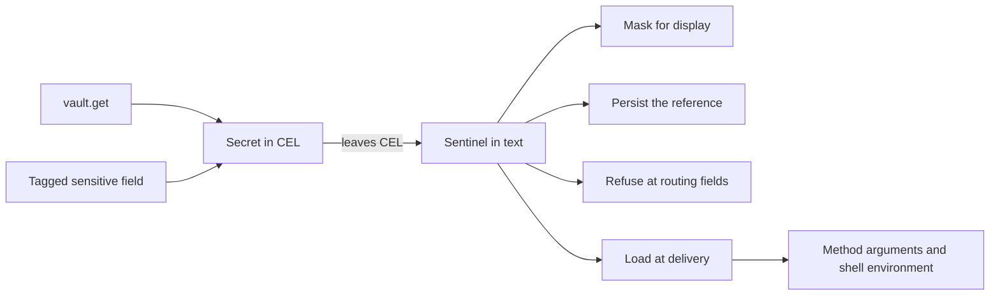

# Typed Secrets for Expressions

**Status:** Phases 0–4 are implemented. Every internal expression entry point
uses typed secrets; there is no rollout option. Phase 5, remote reference
transport, remains separate. The phase descriptions below record the staged
implementation; Phase 4.6 supersedes their references to the internal option.
[Expressions](./expressions.md) describes the default behavior.

## Outcome

Inside an expression, a secret is a `Secret` value. It holds a reference to
where the secret lives, never the secret itself. Expressions can pass a secret
along, join it with text, and test it against `null`. Any other operation on a
secret fails with an error that contains no value.

Outside an expression, a secret travels as a sentinel: text that stands for the
reference. Swamp loads the plaintext only when it delivers a value to a trusted
consumer, such as a method or the shell environment. Everything swamp writes
holds the reference or a mask.

This is the current expression engine with three changes:

1. Sentinels stand for references instead of values, and loading moves to
   delivery.
2. `vault.get` and sensitive-field reads produce `Secret` values instead of a
   sentinel string or plaintext.
3. Persisted forms are built from sentinels instead of by searching text for
   known values.



## Why this design

The earlier plan ran a second expression engine beside the current one. It
loaded plaintext into CEL so that `==` and `size` could work on secrets, and it
added a new persisted codec. Those three choices needed per-repository engine
selection, a journaled migration across shared datastores, reader guards
released before any writer, a CEL-to-CEL lowering compiler, and loaded and
unloaded secret states. They made up more than half of that plan.

This plan makes none of those choices:

- No skill, design doc or example in this repository compares or measures a
  `vault.get` value. Today such a comparison runs against the sentinel text, so
  no working expression depends on it.
- With no plaintext in CEL, no CEL operation can disclose a secret. Refusing
  operations needs registered overloads, not a compiler.
- The current persisted form already stores references by path and keeps
  reference-looking data inert. Current binaries write and read it.
- Every change to how an expression evaluates is a refusal with a stable code,
  so no expression silently changes meaning. That includes the comparisons
  cel-js answers without calling a handler (Section 4.3) and a reference to a
  missing key (Section 3.4). The change ships in place with release notes
  instead of as an opt-in engine.

## 1. Scope and success criteria

### 1.1 Security contract

The contract covers known secrets: values from `vault.get`, and fields that a
record's `_swamp.sensitiveFields` tag names.

1. Expression evaluation never holds secret plaintext. CEL source, bindings and
   results carry `Secret` values or sentinels.
2. Swamp loads plaintext only to deliver it at a boundary that Section 7.1
   allows. Each load runs under the run's vault access scope. The one other read
   is the existence probe in Section 3.4, which discards the value at once.
3. Evaluated caches, run records, run indexes, output records, reports, events,
   logs and dispatch records hold references, sentinels or masks. They never
   hold secret plaintext. Swamp decides this from the sentinel, not by searching
   for known values.
4. A field that refuses secrets rejects a secret anywhere in its value before
   any secret is loaded.
5. Swamp never puts a secret in the command text of its own `command/shell`
   invocation. That is `sh -c` on POSIX and `powershell.exe -Command` on
   Windows. Secrets reach the shell through the child environment.
6. Any operation on a secret outside the allowed set in Section 4.1 fails with a
   value-free error. This holds inside `||`, `&&`, `exists` and `all`, and for
   the comparisons cel-js answers without a handler (Section 4.3).
7. Reference-looking text that arrives as data stays data. The inert-data rule
   in [expressions](./expressions.md) is unchanged.

Remote dispatch is the one exception to items 2 and 3 until Phase 5 (Section 9).
From typed-secrets 5.2 the exception narrows to a dispatch to a protocol
version 5 worker during the deprecation window Section 9 records, and
typed-secrets 5.3 removes it.

Plaintext exists in vault storage and vault providers, in a step's loaded bag
during its delivery attempt, and in trusted consumers. The trusted consumers are
methods, pre-flight checks, `readResource`, `readModelData` and shell child
processes. Extensions and scripts can transform, send or log what they receive,
and this plan does not sandbox them. `SecretRedactor` stays as defense in depth
for their output. It ignores values shorter than three characters, so it cannot
replace the rules above.

### 1.2 Starting point

As of the commit in the header:

- `vault.get` is not a CEL function. `resolveVaultExpressions` finds each call
  with a regular expression and reads the value into the step's
  `VaultSecretBag`. It then replaces the call with a sentinel string literal
  before CEL runs. CEL works on the sentinel, so `vault.get(...) == 'x'`
  compares the sentinel text and `size()` measures it.
- Some expression-facing accessors resolve tagged sensitive fields to plaintext
  (`resolveSensitiveVaultRefs`) and some return the stored reference text.
  Plaintext inside CEL can reach names, tags, guard results and error text.
- Keeping plaintext out of persisted files and identifiers relies on searching
  text for the values a run recorded (`RunSensitiveValues`,
  `VaultSecretBag.sentinelizeText`). Values shorter than three characters are
  never recorded. A transformed value, such as a substring, is not found.
- Remote dispatch carries plaintext in the arguments, in `secretValues` and in
  the bag entries. The baseline in swamp-club#3512 pins this path. The
  disclosures it found are tracked in swamp-club#3525 to swamp-club#3530.

### 1.3 First-release boundaries

In scope:

- String secrets from `vault.get` and from tagged sensitive fields.
- Joining secrets with text, with `+` in CEL and by template interpolation.
- Every expression-facing accessor (Section 6.1) and data query (Section 6.2).
- Local behavior runs, workflows, child workflows, resume, and the caches that
  `evaluate` writes.
- Remote dispatch of references (Phase 5).

Out of scope, each its own issue if it is needed:

- Comparing or measuring a secret in an expression. A later design can add it by
  loading at a point read.
- Non-string secrets. A sensitive output stored as JSON text keeps today's
  string-on-read behavior. The exception is a number or boolean at a place
  `_swamp.sensitiveFieldJson` lists (swamp-club#3038): it is delivered as a
  number or boolean where it stands whole (Section 6.1, swamp-club#3967). An
  object or list there stays its JSON text. Delivering it parsed needs the
  run's redactor to mask it by structure rather than by text, and exposing it
  as an object of `Secret` values, so an expression could select a field inside
  it, would need the writer to vault each leaf apart or a load at a point read.
  Both stay out of scope.
- Treating literal inputs that a schema marks sensitive as secrets. Today's
  handling of literal sensitive arguments is unchanged: they are masked in run
  output and in the evaluated caches, and `--last-evaluated` refuses a cache
  holding the mask (swamp-club#3681), but they are not `Secret` values.
- Evaluating `vault.get` in a `forEach` iteration scope. `vault` stays a runtime
  root, so today's limitation remains. A later change can lift it, because
  `vault.get` no longer reads anything.
- Cancellation of vault provider reads, resume drift detection, and changes to
  the pre-flight check API.

`env.*` is unchanged and is not a secret source.

Other CEL environments keep their contracts. These are the extension CEL factory
(`createExtensionCelEnvironment`, `packages/testing/_cel_environment.ts`), the
grant-condition environment, the workflow-run history filter
(`workflow_run_filter.ts`, which binds only persisted-form inputs and tags) and
the datastore config resolver. Only the internal evaluator and the
expression-facing query view register `Secret`.

## 2. Implementation decisions

| Area                       | Decision                                                                                                                                                                                                              |
| -------------------------- | --------------------------------------------------------------------------------------------------------------------------------------------------------------------------------------------------------------------- |
| Representation in CEL      | One registered `Secret` type. It holds a vault reference, a sensitive-field reference, or an ordered list of text and references. It never holds plaintext.                                                           |
| Representation outside CEL | A sentinel in text, which a `VaultSecretBag` maps to its reference. Everything else stays plain JSON.                                                                                                                 |
| `vault.get`                | A real CEL function, `vault.get(string, string): Secret`. It reads nothing. Legacy bare-token arguments become quoted strings before parsing.                                                                         |
| Loading                    | Only at delivery, through `VaultService.get` under the run's `RunVaultAccess`. One load per reference per attempt. An existence check keeps a missing key failing at evaluation (Section 3.4).                        |
| Operations                 | The allowed set in Section 4.1: passing along, concatenation, comparison with `null`, and `has()` or `.?`. Everything else is refused, including container comparisons that cel-js answers without a handler.         |
| Accessors                  | Every expression-facing accessor returns tagged fields as `Secret` values and reads no vault.                                                                                                                         |
| Identifiers                | Names, tags, labels and data-name suffixes keep the `sensitive-<vault>.<key>` stand-in. Step identities keep `sensitive-<index>`. Task selectors, placement, paths, `workingDir` and environment keys refuse secrets. |
| Shell                      | Today's environment-variable placement for `run`. The two cases that paste a value into the command become refusals.                                                                                                  |
| Persistence                | `sensitiveFormat` (2 since the masks of swamp-club#3681) and `writtenReferences`, unchanged by this design; the caches and the run record gain optional persisted-coordinate provenance fields (Section 8.1). Entries come from sentinels.                                                                                                                                 |
| Rollout                    | One engine, changed in place. Changes are refusals with stable codes. `validate` reports static cases early, and release notes list them all. There is no repository marker and no migration command.                 |
| Remote                     | Phase 5. Dispatch carries sentinels and references, and the worker loads each value over the data plane.                                                                                                              |

## 3. Representation and loading

### 3.1 The `Secret` value

cel-js decides a value's type by exact constructor identity. `Secret` is one
class, registered with `registerType("Secret", { ctor, fields: {} })`.

A `Secret` holds one of these:

- A vault reference, which is a vault name and key, from `vault.get`.
- A sensitive-field reference, which is the vault name and key in the stored
  reference text, marked as data origin.
- A composition, which is an ordered list of text and references, from
  concatenation.

Each instance is a Proxy over a frozen, empty `Secret` object. Its state lives
in a module-private `WeakMap` keyed by the proxy. The `ownKeys` and
`getOwnPropertyDescriptor` traps throw. The `get` trap answers `constructor`,
and for `toString`, `toJSON`, `valueOf` and `Symbol.toPrimitive` it returns
functions that throw. Every other key, including `then` and the `Symbol`
inspection hooks, returns `undefined` and records no fault, so awaiting a
`Secret` or inspecting it in a debugger is harmless. `structuredClone` of a
Proxy throws. Code that mishandles a `Secret` therefore fails, instead of
turning it into `{}` or text. Every trap and function that throws records a
fault first (Section 4.3).

Only module-owned factories create instances. Nothing recognizes a `Secret` by
its shape. `Deno.inspect` prints the class name and reads nothing, unless it is
asked to show the proxy. Phase 1.2 showed that cel-js uses the Proxy (Section
11), so the fallback, a plain class with private fields with the container rule
extended to comprehension macros, was not needed.

### 3.2 Sentinels outside CEL

Outside CEL a secret is a sentinel, text of the form
`__SWAMP_VSEC_<prefix>_<n>__`. A `VaultSecretBag` maps each sentinel to its
reference, an encoding and a data-origin flag, and a data-origin entry may be
marked `jsonValue` (Section 6.1). Each bag draws a 128-bit random prefix, so
data cannot guess a sentinel.

The CEL adapter converts at its boundary:

- A `Secret` that leaves CEL becomes its sentinel. A composition becomes its
  text with a sentinel for each reference.
- A string bound into CEL that holds the evaluation's sentinels becomes a
  `Secret`. This covers inputs, `self.item`, deferred parent bindings and other
  values the engine produced in an earlier pass.

The conversion runs before the adapter's own post-processing (`coerceBigInts`,
`unwrapOptional`). It also converts a `Secret` inside an Optional. No code
outside the CEL adapter sees a `Secret`. Everything else stays plain JSON, so
the existing walkers, clones and codecs need no change.

Two rules keep that true:

- **One bag registry per run.** Every pass, including the run-start pass and
  workflow-level evaluation, issues sentinels into a run-scoped registry
  (`SecretBagRegistry`), and a step's bag is a view of it. A load resolves any
  sentinel the run issued, so a `Secret` from an earlier pass is never
  delivered as literal sentinel text. The registry travels with the run's
  `RunSensitiveValues`, so its boundary is the parent-child run tree: a child
  workflow issues into its parent's registry under prefixes of its own, while
  `context.runModel` keeps a registry of its own. Rehoming between bags
  (`SanitizedTaskOverlay.forStep`) covers vault-origin entries as well as
  data-origin ones, and what a bag ships to a worker stays the entries it
  issued plus those its step's arguments reference.
- **New objects at the boundary.** The accessor adapter and the binding
  conversion build new objects. They never wrap or mutate a context, a cached
  record or a live output in place (`data_writer.ts` mutates in place today), so
  no `Secret` reaches `steps.*` contexts, deferred bindings or a
  `structuredClone`.

Sentinels sit only in literal text. Spliced text is never evaluated, so a
sentinel cannot end up inside an expression. A sentinel-shaped string with
another prefix is ordinary text.

### 3.3 Loading at delivery

Swamp loads a secret only when it delivers it:

- The method execution service loads the sentinels in a step's arguments once
  per attempt, before pre-flight checks. The checks and the method share that
  loaded bag as `context.vaultSecrets`.
- The shell behavior uses the loaded bag (Section 7.2).
- `readResource` keeps resolving tagged fields itself.
- Until Phase 5, the orchestrator loads a remote step's bag before dispatch.

Runtime expression helpers issue sentinels without loading them. Routing
and other refusing destinations check them before delivery:

| Inventory key | Resolution site | Destination (Section 7.1) | Loading contract |
| --- | --- | --- | --- |
| `validation` | Checks in `swamp behavior validate` | Trusted consumer | The shared refuse-then-load step loads once before checks. |
| `routing` | Placement and task selectors | Refuses secrets | No load, including references issued by earlier passes. |
| `child` | Child workflow references | Refuses secrets | No load before lookup or invocation. |
| `deferred` | Deferred targets, `inputs` and `globalArgs` | Targets refuse; records issue into the step's bag | Records load at method delivery. |
| `assert-message` | Assert message interpolation | Masked | Masks references without loading, including literal sentinel text. |
| `runtime` | Runtime expression helpers | The caller's explicit destination | Routing issues sentinels or refuses; the generic trusted-consumer helper can load inline. |
| `delivery` | Method argument parsing and local/remote delivery | Trusted consumer | Loads per attempt; remote delivery remains unchanged until Phase 5. |

### 3.4 Existence check

Today a reference to a missing or unreadable key fails the run when the
expression is evaluated, because the eager read fails. Loading at delivery would
make that failure disappear wherever nothing delivers the reference, such as a
guard `vault.get('prod', 'MISSING') != null`. An existence check keeps it.

- **`vault.get` references.** Before the expression runs, the evaluator
  evaluates the arguments of every `vault.get` call in it, whichever branch
  would run, as `resolveVaultArg` does today, and with today's rules for which
  arguments it accepts. An argument that fails to evaluate fails the expression,
  as today. Each resulting reference is checked.
- **Sensitive-field references.** Stored readers never load values. The
  accessor adapter records the references in each record it returns, and after
  evaluation, before the result is used, each is authorized under the run's
  `RunVaultAccess` with no provider call. A missing key fails only if the
  reference is delivered, at its load (Section 10.1). Phase 3.3 implements
  this on the typed path: the adapter records every reference of each record
  it adapts, selected or not, in the evaluation's fault context, except the
  rows a `data.query` predicate reads, whose references stay in a row-local
  scope (Section 6.2) so that only the records the expression receives,
  answered whole or read by a projection, are authorized; after the
  boundary conversion of the result, which adapts records the expression
  returned without selecting into them, the evaluator authorizes each distinct
  reference through `VaultService.authorizeRead`, sequentially and uncached,
  and a denial fails the evaluation. An evaluation with no vault scope fails
  closed; with a scope but no ambient `RunVaultAccess` the check passes, as
  a read does outside a run. On the asynchronous path release precedes
  authorization, so a denial leaves the value-less entries release issued in
  the run's registry; nothing delivers them, and a load authorizes again. The
  synchronous `evaluate` fails closed on any recorded reference, naming
  `evaluateAsync`, because the check is asynchronous: it reads the whole
  result as release would first, so a record the expression returned without
  selecting into it is adapted too, even behind a sentinel bound from the
  context, and the refusal comes before release issues any sentinel. Phase
  4.1 gives the synchronous passes (`forEach` step names, the step and child
  task passes of `resolveAvailableExpressions`, and the vault selectors a
  child binding captures) an authorization step of their own:
  `CelEvaluator.prepareSynchronousReads`, run from the pass evaluator's
  `prepare` before the pass evaluates. It prepares the context as
  `prepareExpressionsIn` does, takes the `model.<name>.resource` records the
  expressions read synchronously from the same analysis the data namespace's
  `prepare` uses (`analyzeExpression(...).syncDataReads`, the read set),
  parses their sensitive-fields tags without reading a value, authorizes each
  reference through `VaultService.authorizeRead`, and returns a scope whose
  `authorizedReferences` the synchronous `evaluate` accepts; any other
  recorded reference still fails closed. Authorization is by vault and key,
  so a record another model holds under an authorized reference reads too,
  and a reference the content never names does not. The read set names
  models, not records, so a check that fails (a denial, an unavailable vault,
  no vault scope) is kept for its reference (`deniedReferences`) and fails
  the synchronous evaluate that reads the record holding it, with the access
  error and before release issues a sentinel; a denied record the expression
  never reads costs nothing. A record whose tag does not parse is left for
  the evaluation to refuse. Each pass evaluator carries its own authorized
  and denied sets, so one pass never authorizes for another.
- **How, for `vault.get`.** Every check authorizes `read` on the vault and key
  under the run's `RunVaultAccess`, as a load would, so a grant revoked mid-run
  fails the next check. It then asks the provider:
  1. A provider that implements the optional `VaultExistenceProvider.has(key)`
     answers from it. The contract of `has` is that `get(key)` would succeed
     under the same provider credentials, so presence in a listing or a describe
     call is not enough. A conformance suite in `packages/testing/` holds
     providers to that, and a built-in provider implements `has` only where its
     API can answer it without reading the value.
  2. Any other provider gets one keyed `get`, the read the eager read does
     today. This probe registers the value with the run's `SecretRedactor` and
     drops it. The value never enters a bag, CEL or a delivery.

  Only a positive answer is cached, for the run and per reference, on the run's
  `SecretBagRegistry`: a child workflow shares it, while a resume and
  `context.runModel` ask again. Checks of one reference in flight at once
  share one answer, so parallel steps probe once. A key removed later fails at
  load. Authorization is never cached.
- **Failure.** A missing key fails with `secret_reference_unavailable`, naming
  the vault, the key and the authored location. An unauthorized key fails with
  the access error a load would raise. A probe that fails fails the step with
  the provider's error, as the eager read does today. A key fails the check
  exactly where today's eager read or record resolution would have failed it. A
  guard result is used only after its references pass.

A **load** reads a value for delivery (Section 3.3). A **probe** reads one only
for this check. Read counts in exit criteria and tests count loads unless they
say otherwise. A reference costs at most one probe per run, and none on a
provider with `has`. A refusal before delivery makes zero loads, though a probe
may already have run. Today one eager read serves both purposes, so a provider
without `has` sees one extra read per delivered reference per run. That matters
when a read has an effect, such as minting a dynamic credential. Such a provider
should implement `has`, and the release notes say so (Section 10.3).

The check runs wherever a `vault.get` call is evaluated
(`checkSecretReference`, from `resolveVaultExpressions`): the runtime pass that
behavior runs, workflow steps, `context.runModel` and the inline resolutions in
Section 3.3 go through. `swamp behavior evaluate` and `swamp workflow evaluate`
defer `vault.get` as a runtime expression and evaluate none, so they read
nothing, as before, and guards, asserts and `forEach` bind no `vault` in the
current engine. From Phase 3, where `vault.get` is a CEL function, every entry
point that evaluates one runs the check. Phase 3.2 implements this in the
test-only `CelEvaluator.evaluateAsync` path, with `EvaluationScope.secretBag`
and `EvaluationScope.vault` supplying the issuing registry, vault service,
probe redactor and authored field path. It checks all direct calls before
executing the expression, including unselected branches. The synchronous API
refuses direct vault calls before I/O and directs callers to `evaluateAsync`;
expressions without vault calls remain synchronous. Missing check scope fails
closed. The checker retains its unavailable/access-denied codes and provider
failures, and its registry owns the positive/in-flight cache.

## 4. CEL semantics

### 4.1 Required runtime behavior

Let `S` be a `Secret`, single or composed.

The **allowed set** is passing `S` along, concatenation (`+` and template
interpolation), comparison with `null`, and `has()` or `.?`, which expose no
field. Every other operation is refused. Sections 1.1, 2 and 4.3 refer to this
set.

| Operation                                                                          | Result                                                |
| ---------------------------------------------------------------------------------- | ----------------------------------------------------- |
| `S + string`, `string + S`, `S + S`, template interpolation                        | A composed `Secret`                                   |
| A list or map that holds `S`, and field selection on an ordinary container         | Structure and leaves kept                             |
| `S == null`, `null == S` and their `!=` forms                                      | `false` for `==`, `true` for `!=`                     |
| `S == x`, `x == S` and `!=` for any other `x`, including two secrets               | Refused                                               |
| `size`, conversions such as `int` and `string`, string functions, `matches` on `S` | Refused                                               |
| `S` as a map key, a macro range, a `data.query` predicate or a regex pattern       | Refused                                               |
| A container that holds `S`, interpolated into text                                 | Refused. Pass the container as a structured argument. |
| `type(S)`                                                                          | `Type<Secret>`, which reveals nothing                 |
| `has(S.x)`, `S.?x`                                                                 | No field is exposed                                   |
| `S in list`, list or map equality with a secret element                            | Refused (Section 4.3, item 5)                         |

A `Secret` exists only where a field holds a stored reference, so it is never
`null`. Comparing it with `null` needs no value and loads nothing. A tagged
field that is null stays null (Section 6.1). A presence check such as
`data.latest('db', 'main').attributes.password != null` therefore gives today's
answer, and so does `has()` on the record.

A refusal happens when the operation runs, so an unselected branch refuses
nothing. `vault.get` reads nothing, so evaluation order and branch selection
cannot change what is loaded.

### 4.2 Dependency facts that determine the design

The Phase 1.1 suite pins these facts about cel-js 7.6.1
(`src/infrastructure/cel/cel_js_pins/`). The Phase 1.2 suite beside it
(`cel_js_secret_*_pin_test.ts`) pins how cel-js treats the production `Secret`
of Section 3.1 and the refusal inventory of Section 4.3; its observations are
listed under Phase 1.2 in Section 11. A dependency upgrade must pass both.

1. Async custom function inputs are awaited. Derived `!=`, container `isEqual`,
   and `listIncludes` consume equality-handler returns synchronously, and a
   rejecting async handler can leave unobserved promises. Equality handlers must
   therefore be synchronous. A getter that returns a Promise reaches member
   access as an unsupported value.
2. Container equality and membership short-circuit on identity and type, and
   never call a `Secret == string` overload for their elements. Direct dyn
   equality with no matching overload falls back to identity without calling any
   handler. A fault that only handlers record cannot see either case.
3. A missing-overload error at run time, or an error a handler throws, is
   absorbed by `||`, `&&`, `exists` or `all` when the other operand decides the
   result. A statically detectable type error, and an error while building a
   macro's range, are not absorbed.
4. `==` creates derived `!=` and mirrored mixed-type equality, so register `==`
   only. A `Secret == dyn` overload overlaps its own mirror when both operands
   are secrets. Addition is not mirrored, so each operand order needs its own
   registration. The `map` type alias is valid in custom signatures, but a
   parameterized type spelled with a comma is not. Overlapping built-in list and
   map registrations are not a reliable override. A custom binary overload marks
   every use of its operator maybe-async, and so does a function registered
   without `{ async: false }`.
5. cel-js decides a value's type by exact constructor identity. `fields: {}`
   hides fields from selection, indexing, `has()` and `.?`. Comprehension macros
   fall back to `Object.keys`, so a dyn value whose state is private yields an
   empty range instead of an error. A statically typed custom variable is not a
   comprehension range.
6. `cel.bind(v, vault, v.get(...))` can call a registered receiver through an
   alias. Receiver typing does not enforce scope or effect restrictions.
7. Parsed programs contain mutable checker and comprehension state. Successful
   concurrent examples are evidence for a test case, not a concurrency contract.
8. `size(string)` counts code points. Ordinary `matches` uses JavaScript RegExp.
9. The planner unifies the branch types of a ternary when it builds a
   program, before anything runs, and refuses `incompatible_ternary_branches`
   when they differ: a call declared to return `Secret` beside a string
   literal fails even in the branch not taken, while a dyn branch unifies
   with anything.

How they shape the design:

- Refusing handlers are synchronous, and no getter returns a Promise (fact 1).
- No handler sees a container comparison, so an expression-level rule refuses
  them (fact 2, Section 4.3 item 5).
- A refusal records a fault, so absorption cannot hide it (fact 3).
- Overloads follow the registration rules, and synchronous entry points must
  stay synchronous with them in place (fact 4).
- The Proxy turns a macro range over a secret into a recorded fault (fact 5).
  cel-js absorbs the range error like a handler error, so the fault is what
  fails the evaluation (Phase 1.2).
- `vault` stays usable only as the receiver of a direct `vault.get(...)` call,
  so every reference is a call the existence check finds (fact 6, Section 4.4).
- The design adds no state to shared programs (fact 7).
- Fact 8 no longer affects the design. Its pin stays as an upgrade alarm.
- Each checked `vault.get` call is bound as dyn when the typed evaluator
  prepares the program (fact 9, Section 4.4), so `flag ? vault.get(...) :
  'none'` keeps its meaning; the value is the `Secret`, on which every
  overload still dispatches at run time. The static check in Section 4.3
  item 4 cannot unify such a ternary and reports nothing for it.

### 4.3 Refusal

Refusal uses registrations. It does not rewrite expressions.

1. **Run time.** The internal environment registers a refusing overload for
   `Secret` wherever a `Secret` can reach a built-in operator, function or
   conversion, or one of swamp's own registrations. The refusal inventory
   (`src/infrastructure/cel/cel_js_secret_refusal_inventory.ts`) classifies
   every secret-capable position, a receiver or a parameter typed `string`,
   `dyn`, a type variable, or a list, map or optional of anything, as one of five
   dispositions: a refusal, a named delivery (`dyn(dyn)`, `cel.bind`, the
   optional accessors `of`, `value` and `orValue`, and `model.method` inputs,
   Section 4.5), an argument walk (the vary list, below), a container (`size`
   and `type` of a list or map, the `join` receiver, the comprehension macros
   over a list, and `hasValue` and `or` on an optional, which reveal nothing),
   or a type name (`type(S)`, which cel-js registers itself and which answers
   `Type<Secret>`). The
   refusals are the full cross product over a signature's refusal positions,
   because one overload per position leaves a call with two secrets to a
   missing-overload error that records no fault. Every operator is covered
   against every type cel-js or swamp can name, `null` included, so arithmetic
   or a comparison on a secret records a fault whatever the other operand is.
   Two built-ins have no registrable refusal. `in` overlaps the built-in at
   evaluation (`Secret in list`, `Secret in map`); item 5 covers it. `join` on
   a list that holds a secret fails with cel-js's own
   `invalid_list_element_type` before any handler runs, and a `list<dyn>.join`
   overload never intercepts it; it records no fault and reveals nothing, and
   stays a known unrecorded failure. A few more failures on a `Secret` record
   no fault, so `||`, `&&`, `exists` and `all` can absorb them: a `Secret` in a
   parameter that is not secret-capable, such as the `int` of `substring`,
   meets a missing-overload error; a `Secret` as a logical operand, a ternary
   condition or a macro predicate result is not a `bool`; and selecting or
   indexing a `Secret` finds no field. Each answers exactly as today's
   sentinel text answers, a string in the same place, so no expression changes
   meaning, and none reveals anything. Every
   overload is synchronous, and functions use `{ async: false }`. Equality is
   one refusing `Secret == T` overload for each type cel-js can name in a
   signature, `Secret` and swamp's own namespace types among them, and a
   `Secret == null` overload that answers `false`. `!=` and the mirrored operand
   order come from each (fact 4). A single `Secret == dyn` cannot serve, because
   it overlaps its own mirror when both operands are secrets (fact 4).
2. **Absorption.** Every refusing overload, and every throwing trap in Section
   3.1, records a fault in the evaluation's ambient context before it throws.
   The evaluator enters that context with `AsyncLocalStorage`, as
   `RunVaultAccess` does. A recorded fault fails the evaluation even when `||`,
   `&&`, `exists` or `all` absorbed the error.
3. **Macros.** Building a macro range over a `Secret` calls its `ownKeys` trap,
   which records a fault and throws. cel-js absorbs that error under `||`,
   `&&`, `exists` and `all` like a handler error, so the recorded fault is what
   fails the evaluation (item 2). Fact 3 is about an error while evaluating the
   range expression, such as a list literal, which is not absorbed; iterating a
   range value whose `ownKeys` throws is.
4. **Before a run.** `vault.get` has the static return type `Secret`.
   `swamp behavior validate` and `swamp workflow validate` type-check
   expressions in the same environment, with the allowed set's overloads
   (Section 4.1) in place of the refusing ones. The allowed set passes there,
   and any other operation on a `vault.get` result is a check-time error, with
   three escapes: a dyn operand (an unlisted variable, or `dyn(...)`) and a
   map literal keyed by the result check as valid and are refused only at run
   time, and `type()` checks as valid and answers the type name at run time,
   which reveals nothing. `has()` on a call result fails the check for a
   reason of its own, `invalid_macro_argument`, although `has()` is in the
   allowed set. Secrets from records are dyn values, so their misuse shows up
   only at run time. Phase 3.5 implements the check in
   `src/infrastructure/cel/secret_diagnostics.ts`: an expression with a
   direct `vault.get` call is type-checked in a check environment that
   registers the `Secret` type, the receiver and the allowed set with no
   refusal, and a failure is the secret's when its error names the `Secret`
   type, so an error unrelated to the result (`string + int`) is never
   reported with a secret code; the container rule's scan is reported beside
   it. Both findings answer `secret_operation_unsupported`. A ternary with a
   `Secret` branch is a fourth escape: the check cannot unify its branches, the
   evaluator binds the call as dyn (Section 4.4), and what follows the ternary is
   refused only at run time.
   5. **Containers.** cel-js answers `in` and list or map equality without calling
   any handler (fact 2). They cannot reveal a value, because a `Secret` holds
   none, but they would answer by identity: a guard
   `data.latest('db', 'main').attributes.password in ['', 'changeme']` would
   become always false. An expression-level rule refuses them instead:
   - Before evaluation, the evaluator scans the parsed expression for a
     container comparison: an `in`, or an `==` or `!=` with no operand that is a
     scalar literal or `null`. A scalar compared with a container is `false`
     today and after, so it needs no rule.
   - During evaluation, the fault context records each `Secret` that enters it:
     from `vault.get`, from a binding, or when CEL reads it out of a record,
     list or map. The accessor adapter (Section 6.1) and the boundary conversion
     put each secret-valued property and element behind a getter that records
     it. Selecting another field records nothing. Map key membership on a plain
     object does record: cel-js reads the value to tell an absent key from an
     undefined one, and deep type inference reads a container's first entry,
     so `'z' in attrs` records a secret that is the first attribute. `has()`
     and `.?` on a field read the value and record it too.
   - An evaluation that has a container comparison and records a `Secret` fails
     with `secret_operation_unsupported`, after any absorption. Recording stops
     when evaluation ends. The boundary conversion of the result reads getters
     too, but what it reads is not recorded, so returning a record with tagged
     fields beside an unrelated `in` is not refused.

   The rule over-refuses. `vault.get('v', 'k') != null && self.item in ['a']`
   fails, although the secret never reaches `in`, and so does
   `vault.get('v', 'k') != null && inputs.a == self.item` with two strings, and
   `'z' in attrs && self.item in ['a']` when the first attribute is a secret.
   The refusal is loud and names the expression. Moving the comparison into its
   own expression, such as an input, avoids it. A later change can narrow the
   rule if cel-js gains a container-equality hook.

A fitness test (`integration/cel_secret_refusal_coverage_rules_test.ts`)
lists every place a `Secret` can reach and fails when a position has no
disposition in the inventory, so a built-in that a dependency upgrade adds
needs a decision. The built-in functions come from cel-js itself, through
`Environment.getDefinitions()`. The built-in operators and the `==` type list
are maintained tables pinned against the dependency, because the registry
keeps its operator list private and the package does not export its type
table.

The same test covers swamp's own registrations in the internal environment and
the query view, such as the `data`, `file` and `model` namespaces, through a
maintained list it keeps equal to the source. Each string, dyn or `list<dyn>`
parameter either has a `Secret` refusal that records a fault, or is a named
delivery (`model.method` inputs, Section 4.5), or is an argument walk. Without
that, a `Secret` argument would meet a missing-overload error that records no
fault, and `||` could absorb it. A `Secret` in the vary list of `data.latest`,
`data.version` or `data.listVersions` is the argument walk: no signature can
refuse a list element, so the handler walks the list and refuses with
`secret_destination_refused`, because a lookup key cannot use the stand-in that
a data-name suffix gets. The test proves the inventory is complete, and its
production half (Phase 3.1) proves that `getDefinitions()` on the internal
environment holds exactly the function refusals the inventory yields for it;
the extension environment retains its separate definitions.
`getDefinitions()` lists no operators, so the operator refusals are proven
through the evaluator. The query view's half (typed-secrets 4.3) proves the
same for the view's environment of Section 6.2, built from the query service's
own base, and that the base defines no `Secret`. The container rule of item 5
is applied to each query predicate and projection as well, since the calling
evaluation scans only its own AST; its over-refusal there reaches an equality
of two non-literals, such as a run id compared with `latestRun`, beside any
secret read in the same row.

### 4.4 `vault.get`

`vault` is a receiver type with one method, `get(string, string): Secret`. The
method builds a reference and reads nothing. Section 3.4 checks that the key
exists.

Arguments are CEL expressions, with the legacy literal-name rule applied
first: a bare token without `.` is a literal, including numeric-looking tokens
and punctuation. `vault.get(my-vault, KEY)` keeps working. Quoted and backtick
arguments retain their raw interiors, including backslashes, because the legacy
resolver did not decode CEL escapes in names. `vault_call_syntax.ts` rewrites
only direct call arguments outside strings/comments and maps normalized offsets
back to authored text, including the existing hyphenated-model rewrite. The
module sits below the template scanner to avoid a parser import cycle.

The shared AST walk finds direct root calls and rejects other free uses of
`vault`. Aliases such as `cel.bind(v, vault, v.get(...))`,
`dyn(vault).get(...)` and `[vault].map(m, m.get(...))` stay refused. Calls whose
arguments depend on surrounding comprehension or `cel.bind` locals are refused:
up-front evaluation does not introduce local-binding semantics. Effectful
`model.method` calls inside arguments are refused before any checks or argument
evaluation, including aliased receivers, so checking cannot run an effect that
short-circuit evaluation would skip or reorder it ahead of the outer expression.
A `Secret`
argument is refused inside the fault/boundary scope before string conversion or
result release.

Phase 3.2 checks each pair once per call site, then binds a private receiver
holding that checked pair and its authored location. Runtime calls reuse those
arguments, so a changing getter cannot switch reference identity after checking.
Phase 3.5 binds each such call as dyn, so the planner's ternary rule (Section
4.2, fact 9) cannot change an expression's meaning; dispatch on the `Secret`
value is unchanged.
The receiver creates a `Secret`, records a Secret read for the container rule,
and performs no provider I/O. Its types and refusal signatures are registered
in every internal expression environment.

The AST records feed static extraction, model/workflow validation, foreign-root
attribution, vault removal checks and the dispatch allowlist; parse-only
`freeRoots` uses the same normalization. The compatibility filter in
`vault_reference_extractor.ts` retains the dispatch allowlist's existing syntax
contract; the AST evaluator is the only internal execution path.

### 4.5 Effectful functions

`model.method(model, method, inputs)` runs a method through a synthetic step. It
is the internal environment's effectful function, and any swamp function with an
effect follows the same four rules:

1. **Effect gate.** Before it starts any work, the function checks the
   evaluation's fault context. It refuses if a fault is already recorded, or if
   the expression has a container comparison and a `Secret` is already recorded
   (Section 4.3 item 5). An absorbed refusal therefore cannot let an effect run
   that today's short-circuit would have skipped, as in
   `attrs.mode == 'frozen' || model.method('prod', 'deploy', {})`.
2. **Routing arguments refuse secrets.** The model and method names are routing
   values, like task selectors. A `Secret` there is refused with a recorded
   fault.
3. **Inputs are a delivery.** The call converts `inputs` at the CEL boundary, so
   each `Secret` becomes a sentinel in the synthetic step's bag. The step loads
   it under its own attempt, as Section 3.3 loads method arguments. No `Secret`
   reaches the step delegate, step creation or persistence. This is what happens
   today, where the sentinel reaches the step and the bag resolves it. Phase
   3.5 lands this conversion: the function releases `inputs` through the
   evaluation's boundary into the run's bag and hands the delegate a plain
   copy, ints as cel-js's bigints; with no bag to issue into, a `Secret` in
   them has nowhere to go and is refused with `secret_destination_refused`
   before the delegate starts.
4. **Results go through the accessor adapter.** `model.method` returns the
   step's latest resource or its raw result. Tagged fields in it become `Secret`
   values through the adapter in Section 6.1, as `data.latest` returns them, so
   reference text never comes back as a comparable string.

## 5. Evaluation passes

The pass structure is unchanged. Each pass evaluates the expressions it can,
splices the results into text, and leaves the rest for a later pass. `vault` and
`env` stay runtime roots.

- A result that holds a `Secret` leaves CEL as a sentinel. A partly evaluated
  string carries the sentinel to the next pass, as it carries a sentinel today.
- Values bound into CEL turn their sentinels back into `Secret` values. A later
  expression that reads `inputs.x` or `self.item` sees a `Secret`, not sentinel
  text.
- A guard or assert predicate whose result holds a secret is refused. A secret
  in an assert message is masked. Phase 4.1 implements both: the predicate is
  evaluated under the predicate destination (`EvaluationScope.secretResult:
  "refuse"`), which refuses a `Secret` anywhere in the result with
  `secret_destination_refused` before anything reads it and issues nothing,
  while the bindings still read sentinels as Secrets so a comparison to null
  decides as before; the message's expressions evaluate through the typed
  evaluator, so a secret leaves as a sentinel, and the message is masked
  through `RunSensitiveValues.masked` before the redactor's pass. A refused
  guard fails its step, as any guard failure does.
- A `forEach` collection may hold secrets. Each item binds as a `Secret`. A
  secret in a step identity becomes `sensitive-<index>`, as today. Phase 4.1:
  the expansion evaluates `forEach.in` typed, so an item that holds a `Secret`
  leaves as a sentinel the step's passes bind back; a name template runs the
  authorization step and then the synchronous evaluate, and
  `forEachNameWithoutSecrets` replaces every sentinel the run issued with the
  index stand-in (`RunSensitiveValues.withForEachStandIns`) beside today's
  value search. A secret refusal in a name template fails the expansion,
  naming the expression; every other failure keeps the suffixed fallback. A
  step name the run-start pass resolves, one that reads a secret but no
  `self`, keeps the `sensitive-<vault>.<key>` stand-in of an identifier
  (`stepNameSanitizer` in `expression_evaluators.ts`), so a plain step's
  name and the template an iteration is recorded under (`forEachTemplate`)
  never hold a sentinel.
- Child workflows keep today's deferred parent bindings. A value that crosses
  into another run carries its references, and that run issues its own
  sentinels. Phase 4.1: the child shares the parent's registry through the
  run's `RunSensitiveValues`, so a sentinel the parent issued binds as a
  `Secret` in the child's passes, and the child's bags issue under their own
  prefixes.
- Every CEL entry point converts at the boundary. These are the run-start, step
  and runtime passes, `forEach` expansion and step names, guards, asserts,
  `swamp behavior evaluate`, `swamp workflow evaluate` and validation. From
  Phase 4.1 the workflow passes select their evaluator through one seam,
  `ExpressionEvaluationService.passEvaluatorFor`, bound to the pass's issuing
  bag, lazy vault scope and, for a predicate, the predicate destination.
- The runtime pass of a delivery (`resolveRuntimeExpressionsInDefinition` with
  its `methodName`: a behavior run, a workflow step, `context.runModel` and the
  pre-flight delivery of `swamp behavior validate`) resolves the runtime
  expressions of the global arguments and of the invoked method only
  (`isDeliveredWithMethod`). Another method's are left as authored, and nothing
  is substituted into them: its references are neither checked, loaded nor
  failed on, as its failed definition-pass expressions are never asserted
  (`assertMethodArgumentsEvaluated`), so a `delete` runs without the secret
  its `create` named, and validate with `--method` predicts the run it names.
- `context.runModel` (`model_invocation_service.ts`) evaluates and delivers a
  nested invocation with its own bag. It is an entry point and a delivery under
  Sections 3.3 and 5, and moves with Phase 3.
- Webhook trigger inputs (`trigger_input_resolver.ts`) are evaluated with no
  bag. That evaluation binds no `vault` and refuses a `Secret` result with
  `secret_destination_refused`, so no sentinel is persisted as orphan run-input
  text.

The run-start pass reads data for steps that a guard may later skip. Those reads
now return references and load nothing.

## 6. Sensitive data and arguments

### 6.1 Structured accessors

One adapter turns the tagged fields of a trusted data record into `Secret`
values. The tag is `_swamp.sensitiveFields`, either `"*"` or a list of
dot-paths. Beside a list, `_swamp.sensitiveFieldKeys` adds key lists for places
a dot path cannot name (a record key holding a dot, an empty key, or a
prototype property's name, swamp-club#3038); the adapter reads each as one more
tagged path, through own properties only, and ignores a malformed one whole
(`readSensitiveFieldPlaces()`). Every expression-facing accessor uses the
adapter:

- `data.latest` and `data.version`, in own-namespace, wildcard and
  cross-namespace forms: a record of the reader's own namespace is adapted
  whichever form reached it, and a record of another namespace is returned as
  stored, its tag unread, as [datastores](./datastores.md) and swamp-club#3306
  require. That namespace's tags must not choose which of this repository's
  secrets are read, and its references name vaults this repository does not
  have, so its reference text is ordinary text. Own and other are decided by
  the data layer's rule (`isForeignToReader`): a record stamped with the solo
  namespace in a namespaced repository was written before the repository set
  a namespace and is the reader's own, unless the repository reads the solo
  namespace as another namespace, as a v3 checkout does (swamp-club#3785). A
  catalog pull never stores a solo row, so only the repository's own writes
  leave one.
- `findBySpec`, `findByTag`, and `data.query` records and projections.
- Live and reconstructed `steps.<name>.outputs`, child outputs a parent can see,
  and `model.<name>.resource`.

A place `_swamp.sensitiveFieldJson` lists holds the JSON text of a value
that is not a string (swamp-club#3038). The adapter marks its `Secret` as
`jsonValue` (`readSensitiveFieldJsonPlaces()`), reading the tag only beside a
path list and only for places the path tags list. The mark is a property of
the stored value, not of where a sentinel stands, so it sits beside the
encoding rather than in it. The boundary carries it into the registry
(`addDataReference`) and back onto a rebound `Secret`. Delivery
(`VaultSecretBag.resolveDeep`) replaces a string that is exactly a marked
sentinel of the `raw` encoding with the number or boolean its loaded text
holds, when the text is that value's canonical JSON (`deliveredJsonValue`), and
with the text otherwise (swamp-club#3967). Inside other text, in the shell and
in a `json`-encoded position it delivers the text. This is how CEL typed the
plaintext before swamp-club#3038 vaulted it: a whole-expression result kept its
type and an interpolation made text. A field inside the value cannot be
selected, because a `Secret` has no keys.

An object or list at such a place is delivered as its JSON text, not parsed.
The run's redactor matches text, and it also masks the resources a method
writes. A parsed object prints in layouts that depend on its nesting depth, on
inspect's depth limit and on the key order and keys the method's schema leaves,
so no registered text matches every print of it. Registering its parts instead
either misses some prints or masks unrelated text, written resources included.
A number or boolean prints as exactly the text the loader registers, so
delivering it parsed adds no new exposure, except where a sink exports it as a
value rather than text: the OTLP log sink sends a number or boolean attribute
whose text is a registered value as `***` (`RunFileSink.isActiveSecret`).

Releases that carry swamp-club#3038 but not swamp-club#3967 deliver such a
number or boolean as its text. A definition written against them that passes it
whole into a `z.string()` argument now fails that argument's parse, and one
that reads it through `z.unknown()` gets the number or boolean rather than
text. Such a definition should read the field's type, or interpolate the value
into text (`"${{ ... }}"` with surrounding text) where it needs the text. A
definition written for the plaintext read before swamp-club#3038 works as it
did. Objects and lists are delivered as on those releases.

The adapter replaces the expression-facing calls to `resolveSensitiveVaultRefs`.
It reads no vault, so the synchronous property views can use it. For JSON
resources `.content` and `.attributes` are the same object and carry the same
`Secret` values. It builds new objects: each tagged leaf is a getter that
answers one `Secret` and counts a read for the container rule, untagged values
are carried as they are, and the record, the context and the model map are
never mutated. The model map is viewed lazily, so the `model.<name>.resource`
loaders fire only when CEL reads them, and a model indexed by name and by id
reads one view.

An absent tag means no sensitive fields. Under the star value every field is
sensitive at any depth: the writer stores each top-level field as a reference
or leaves it null. Legacy records may contain a container where a schema marked
a parent and its child sensitive; the current writer retains the whole parent
reference, including when the child has its own vault key (swamp-club#3529).
Every leaf in a legacy container must be absent, null or a stored reference.
A path list is walked
through own properties only, as the writer walks it. Some records fail with
`secret_reference_invalid` before they reach CEL. That happens for a malformed
tag, an unsafe path, or a tagged non-null value that is not a stored reference.
A stored reference is the anchored text `${{ vault.get('v', 'k') }}`. A tagged
value that is absent or null stays that way. A tagged path that is a strict
prefix of another tagged path may hold a container instead: the writer stores
a child's reference inside its parent when both are marked sensitive, in either
order, and such a container holds nothing but its tagged descendants, so an
untagged leaf inside it is refused too. The refusal names the accessor, the
model, the record id, the version and the field path, never the data name,
which a vary suffix can fill from a resolved secret, and never a value.
Reference-looking text outside a tagged path stays ordinary text.
A workflow step keeps the records it wrote as stored, their
tags intact (`fromResourceHandle` reads no vault), so the model map view
adapts them like any other record (typed-secrets 4.2).

Phase 3.3 (swamp-club#3626) ships the adapter for `data.latest`,
`data.version`, `findBySpec`, `findByTag` and `model.<name>.resource` (`src/infrastructure/cel/sensitive_record_adapter.ts`,
applied in the typed environment's accessor handlers and in the typed
bindings, so a namespace instance built earlier is adapted all the same). A
`Secret` it creates leaves CEL as a value-less data-origin entry of the run's
registry (`DataReferenceEntry`, `VaultSecretBag.addDataReference`), which
`SecretLoader` loads at delivery like a vault reference. `model.method`
results are Phase 3.5: in a typed run the delegate returns the stored record
(`src/domain/workflows/model_method_result.ts`) and the function answers its
attributes through the adapter (`adaptModelMethodResult`), so a tagged field
is a `Secret` within the calling expression. `data.query` is Phase 4.3
(swamp-club#3732, Section 6.2). A legacy row stamped
with the empty namespace is the repository's own to the data layer but foreign
to the adapter, so its tagged fields stay reference text on the typed path
(swamp-club#3785).

Phase 4.2 (swamp-club#3731) adds the steps view (`stepsView`) for live and
reconstructed `steps.<name>.outputs` and child outputs. A step context
carries its output sources, the records its outputs were merged from, as
stored and in write order (`src/domain/expressions/step_output_sources.ts`),
under a symbol key CEL cannot read; the typed evaluator views the outputs as
the merge of the adapted records under the accessor `steps.<name>.outputs`, a
later record's field winning as the flat merge decides, a child's records
nesting under its step name, and a child step name repeated across jobs
replacing the earlier step's outputs, as the flat outputs do. The maps the
view builds have no prototype and its path walk steps into own properties
only, so a step named `__proto__` reaches nothing shared. All of a step's
records are adapted on the first
read of its outputs, selected or not, so every reference is recorded and a
denied one fails the evaluation before its result is used. The tag of a
reconstructed or child output is the one the run record kept, as today's
reader takes it; a tag tampered with there can only refuse or leave inert
reference text, since every reference is authorized under the run's access
and names only content the datastore holds.

Extension `readResource` is a trusted plaintext API. It keeps resolving tagged
fields, including the resource-schema fallback for untagged records written
before the writers stamped `_swamp.kind` (swamp-club#3684), on both
executors: the worker builds the same reader with the verified bundle's specs,
and a malformed present tag already fails it with `secret_reference_invalid`
(swamp-club#3530). Expression-facing accessors add no fallback. The accessors
live in
`src/domain/expressions/model_resolver.ts`,
`src/domain/data/data_record_mapper.ts` and
`src/domain/workflows/step_output_resolver.ts`.

### 6.2 Expression-facing queries

`DataQueryService` evaluates predicates and projections in its own synchronous
CEL environment. The expression-facing query view registers `Secret` there with
the same refusals. It wraps tagged attributes before any predicate or projection
runs, because wrapping only the returned value is not enough.

A predicate cannot operate on a secret. A projection can return a `Secret` or a
container of them. The view returns them to the calling expression without
cloning them. It converts or skips each `Secret` before its own `coerceBigInts`
walk, as Section 3.2 does, so selecting `attributes.password` does not trip the
`ownKeys` trap.

Errors propagate. Query filtering must not turn a refusal or a malformed
reference into `false`, a missing row or `null`. The raw `swamp data query`
command keeps returning stored reference text. Raw content of non-JSON resources
and files is unchanged.

Phase 4.3 (swamp-club#3732) implements the view. `DataQueryService` declares
the port, `QueryView` (the environment, the viewed record, and one evaluation
each for a row's predicate and projection), carried per query in
`DataQueryOptions.view`; the CEL adapter implements it in
`src/infrastructure/cel/query_view.ts` (`expressionQueryView`), which the typed
`data.query` handlers build per call from the data namespace's own namespace,
so one identity decides the own-namespace check for the rows a predicate reads
and for the records `fromAccessor` adapts afterwards. The view's environment
is the service's base (`createQueryEnvironment`) with the `Secret` type, the
allowed set and every refusal the inventory yields, `latestRun`, `model` and
`behavior` included, built once per base; every parse in the service uses it,
the history-opening program and the `latestRun` and `model()` clones among
them. A row is viewed on first read, so the predicate's `attributes` and its
JSON `content` are one view; a projection's context views the record the same
way, after hydration rebuilt it. The view's answer is the one identity that
routes content: `QueryView.record` answers a new object when it adapted the
record and the record itself when it leaves it as stored, and a row's JSON
content (by media type, parameters included, or by the aliased object) reads
the viewed attributes only when the view adapted the record. A record the view
answers as stored (another namespace's, a legacy row stamped with the empty
namespace in a namespaced repository, or one whose tag names no sensitive
field) keeps today's content and projected content, null where its bytes are
not on this host; an adapted record whose JSON body did not parse keeps the
empty attributes the view holds (swamp-club#3790). A predicate runs in a
row-local fault scope: its refusals propagate to the calling evaluation,
absorbed or not, and the container rule is applied to the
predicate itself, whether the program answered or threw an unrelated error,
while the row's secret reads and sensitive references stay
with the row, because the predicate's Secrets never enter the calling
expression and an unmatched row issues nothing. A projection runs in the
calling scope, since its result enters the calling expression; its value is
coerced (`cel_coercion.ts`) with each `Secret` and each adapted view kept by
identity. A refusal crosses the port as its own `QueryViewRefusal`
(`src/domain/data/query_view.ts`, so the data context imports nothing from
expressions), which the service rethrows ahead of its skip-the-row and
content-violation branches and its null projection; the calling evaluation
answers with the fault the view recorded. Records the query answers, for no select or an empty one,
are adapted by the typed handler as `findBySpec` results are, so what the
expression receives is recorded and authorized (Section 3.4); a non-empty
select is answered as the view post-processed it. `CompositeDataQueryService`
forwards the view to both of its services. The raw command, the extension
API's `queryData` and the libswamp callers pass no view.
`integration/typed_data_secrets_test.ts` carries the query rows.

### 6.3 Method arguments and checks

At the execution boundary the method execution service does three things:

1. It refuses a secret anywhere in a field marked
   `.meta({ secrets: "refuse" })`: in the global arguments against their
   schema, then in the merged arguments against the method's schema. The
   merged arguments are the ones `unresolvedMethodArgs` carries, the raw
   method arguments over the raw global arguments that hold no unresolved
   expression, so a field reaches the policy whichever side it was authored
   under, and a type with no `globalArguments` schema is covered too. The
   metadata sits beside `sensitive`, and the walker that reads `sensitive`
   reads it too (`findValuesWithMetadata`); only the exact value `refuse`
   means anything, since `.meta()` is a free-form bag. A field marked both
   `sensitive` and `refuse` is a schema error at registration. A method may
   add destinations its schema cannot express through the optional
   `refuseSecretDestinations` hook on its definition, called after the
   schema-marked refusals, for a local placement only (a remotely placed step
   runs its body on a worker; Phase 5 owns it), with the same merged
   arguments and a value-free view of the run's secrets (`SecretOccurrences`:
   each sentinel's position, reference and origin, never a value). The shell
   behavior uses the hook (Section 7.2). Every refusal reads the run's
   sentinels, so a refused attempt reads no vault, and the error names the
   destination, the reference and where it was written or read.
2. It loads the step's sentinels for the attempt (Section 3.3).
3. It resolves sentinels in method and global arguments, then merges and
   validates them as today. Global arguments with unresolved expressions stay
   excluded. The merge of item 1, built before the resolution wrote values
   into the global arguments and with the values validation parsed laid under
   its non-secret globals, is what the checks and the method receive as
   `unresolvedMethodArgs`, so a shell `run`
   authored under `globalArguments` keeps its sentinels for the placement
   fill (before swamp-club#3627 that merge was built from the resolved
   definition, and such a `run` reached the command line as plaintext). The
   refusal of a literal sensitive global argument stays where it lives, in
   the create and save paths.

Pre-flight checks run on the orchestrator before a local method. They receive
resolved `globalArgs`, and method arguments with sentinels in
`unresolvedMethodArgs`, as [behaviors](../primitives/behaviors.md) documents.
Checks stay skipped for remote placement.

The existing refusal to save literal sensitive global arguments is unchanged.
The boundary lives in `src/domain/models/method_execution_service.ts`.

## 7. Destinations and shell behavior

### 7.1 Destination contract

| Destination                                                                                                                    | Policy                                                                                                                                                                          |
| ------------------------------------------------------------------------------------------------------------------------------ | ------------------------------------------------------------------------------------------------------------------------------------------------------------------------------- |
| Method arguments, `context.globalArgs`, orchestrator pre-flight checks, `readResource`, `readModelData`, `model.method` inputs | Plaintext at the trusted extension boundary, loaded at delivery. Checks see method arguments with sentinels, as today.                                                          |
| Shell `env` values                                                                                                             | Plaintext in the child environment. A value with an embedded NUL is refused without echoing it.                                                                                 |
| Shell `run`, `workingDir`, environment keys                                                                                    | `run` keeps environment-variable placement (Section 7.2). `workingDir` and environment keys refuse secrets.                                                                     |
| Other fields with `.meta({ secrets: "refuse" })`                                                                               | Refuse a secret anywhere in the value.                                                                                                                                          |
| Tags, labels, names, data-name suffixes, task selectors, placement, paths, child workflow references                           | Tags, labels, names and data-name suffixes get the `sensitive-<vault>.<key>` stand-in, as today. Task selectors, placement, paths and child workflow references refuse secrets. |
| Guards/assert predicates                                                                                                       | A result that holds a secret is refused.                                                                                                                                        |
| Assert messages, logs, reports, previews, history, telemetry, events                                                           | Sentinels are masked as `***`. Errors carry no value. Output redaction stays.                                                                                                   |
| Evaluated caches, run records, run index, pending scopes                                                                       | The persisted form in Section 8.1.                                                                                                                                              |
| Auto-definitions                                                                                                               | Each sentinel is written as its reference text.                                                                                                                                 |
| Lease, pending-dispatch, and worker records; serve audit; `run_tracker` payloads                                               | References and masks only. Error strings are masked.                                                                                                                            |
| Protected worker delivery                                                                                                      | Plaintext only in worker memory, for the current dispatch attempt (Phase 5).                                                                                                    |

Keep one implementation per destination family, shared by the CLI, libswamp,
workflows, serve and workers. Beyond the caches and run records, the sinks found
at review time are these: the `step_skipped` event and debug log (raw
`guardResult`), `stepRun.error` and `assertResult`, `failureReason`,
`.runs-index.json` (`inputs`, `tags`, `failureReason`), `outputs/*.yaml`
(`error`), the step-lease `error` (the worker's `result.error`, scrubbed by
value on both hops since swamp-club#3525), the worker's debug log of runner
stderr, `run_tracker.db` pending-run payloads, control-plane wait records,
`_catalog.db` tags, the serve audit WAL and store at each detail level, the CLI
command audit, and on v3 every record's copy in
`commits.db` and `_blobs/`. The checked-in inventory,
integration/secret_sink_inventory.json, is the list every phase gate is measured
against. Its rules test fails when this section or the code names a destination
the inventory lacks.

### 7.2 Shell

The shell behavior has two strategies: POSIX `sh -c` and Windows PowerShell 5.1
`powershell.exe -NoProfile -Command`. `run` keeps today's placement. Each
sentinel in `run` becomes a double-quoted environment-variable reference,
`"${__SWAMP_VAULT_N}"` on POSIX and `"$env:__SWAMP_VAULT_N"` on PowerShell. The
loaded value goes in the child environment. Generated names must not collide
with authored environment keys.

Two cases that previously pasted a value into the command are refused. One is a
data-origin value inside a here-document with a quoted delimiter. The other is a
data-origin value inside PowerShell single quotes (`resolveForPowerShell`). Both
are refused: the shell behavior's `refuseSecretDestinations` hook plans the
placement from references alone (`planShellPlacement`,
`planPowerShellPlacement`) and refuses before the load; the fill after the
load (`resolveForShell`, `resolveForPowerShell`) uses the same placement plan. A `vault.get` inside
single quotes keeps today's behavior on both shells: the reference stays
literal and a warning is emitted. A `vault.get` inside a here-document with a
quoted delimiter also stays literal, with no warning, as before.

`workingDir` carries `.meta({ secrets: "refuse" })`, and the shell behavior
refuses a secret in an environment key, from the merged arguments, so `run`,
`env` and `workingDir` authored under `globalArguments` are covered. Generated
environment names skip the authored `env` keys, case-insensitively on
PowerShell. The shell resolves its command and checks the child environment
before it borrows the run's locks and before the launch, so a refusal is an
error of the step with no result or log written; a value holding a NUL fails
there with `shell_environment_value_refused`, naming the authored variable or
the vault and key, never the value. Swamp supplies secrets only through the
environment. A script that traces, prints, or passes a value into another
program's arguments is responsible for that. Examples should use a tool's own
environment or stdin credential interface:

```yaml
methods:
  execute:
    arguments:
      env:
        PGPASSWORD: ${{ vault.get('prod', 'DB_PASS') }}
      run: psql --host=db --username=app --dbname=app --command='select 1'
```

Placement uses the existing quote-context scanner: `resolveForShell`,
`resolveForPowerShell`, `classifyShellPositions` and `getQuoteContext` in
`src/domain/vaults/`.

## 8. Persistence and resume

### 8.1 Persisted form

The persisted form carries `sensitiveFormat` (version 3 since reliable reference
origins in swamp-club#3735; a reader refuses a format newer than its own) and its
`writtenReferences` list. Each entry names a path, an occurrence, a vault and
key, an encoding and a data-origin flag
(`src/domain/secrets/persisted_sensitive_form.ts`).

What changes is where entries come from. `toPersistedForm` replaces each
sentinel with its reference text, `${{ vault.get('v', 'k') }}`, and takes the
entry from the run's bag registry. No value search is performed: plain data
equal to a secret remains plain data.
Every caller passes the registry, including run records
(`WorkflowRun.toPersistedData`) and direct execution (`direct_execution.ts`),
and only sentinels with a prefix the registry issued are looked up. Text with
any other prefix is data and is written as it is, as Section 3.2 says. A
sentinel with one of the run's prefixes and an unknown index fails the write.
Rehydration (`rehydrateReferences`) issues a sentinel in a
bag of the run's registry for each entry, with the entry's encoding and origin
(`VaultSecretBag.addWrittenReference`), and reads no vault; reference text that
no entry names stays inert data, and a path through a prototype touches
nothing. Restoring a cache or run never loads a value.

Versions 1 and 2 could mark data-derived plaintext as `dataOrigin: false`.
Their default reader restored every written reference as data, regardless of
that flag. Replay and resume preserve that historical origin for these files,
including files without a format marker. Version 3 trusts the recorded flag.
The next write records the corrected origins in version 3.

A written reference also records a data-origin entry's `jsonValue` mark
(Section 6.1), so a resumed run or a replayed cache delivers the same value.
The key is optional, and the format version is unchanged: a reader that
predates the key drops it and delivers the text, as it did before. A shipped
remote entry carries the mark the same way, and an older worker drops it.

New writes produce `raw` entries. Entries in existing files keep their encoding
through rehoming and persist back as they were read, and delivery applies it:
`json` escapes the loaded value; `number` and `boolean` deliver the text, which
the schema at the trusted boundary coerces where a scalar is expected and
refuses when the vault now holds something else. Delivery cannot restore a
scalar itself, because the sentinel may have flowed from the written position
into a text field. Number and boolean entries do not ship to a worker as
scalars until Phase 5 carries references. An entry restored and then persisted
at an embedded position keeps its original encoding.

A persisted copy carries its provenance in its own coordinates: the evaluated
definition cache's `persistedProvenance` (since swamp-club#3681), the evaluated
workflow cache's `persistedProvenance` and the run record's
`persistedInputsProvenance` (typed-secrets 4.4, both optional), each exact wherever a sentinel became a reference
(`sentinelReferenceTextOf`) and with every written reference marked data
(`withWrittenReferenceRanges`). A typed replay aligns it back onto the sentinel
copy exactly; one of a cache that holds references and a map in value
coordinates only is refused, since no copy in hand can realign it, and a typed
resume of such a run record marks each input string holding a reference whole
data and continues. Deferred bindings holding a reference are whole data in
their own map on a typed resume.

The provenance fields remain optional. The version 3 marker distinguishes
reliable origins from the older flags; older binaries refuse new files through
the existing newer-format guard.

### 8.2 Durable state and current values

Persisted runs hold references. Vault values can rotate, and sensitive-output
keys can be reused. Resume, retry and `--last-evaluated` load current values
under current authorization. Completed steps are not rerun to reproduce an old
value.

Every persisted copy uses the persisted form. That covers evaluated caches, run
records, the run index, output records, the data catalog and control-plane
records. On v3 it also covers the commit log, blobs and read model. Environment
values stay out of evaluated caches, as today.

## 9. Serve and workers

Until Phase 5, remote dispatch keeps today's protocol. The orchestrator loads
the step's bag and ships its entries with the resolved arguments. For runs that
serve executes itself, serve audit follows Section 7.1 from Phase 3.

Phase 5 removes plaintext from dispatch. It ships in three parts (Section 11):
5.1 adds the protected route below with no caller, 5.2 moves the load to the
worker for protocol version 6, and 5.3 removes the version 5 frame.

- **Compatibility window.** From 5.2, serve accepts workers on protocol versions
  5 and 6 at enrollment. A version 6 worker receives references only. A version
  5 worker keeps today's plaintext frame, the documented and time-boxed
  exception to the Section 1.1 contract, until 5.3 removes it. A version 6
  worker under a version 5 serve still fails at enrollment, because a version 5
  serve requires an exact match.

- Dispatch carries the arguments with sentinels in place. Its bag entries carry
  a reference, an encoding and a data-origin flag. It carries no `secretValues`,
  no entry values and no resolved arguments. Step leases, pending-dispatch
  records, the bootstrap stdin frame and control frames carry no plaintext.
- The runner loads each reference through a protected data-plane POST route,
  authenticated with the per-dispatch credential. Serve answers only for
  references in that dispatch's bag. It answers under the dispatching run's
  `RunVaultAccess`, and only while the attempt holds its lease. Completion,
  revocation, reassignment and expiry end access, including for reads in flight.
  Replies carry `Cache-Control: no-store`. Serve audit records only metadata for
  this route, at every detail level, and in fail-secure mode the route refuses
  with 503 (`audit_unavailable`) before any vault read while audit cannot
  durably record ([serve-audit](./serve-audit.md)).
- **The route** is `POST /data/secrets` (`DISPATCH_SECRETS_PATH`), with its
  wire contract in `src/domain/remote/protocol.ts`. A request names up to 256
  references (`MAX_DISPATCH_SECRET_LOADS`), each a vault name of at most 256
  characters and a key of at most 1024, optionally with a resource claim whose
  name is at most 512. One request claims at most 16 distinct resources
  (`MAX_DISPATCH_SECRET_CLAIMS`), which bounds the record reads it costs and
  keeps it from emptying the bounded claim cache; a request over the cap is
  refused as `malformed_request` (400) before any record read. Serve reads at most 4 MiB of body
  (`MAX_DISPATCH_SECRET_LOAD_BODY_BYTES`), which fits the largest request the
  schema admits, and refuses a longer one with 413 before any vault read. The
  reply holds one value per distinct reference, in order of first occurrence.
  It is all or nothing: one refused reference returns no value. A refusal names
  its code (`DISPATCH_SECRET_LOAD_REFUSALS`) and the reference, never a value,
  and a vault provider's own message is neither echoed nor logged.
- **The credential** must be a dispatch credential. A worker's control
  credential is refused, with none of the sole-dispatch fallback the other data
  routes take, and a forged, revoked or expired one is refused alike, with 401
  and the code `unauthenticated`. A dispatch that has ended is `access_ended`
  (410), so a client can tell the two apart.
- **The bag** is the set of references behind the sentinels of the step's
  arguments (`VaultSecretBag.referencesFor`), which serve registers on the
  dispatch as `ActiveDispatch.bagReferences`. It is narrower than every entry a
  dispatch ships: a sentinel a bag issued for a method the dispatch does not run
  is not in it. A dynamic reference never widens it, and an empty bag admits
  nothing but a verified resource claim. The reserved vaults and keys stay
  refused even when the bag holds them.
- **Vault scope.** The reads run under the dispatching run's `RunVaultAccess`.
  A read is unscoped exactly when the dispatching run had none, as for
  `resolveSecret` and a local run.
- **Reads in flight.** After its vault reads and before it forms the reply, the
  route checks again that the same credential verifies to the same dispatch and
  that serve still holds that dispatch's registration. Otherwise it answers 410
  with no value. This covers every end of access because the gateway revokes a
  dispatch credential when its dispatch call settles, before the dispatch
  service ends the lease and unregisters the dispatch, and because a
  reassignment is a new attempt with a new dispatch id and credential. A reply
  formed after that check while access ends in the same instant is answered.
- Each value the route serves joins the dispatch's `SecretRedactor` before the
  reply leaves, as a `resolveSecret` delivery does (swamp-club#3527).
- The worker builds the loaded bag in memory and runs the step through the same
  method execution service as a local run. Arguments are merged and validated
  once, on the worker.
- `REMOTE_PROTOCOL_VERSION` goes up by one in 5.2, when a worker starts calling
  the route; 5.1 leaves it at 5, since nothing calls the route yet. Until 5.3,
  serve also enrolls version 5 workers (the compatibility window above).
- The dispatch's own bag stays the allowlist, as the legacy repair of
  swamp-club#3529 made it: the references travel on the dispatch frame rather
  than the in-process request, and a dynamic reference no longer turns the
  allowlist off because every reference reaches serve as a reference.
- `readResource` keeps its own authorization, the resource claim serve verifies
  against the record's tagged fields (swamp-club#3529), and uses the same route
  for those fields. In 5.1 the route verifies tagged fields only, exactly as
  `resolveSecret` does, and refuses a claim on a legacy untagged record. The
  resource-schema fallback for such a record from the verified bundle's
  definition (swamp-club#3530) is decided in 5.2. A record old enough to have no
  `_swamp.kind` tag predates the writer guards the writer-version tag attests,
  so a reference in one of its schema-sensitive fields may be text a method
  wrote and nobody vaulted. Admitting it by the spec alone would hand the worker
  a key that is neither in its bag nor reachable through `resolveSecret`. 5.2
  either narrows the fallback to references the legacy writer itself generated,
  or keeps such records on `resolveSecret` and the argument allowlist.

Redaction stays after the trusted boundary. Worker result errors are already
scrubbed on both hops, by the runner before the result frame and by serve
before the lease record and the step error (swamp-club#3525); runner stderr
follows (swamp-club#3526). Off loopback, serve keeps requiring TLS and an auth
mode (`assertOffLoopbackSecurity`).

## 10. Compatibility and rollout

### 10.1 What changes for users

There is one expression engine, changed in place. No repository marker selects
it, and there is no migration command. Every change to how an expression
evaluates is a refusal with a stable code, so no expression silently changes
meaning. The last two rows are the changes that reach a trusted consumer or a
delivery instead of an expression.

| Expression or value                                                                                                       | Today                                                         | After                                                                             |
| ------------------------------------------------------------------------------------------------------------------------- | ------------------------------------------------------------- | --------------------------------------------------------------------------------- |
| `==`, `size`, a conversion or a string function on a `vault.get` result                                           | Works on the sentinel text, or fails                          | `validate` reports a type error. A run fails with `secret_operation_unsupported`. |
| The same operations on a tagged sensitive field                                                                           | Work on plaintext                                             | `secret_operation_unsupported`                                                    |
| A container that holds a secret, interpolated into text                                                                   | Delivered inside the JSON text                                | `secret_operation_unsupported`                                                    |
| A number or boolean array element, record value or union field `_swamp.sensitiveFieldJson` lists, read as a whole value | The value, as written | The number or boolean at delivery; its text inside text; an object or list there is its JSON text (swamp-club#3967) |
| A secret in a task selector, placement value, path, `workingDir`, environment key, or `model.method` model or method name | Used as plaintext                                             | `secret_destination_refused`                                                      |
| A guard or assert predicate whose result holds a secret                                                                   | Truthiness of plaintext or sentinel text                      | `secret_destination_refused`                                                      |
| A data-origin value in a quoted here-document or in PowerShell single quotes                                              | Pasted into the command, with a warning                       | `secret_destination_refused`                                                      |
| A malformed sensitive-fields tag or stored reference                                                                      | Treated as absent by the accessors, or left as text; `readResource` already refuses the tag (swamp-club#3530) | `secret_reference_invalid`                                                        |
| An own-namespace tagged field read by `data.version`, `findBySpec`, `findByTag`, a wildcard `data.latest`, `model.<name>.resource`, or a live, reconstructed or child `steps.<name>.outputs` field | The stored reference text, or plaintext in step outputs | A `Secret`, as `data.latest` returns it                                           |
| A tagged field the run's vault access refuses, in any record those readers return, including a set read where the expression uses another record or another field of a step's outputs | The reference text is returned                                | The evaluation fails with the access error, before its result is used            |
| `in`, or `==` or `!=` with no scalar-literal or `null` operand, in an expression that reads a secret                      | Compares plaintext or sentinel text, or works                 | `secret_operation_unsupported`, even when the secret is not an operand            |
| `vault.get` of a missing key, in an expression whose result nothing delivers                                              | The eager read fails the run                                  | `secret_reference_unavailable` (Section 3.4)                                      |
| A secret in a name, tag, label or data-name suffix                                                                        | The `sensitive-<vault>.<key>` stand-in, found by value search | The same stand-in, taken from the sentinel                                        |
| `content` of a JSON record whose media type carries parameters, read by a `data.query` predicate or projection | The JSON text | The parsed attributes, tagged fields as Secrets (Section 6.2); the command keeps the text |
| `== null` or `!= null` on a secret                                                                                        | Works                                                         | Unchanged                                                                         |
| `vault.get(my-vault, KEY)`                                                                                                | Literal names                                                 | Unchanged                                                                         |
| A pre-flight check reading a tagged data field in its method arguments                                                    | Can see the plaintext                                         | A sentinel, as for a `vault.get` value. The value is in `context.vaultSecrets`.   |
| Delivering a tagged data field whose vault key is missing or whose vault is down                                          | The reference text is delivered                               | The load fails the step with `secret_reference_unavailable` or the provider error |

`type(Secret)` remains an allowed type-name observation, returning `Type<Secret>`;
it reveals no value. Plain-value expressions retain their CEL behavior.

The extension API does not change (Section 6.3). `context.vaultSecrets` holds
the loaded bag.

### 10.2 Diagnostics

`swamp behavior validate` and `swamp workflow validate` report static misuse.
That covers a type error on a `vault.get` result, a container comparison in
an expression that calls `vault.get`, and interpolation of a literal container
holding a secret into surrounding text. Whole-field containers remain allowed.
Findings name the file, the expression
location and the code, never a value. Dynamic misuse fails at run time with the
same codes. No new doctor command is needed. Phase 3.5 reports them from
`swamp behavior validate` as the `Secret usage` validation, each finding naming
the definition file, the authored path with the call's line and column, and the
code (`secret_diagnostics.ts`, Section 4.3 item 4). Phase 4.6 also wires
workflow validation and diagnoses indirect vault access with no checks selected.

### 10.3 Release

Phase 4.6 (swamp-club#3735) makes typed secrets the default for behavior and
workflow evaluate, validate, run, resume and replay, including their shared serve
entry points. It removes the option, the regex vault substitution path,
expression-facing plaintext reads, value-search persistence and eager replay.
The compatibility table above is the release note for these behavior changes.
No repository marker or migration command is required. The reserved tag and
namespace gates (swamp-club#3635 and #3636) and Phase 4.3 query view are in place.

Behavior evaluation remains a partial evaluation. A refused CEL operation or
container interpolation keeps its authored expression, so `evaluate --all`
continues through the repository. A run refuses when its selected method uses
that expression. Passing the same container as a structured argument remains
allowed, including when another method interpolates it into text.

A behavior replay rechecks authored CEL expressions still present in its cache,
using the cached global arguments and recorded provenance. It checks globals
and the selected method only. Already evaluated values stay frozen, and text
from data or an authored `literal()` stays literal. A pending refusal fails
before delivery unless an explicit method-argument override replaces it.

Validation reports indirect vault use even without pre-flight checks. A check
receives global arguments after delivery, method arguments as sentinels and the
loaded `context.vaultSecrets`. Only absent input/environment bindings stay
unevaluated; other failures stop delivery and produce one delivery finding.
Static findings carry `code` and `location` in JSON. Plain expressions initialize
no vault scope. Providers without `has` still perform one probe per reference at
evaluation plus a load at delivery. Remote transport remains the Phase 5 baseline.

## 11. Delivery phases

Phases are dependency gates, not estimates. Each is one or more reviewable PRs
with their own tests. A phase is done when its exit criteria pass and the
inventory entries it gates are clean. Phase 5 depends only on Phase 2, so it can
proceed alongside Phases 3 and 4.

### Phase 0: baseline (shipped)

- The sink inventory and the allowed-boundary canary tests (swamp-club#3511).
  The prohibited-sink scans for the current engine run black-box in swamp-uat.
  Each baseline exception there names the phase that removes it.
- The remote secret-path baseline (swamp-club#3512,
  `integration/remote_secrets_baseline_*`). It runs in this repository because
  its sinks sit between serve, the worker supervisor and the runner, where a
  black-box scan cannot separate the hops. It is in-process apart from one
  supervisor test that spawns a runner fixture, not the CLI. It pins current
  behavior for Phase 5 and is not a zero-plaintext gate. Each disclosure it pins
  has its own issue. The runner-stderr disclosure (swamp-club#3526) closed ahead
  of Phase 5: the runner registers its dispatch redactor as an active process
  redactor, so its stderr sink and console guard mask the dispatch's secrets,
  and the supervisor scrubs the shipped values again before re-logging; the
  baseline's two cases for it now assert the masking.

### Phase 1: CEL feasibility on the pinned dependency

Phase 1.1 (swamp-club#3510, shipped) pins the facts in Section 4.2.

Phase 1.2 (swamp-club#3551, shipped) pins what this design relies on, in
`cel_js_secret_*_pin_test.ts` beside the Phase 1.1 suite, with the refusal
inventory in `cel_js_secret_refusal_inventory.ts` and the coverage fitness test
in `integration/cel_secret_refusal_coverage_rules_test.ts`. It first observed a
`Secret` test fixture; since Phase 3.1 the pins observe the production `Secret`,
its registrations and its fault context, and the inventory lives in
`src/infrastructure/cel/`. Each claim, as observed on cel-js 7.6.1:

- cel-js recognizes the Proxy-based `Secret` by its constructor. Building a
  macro range over it records a fault and throws; cel-js absorbs the error like
  a handler error, so the fault is what fails the evaluation.
- A custom function sees, at its start, every fault recorded earlier in the same
  evaluation, across asynchronous evaluation, so the effect gate in Section 4.5
  holds.
- `{S: 1}`, `m[S]` and `S in m` record a fault through a Proxy trap, so a
  map-key refusal is visible under `||` even though a map literal calls no
  overload.
- An async custom function can return a `Secret`, and awaiting it reads `then`
  without a fault.
- The refusing overload set covers every built-in and every swamp registration
  a `Secret` can reach, including `==` between two secrets, as the full cross
  product over each signature's refusal positions. The `==` overloads name every
  type cel-js accepts in a signature and answer a comparison with `null` in both
  operand orders. Adding `Secret == Secret` beside `Secret == dyn` does not
  remove the overlap, so the enumerated set is the only shape. `in`, `join`
  on a list holding a secret, and `type(S)` have no registrable refusal.
- A fault recorded in the ambient context survives absorption by `||`, `&&`,
  `exists` and `all`, across asynchronous evaluation.
- Synchronous entry points still return synchronous results with the `Secret`
  registrations in place, although every operator use is marked maybe-async.
- `vault.get`, with the static return type `Secret`, gives check-time errors in
  the validation environment, except for the allowed set in Section 4.1 and
  three escapes: a dyn operand, a map literal keyed by the result and `type()`
  check as valid; `has()` on a call result fails as `invalid_macro_argument`.
- The container rule in Section 4.3 refuses every case the fact 2 pins answer by
  identity. cel-js reads a record field, a list element and a map value through
  ordinary property access, so a getter records the secret on selection and on
  container traversal. Selecting another field records nothing. Map key
  membership, `has()` and `.?` read the value and record it.

**Exit:** every refusal is observed. The Proxy stays, and the fallback in
Section 3.1 was not needed.

### Phase 2: sentinels hold references

Phase 2.2 (swamp-club#3558, shipped) is the structural half, done while values
are still read eagerly so the existing suites prove the refactor preserved
behavior: entries hold a reference, an encoding and a data-origin flag beside
the value; the run-scoped registry with each bag as a view of it, carried by
`RunSensitiveValues`; the 128-bit prefix; `toPersistedForm` from entries; and
provenance alignment by sentinel identity at the rehoming seam, with symmetric
value resolution elsewhere until 2.3. The dispatch schema validates the
sentinel format, so `REMOTE_PROTOCOL_VERSION` went to 5 with the longer
prefix, while the dispatch fields stayed as they are (Section 9). The load
step, the inline resolutions as loads and the existence check are 2.1 and 2.3.

Phase 2.3 (swamp-club#3562, shipped) is the behavioral half:
`resolveVaultExpressions` checks each reference and issues a sentinel that holds
no value; `SecretLoader` loads at delivery, in the method execution service once
per attempt and at each inline resolution; `sentinelResolverOf` gave way to
`sentinelStandInOf`, which stands a vault reference in for its identity and a
data entry for its value. "No bag holds plaintext before delivery" covers
`vault.get` values: a data entry keeps the value a data read brought into CEL
until Phase 4 makes data reads return references; on the typed path, since
4.2, only `data.query` still brings one, every accessor and the live,
reconstructed and child step outputs returning references. The evaluate commands evaluate
no `vault.get`, so they read nothing (Section 3.4).

- `VaultSecretBag` entries hold a reference, an encoding and a data-origin flag.
  A load step fills values at delivery (Section 3.3).
- `resolveVaultExpressions` issues a sentinel for the reference and stops
  reading the vault. Data-origin sentinels record the source that
  `RunSensitiveValues` already holds for each value.
- The existence check (Section 3.4) for every reference
  `resolveVaultExpressions` finds, with `VaultExistenceProvider`, its
  conformance suite, and `has` on each built-in provider that can honor its
  contract. It ships with this phase because this phase stops the eager read.
- Each inline resolution in Section 3.3 becomes a load, so no destination
  receives a sentinel in place of the value it receives today.
- The sentinel prefix grows to 128 random bits.
- The run-scoped bag registry (Section 3.2). `toPersistedForm` callers pass it.
- Provenance alignment (`alignProvenance`, `SplicePair`) compares sentinels, not
  values, and `sentinelResolverOf` goes, because no `vault.get` entry holds a
  value before delivery.
- Each load registers its value with the run's log redactor.
  `extractSensitiveFieldValues` keeps registering every resolved string under a
  sensitive field, because literal values, `env.*` values and, until Phase 4,
  plaintext from data reads never become sentinels. Only a sentinel it finds is
  skipped, because its load registers the value.
- `toPersistedForm` takes entries from sentinels. The value search stays only
  for plaintext that data reads still bring into CEL.
- Until Phase 5, the orchestrator loads the bag before a remote dispatch.

**Exit:** no bag holds a `vault.get` value before delivery. A counting vault sees
one load per reference per delivery per attempt, and at most one probe per
reference per run. A step
that a guard skips makes no load. A missing or unauthorized key fails at
evaluation exactly where the eager read failed it, including a key a principal
can list but not read. A key that `has` confirms is checked with no value read.
Every inline resolution in Section 3.3 receives what it receives today. Refresh
diagnostics carry no value. Existing suites pass unchanged.

### Phase 3: local behavior execution

Behind the internal option:

- The `Secret` type, the boundary conversion, the refusals from the inventory
  (which moves to `src/infrastructure/cel/`), the container rule and the fault
  context.
- The existence check with up-front argument evaluation for `vault.get` as a CEL
  function, and the authorization check for sensitive-field references.
- `vault.get` as a CEL function, with bare-token rewriting. It replaces the
  regular-expression rewrite on this path.
- The accessor adapter for `data.*` and `model.*.resource`.
- `.meta({ secrets: "refuse" })`, the identifier stand-ins and refusals, and the
  shell refusals.
- Masking in reports, events, logs and errors.
- `swamp behavior evaluate` writes its cache through the boundary conversion.
- The `validate` diagnostics.
- `context.runModel` as an entry point and delivery (Section 5).
- The `model.method` rules in Section 4.5, and the production half of the
  refusal coverage test in Section 4.3.

Phase 3.1 (swamp-club#3619, shipped) is the core, behind the internal option
(`CelEvaluator` with `typedSecrets`, set only by tests): the production
`Secret`, its traps and its module-owned factories; the fault context; every
refusal the inventory yields for the internal environment, with the vary-list
walk and, until 3.5, a refusal of a `Secret` in `model.method` inputs; the
container rule, with an AST scan that decides scalar-ness; the boundary
conversion, which reads bindings through views that never fire a getter the
expression does not read; the codes `secret_operation_unsupported` and
`secret_destination_refused`; the Phase 1.2 pins on the production type; and
the production half of the coverage test. A data-origin reference with no
sentinel cannot leave CEL until 3.3 issues one. A fitness test keeps the `Secret` modules inside
`src/infrastructure/cel/` and the option out of production code.

Phase 3.2 (swamp-club#3625) adds the reference-only `vault.get` receiver and
up-front asynchronous checking described in Sections 3.4 and 4.4, still enabled
only by tests. Counting-provider integration tests cover has/probe paths,
concurrent positive checks, retry after failure, revocation, refusal without a
delivery load, and exact canary delivery after rotation through `SecretLoader`.
Accessors, destinations, production entry points, workflows/queries and remote
transport remain later slices.

Phase 3.3 (swamp-club#3626) adds the accessor adapter of Section 6.1 for
`data.latest`, `data.version`, `findBySpec`, `findByTag` and
`model.<name>.resource`; the strict tag reader and stored-reference parser
beside the writer (`readSensitiveFieldsTag`, `parseStoredVaultReference`); the
stored read option of `DataNamespace.latest`, which reads no vault; the
value-less data-origin registry entry the boundary issues and the loader loads
(`DataReferenceEntry`); and the post-release authorization of Section 3.4,
still enabled only by tests. Own-namespace records are adapted and foreign
records stay as stored, and a synchronous typed evaluation that reads a tagged
record fails closed. Counting-vault integration tests cover every accessor,
every canary class, denial and mid-run revocation before the result is used, a
missing key failing only at load, invalid records, and the option-off path,
`readResource` and raw content unchanged. Destinations (3.4), `model.method`
results (3.5), production entry points, workflows/queries and remote transport
remain later slices.

Phase 3.4 (swamp-club#3627) adds the destination policy of Sections 6.3 and 7.2
at the local method boundary, still enabled only by tests. The internal option
has two switches, set together by one test fixture and flipped in one place by
Phase 3.5: `CelEvaluatorOptions.typedSecrets` for the engine and
`SecretBagRegistry.typedSecrets` for the run's destinations, read by
`executeWorkflow`, the shell behavior, `RunSensitiveValues`, `SecretRedactor`
and the fitness test; Phase 4 removes both. The slice ships the `.meta({
secrets: "refuse" })` metadata and the registration-time conflict check
(`secret_destinations.ts`), the value-free `SecretOccurrences` view,
`SecretDestinationRefusedError`, the `refuseSecretDestinations` hook with the
shell's implementation, the value-free shell placement plan with generated names
that skip authored keys, the NUL rejection before the launch, sentinel-derived
stand-ins and masks in `RunSensitiveValues` and `SecretRedactor` (`hasSecrets`
counts an attached typed registry), and `executionErrorFrom` for value-free
output records. Integration tests wire the boundary from real components, with
the shell cases on the host shell and the argv read from `/proc` on Linux. Three
changes reach the option-off path, all stricter: a method boundary's failure
record is redacted of the values the run loaded; a shell resolution that fails
(a sentinel no load filled) fails the step before any result is written; and the
merge the checks and the method receive as `unresolvedMethodArgs` is built
before the resolution writes values into the global arguments, so a shell `run`
or `env` authored under `globalArguments` is placed through the environment
instead of reaching the command line as plaintext, an exposure that predates the
slice, with the values resolved into a copy of the definition so that the object
the caller passed keeps its sentinels for a second delivery (Section 3.3). A
redactor is created per run; one shared across runs would keep every typed
registry it is handed. Carried over: the shell result record's `command`
attribute is still the resolved command through the value redactor (a Phase 4
data-record gate), and generated `__SWAMP_VAULT_N` variables are not stripped
from a nested swamp's inherited environment. Entry points keep building
untyped registries until 3.5 wires them.

Phase 3.5 (swamp-club#3628) completes the local behavior path. The run's
`SecretBagRegistry.typedSecrets` becomes the single switch:
`ExpressionEvaluationService` selects the typed `CelEvaluator` from the registry
(built once by forwarding the flag, the one production site the fitness test
pins beside `SecretBagRegistry.independent`) and passes an `EvaluationScope`
through the definition and runtime passes, with the vault check scope the
resolver's vault service answers (`ModelResolver.vaultEvaluationScope`). The
typed runtime pass evaluates `vault.get` as the CEL function with its up-front
checks and refuses aliases as errors instead of leaving them as raw text. The
local entry points take an injectable sensitive-values factory
(`ModelEvaluateDeps`, `createModelValidateDeps` options, `ModelMethodRunDeps`),
so tests turn the option on while the CLI and serve pass nothing: `swamp
behavior evaluate` persists its cache through `persistEvaluatedDefinition` and
`toPersistedForm` with zero loads; `swamp behavior validate` reports the `Secret
usage` diagnostics of Section 10.2 and, on the typed path only (the untyped path
keeps its inline resolution until Phase 4 removes it), delivers its pre-flight
check arguments through `deliverStepSecrets`, the refuse-then-load step
extracted from `executeWorkflow` and shared with the method boundary. The pass
covers the global arguments and the selected method's arguments only, the scope
every delivery's runtime pass has (Section 5), binds the definition's input
defaults and the environment as a run does, and nothing is delivered when no
check applies; a refused destination, a denied, missing or unreadable reference
(its existence check failing), a vault reached other than through a direct
`vault.get` call, or a failed load fails every applicable check with a
value-free error, while what validate cannot evaluate (an input with no default,
an environment variable unset where validate runs) is left as its stored text
for the checks, as the untyped path leaves it, one expression at a time
(`keepUnevaluated`): the pass goes on past it, so a refusal or a missing key
beside it is reported whatever the key order; `context.runModel`
builds its nested run over `callerContext.vaultSecrets.registry.independent()`,
which carries the option and nothing else, so references are checked anew and
loaded once per attempt under the destination policy. `model.method` gains the
rules of Section 4.5: the effect gate reads the ambient fault scope
(`containerComparison`, `release` and the recorded faults) before any delegate
work; its routing names refuse with `secret_destination_refused` through a per-
signature code on `registerSecretRefusals`; its inputs are released through the
boundary; and a delegate whose consuming evaluator is typed returns the stored
record (`model_method_result.ts`), which the function adapts. The workflow guard
and assert evaluators stay untyped until Phase 4, so their delegate keeps
answering the parsed content whatever the run's registry carries. A
`refuseSecretDestinations` stage with no method checks the global arguments
alone, as validate without `--method` does. Phase 3's exit criteria are met in
process for the local path; compiled-binary journeys and prohibited-sink scans
run in swamp-uat when Phase 4 enables the option.

**Exit:** trusted local consumers receive the exact value of every canary class.
Every Phase 3 entry in the inventory stays clean. Refusals happen before any
load. Non-secret behavior is unchanged.

### Phase 4: workflows, queries and resume

- Sentinels across passes, bindings into CEL, guards and asserts, `forEach`
  items and identities, and child workflow bindings.
- Live and reconstructed `steps.*.outputs` and child outputs through the
  adapter.
- The query view (Section 6.2).
- Resume, retry and `--last-evaluated` through `rehydratePersistedForm`, which
  stops reading the vault. `swamp workflow evaluate` writes its cache through
  the boundary conversion.
- Masking in run events, run records and the run index.
- Webhook trigger inputs bind no `vault` and refuse a `Secret` result (Section
  5).
- The refusals and masks for the inline resolutions in Section 3.3: placement,
  task selectors and child workflow references refuse secrets, and assert
  messages mask them. Their Phase 2 loads go.

Phase 4.1 (swamp-club#3730) lands the workflow passes behind the internal
option. `ExpressionEvaluationService.passEvaluatorFor` is the one seam the
passes select their evaluator through (the former private `withScope` shape
with a `typed` flag and `prepare`), and the run-start pass
(`WorkflowExpressionEvaluator`), the step definition pass
(`DefinitionExpressionEvaluator` over the step's bag), the data passes
(`evaluateData`, `evaluateDataTracked`, `evaluateDataPair`, which resolve step
and child inputs), the synchronous task passes, deferred record expressions
(`resolveRecordExpression`), `forEach` expansion, guards and asserts all take it
in place of the untyped evaluator each constructed. `CelEvaluator` gains the
predicate destination (`EvaluationScope.secretResult`) and the synchronous
authorization step (`prepareSynchronousReads`, Section 3.4); the vault
selectors a child binding captures evaluate under the predicate destination
too, since a selector is a routing value. `TriggerInputResolver` keeps its
default empty scope and documents the contract: no bag and no vault, so a
typed evaluator refuses a `vault.get` before any work and a `Secret` result as
a destination; serve constructs the legacy evaluator until the release flip.
The `model.method` consumer path of Section 4.5 becomes reachable, looks the
resource up by the handle's data name rather than its spec name, and
`isJsonMediaType` (`src/domain/data/content_type.ts`) matches the media type
with parameters and case aside, in `model_method_result.ts` and in the record
mapper's own attribute parsing. Stated as out of this slice: the resume seam
built its sensitive values over an untyped registry until typed-secrets 4.4,
so a resumed run kept the untyped path (its run-start pass is routed through
the seam and received the legacy evaluator); `swamp workflow evaluate` built
an untyped registry until 4.4, so its `forEach` names kept the value search;
`resolveScalarExpression`
(task targets), placement and the task selectors kept the legacy evaluation
until Phase 4.5 added their refusals with child workflow references; step outputs
(`steps.*.outputs`, `fromResourceHandle`) still read tagged fields eagerly for
a method that wrote them, which the outputs slice adapts; and masking in run records
and the index, and the release flip follow (the query view is Phase 4.3).
`integration/typed_workflow_passes_test.ts` runs the scenarios through a real
`WorkflowExecutionService` with a vault that answers `has` and counts loads,
with the option on and off.

Phase 4.2 (swamp-club#3731) lands live and reconstructed step outputs and
child outputs behind the internal option. A step context carries its output
sources (`StepOutputSources`, `src/domain/expressions/step_output_sources.ts`):
the records its outputs were merged from, as stored, under a symbol key the
way the run's sensitive values ride the context, so CEL and the persisted
forms never see them. `liveStepOutputs` and `StepOutputResolver` return them
beside the flat outputs, a reference from an older run record taking the
reader's namespace; in a typed run `fromResourceHandle` and the resolver's
reader read no vault, so the records in `output.resources`, in
`model.<name>.resource` and in the sources keep their references and tags,
and no value enters a bag. The typed evaluator installs the steps view
beside the model map view (`CelEvaluator.withModelView`), and the
synchronous authorization step authorizes the references of the sources of
every step an expression names (`stepTargets` in `expression_references.ts`,
`synchronousSensitiveReferences`): the available-expression pass evaluates
`steps.*` synchronously and leaves a failing expression raw, so without it a
task field reading an untagged sibling of a tagged field would stay
unresolved. Two string-keyed copies of a step context are kept whole: the
deferred-binding rebind passes the context's `steps` by reference, since the
subtree is whole data, and `captureDeferredBindings` serializes each step's
sources into the record (`sources`, optional and validated) in a typed run,
which the nested resolve re-attaches, so a child's deferred expression views
a parent's outputs through the adapter; the untyped capture is byte-for-byte
what it was. `resume` takes `secretRedactor` and `sensitiveValues` as `run`
does, a test seam that stays until 4.6 turns the typed path on for every
entry point: until typed-secrets 4.4 a resumed run with written references
still rehydrated them through the vault. Stated as out of this slice: the
query view, masking in run records and the index, the rehydrate and
evaluate-cache slices, and the release flip. The integration
scenarios cover live, denied (through a principal policy, since the vaults
list is run-wide and a child's list intersects its parent's), reconstructed
(an approval, a narrowed vaults list and a tag the writer could not have
stored), child, deferred and model-map outputs, with the option on and off.

Phase 4.3 (swamp-club#3732) lands the query view of Section 6.2 behind the
option: `DataQueryService` takes a `QueryView` per query, the CEL adapter
implements it (`query_view.ts`), the typed `data.query` handlers pass it and
adapt the records it answers, and the coverage test proves the view's
environment. Stated as out of this slice: the legacy empty-namespace rows of
swamp-club#3785.

Phase 4.4 (swamp-club#3733) lands persistence and resume holding references,
behind the internal option. Rehydration on a typed registry
(`rehydrateReferences`, Section 8.1) issues a sentinel in a bag of the run's
registry for each written reference, with the entry's encoding and origin,
and reads no vault: behavior and workflow `--last-evaluated`
(`rehydrateEvaluatedDefinition`, `rehydrateEvaluatedWorkflow`) restore one
sentinel copy, and resume and retry (`rehydrateRunReferences`, through
`rehydrateRun`) restore the record's inputs, deferred bindings, step errors,
approval prompts, assert text and failure reason the same way, so each
remaining step loads the current value at delivery under the resume's vault
access and no completed step is rerun. Reference-only entries carry a
`SecretEncoding` widened in place to the four written encodings, rehoming
keeps it, and delivery applies it as Section 8.1 says. Provenance on the typed
path is exact or fails closed: the workflow cache gains `persistedProvenance`
and the run record `persistedInputsProvenance`, both written on the untyped
path too, and the definition cache's map is now exact through the
reference-text resolver; a typed replay of a cache written before its
persisted map existed is refused with a message to evaluate again, and a typed
resume of such a record marks the affected input strings whole data.
`swamp workflow evaluate` takes the `createSensitiveValues` seam
`swamp behavior evaluate` has and evaluates every pass through
`passEvaluatorFor` over one `ExpressionEvaluationService`, so with a typed
registry it writes its cache from registry entries with zero loads and with an
untyped one it is the raw evaluator it was. The run events that bypassed the
redactor (`approval_requested.prompt`, `suspended.prompt`,
`step_skipped.guardResult`) are masked at emission, and the run-carrying events
read their value fields through `WorkflowRun.mask`, the one display view the
libswamp run view and so the json output and the serve stream share. The
persistence matrix (`integration/typed_persistence_seams_test.ts`, on the
harness `integration/typed_workflow_harness.ts` shares with the passes test)
runs a suspended child run, its resume and a replay with the option on and
off: every seam round-trips through `writtenReferences`, the run index holds
reference text, the output records and the catalog hold neither a value nor a
sentinel, a record written with the json, number and boolean encodings reads
back and delivers each, and sentinel-shaped text from another prefix persists
as data. The v3 copies are the bytes the repositories write, asserted at the
staging boundary in the run repository tests; control-plane records carry no
expression-derived run value (wait registrations hold ids and keys, pending
runs the webhook body), so nothing there converts. Stated as out of this
slice: the release flip, the untyped branches (the value search, the
vault-reading rehydrate, the legacy evaluator) and the resume test seam, which
4.6 removes.

Phase 4.5 (swamp-club#3734) completes the inline destinations behind the
internal option. Placement and every task selector, including deferred type
and method names, refuse through the run's value-free occurrence view before
any inline load. Runtime resolution checks both its input and result, so a
sentinel left by run-start evaluation or restored from a cache cannot bypass
the policy when no expression remains. Deferred targets use
`passEvaluatorFor` with an explicit destination and authored location instead
of constructing an untyped evaluator. The same checks apply to child workflow
references before lookup or recursion checks. Records keep the issuing pass
and bag from 4.1, and assert messages keep that phase's reference masking.
The failure event masks its model and method fields too, so a refused selector
never reaches telemetry as a sentinel. The old vault-only resolvers are
deleted. The counting-vault scenarios and caller inventory live in
`integration/typed_inline_destinations_test.ts` and
`integration/inline_secret_resolution_rules_test.ts`. CLI acceptance coverage
and public manual updates accompany the 4.6 release flip, since the internal
option still cannot be enabled from the CLI.

Then turn the path on for every entry point and remove the internal option.
Delete the regular-expression rewrite, the value search, and the
expression-facing plaintext resolution of tagged fields.

**Exit:** every Phase 4 entry in the inventory stays clean for live, resumed,
child, cross-namespace, set-read and projected data. A step that a guard skips
makes no vault read. Resume loads current values and reruns no completed step.

### Phase 4.6: default entry points

The default constructors use typed evaluation and reference-only registries.
`passEvaluatorFor` binds the shared evaluator to a run and a lazy vault scope.
All expression readers keep stored records for the adapter; persistence writes
only issued sentinels as references. Resume/replay restore unloaded references,
including historical raw/json/number/boolean entries, retaining format and
provenance checks. Literal-sensitive argument masks and trusted consumer reads
remain in place.

The default integration suites exercise behavior/check delivery, workflow passes,
inline destinations, query sets/projections, cross-namespace and child outputs,
resume/replay rotation and authorization. The compatibility corpus covers the
expression operations with plain controls. Compiled-binary journeys and full
prohibited-sink scans belong to the swamp-uat companion; #697 remains baseline
coverage. Public manual and release publication are tracked separately.

### Phase 5: remote references

Implement Section 9. Update [remote-execution](./remote-execution.md), and the
remote baseline tests, which change on purpose. Then delete the plaintext
dispatch fields. Phase 5 ships as 5.1, 5.2 and 5.3 below.

**Exit:** a version 6 dispatch, its control frames, the runner bootstrap, lease
records, logs and failure files hold no plaintext. Only the protected data-plane
replies and trusted consumers carry it. A version 5 dispatch is the documented,
time-boxed exception of Section 9's compatibility window. A version 6 worker
under a version 5 serve fails at enrollment. Revoked, reassigned, expired and
forged credentials cannot read a value. swamp-uat passes on the supported OS and
shell targets with matching serve and worker versions.

### Phase 5.1: the protected load route

Add the protected data-plane route of Section 9 with no caller, so the protocol
version stays 5 and no existing dispatch behavior changes. The resource claim
check and the reserved vaults and keys move into
`src/serve/dispatch_secret_authorization.ts`, which `resolveSecret` and the route
share. The route verifies tagged resource claims only; the legacy untagged
schema fallback moves to 5.2 (Section 9).

**Exit:** integration tests with a port-0 serve: an in-bag reference loads under
a live lease; an out-of-bag reference, a reference outside the run's vault
access, and revoked, reassigned, expired and forged credentials cannot read a
value; a read in flight when the lease ends gets no value; audit records at
every detail level and serve logs hold no canary.

### Phase 5.2: version 6 dispatches references

`REMOTE_PROTOCOL_VERSION` goes to 6. Serve enrolls versions 5 and 6. A version
6 dispatch carries references only, and its worker loads each value through the
route; a version 5 worker keeps today's frame. The route's resource claim gains
the legacy untagged schema fallback only in a form that admits no reference a
writer did not generate (Section 9), so a version 6 `readResource` of such a
record reads as a version 5 one does.

### Phase 5.3: sunset version 5

Serve stops enrolling version 5 workers, and the plaintext dispatch fields
(`secretValues`, the `secretBag` entry values and the resolved method args) are
deleted.

## 12. Verification strategy

### 12.1 Test matrix

| Suite                   | Evidence                                                                                                                                                                                                                                                   |
| ----------------------- | ---------------------------------------------------------------------------------------------------------------------------------------------------------------------------------------------------------------------------------------------------------- |
| CEL conformance         | Every exposed operator, function and macro class on single and composed secrets. Both operand orders, nesting, selected and unselected branches, and absorption. Each container comparison the fact 2 pins list, and the over-refusal case in Section 4.3. |
| Value properties        | Composition, the boundary conversion round trip, Optional, failing clone and stringify, and sentinel uniqueness.                                                                                                                                           |
| Access and loading      | Principal grants, the workflow `vaults:` list, one read per reference per attempt, refresh, retry and rotation. The existence check through `has` and through a probe, with loads and probes counted separately, a revoked grant, and no value in any bag. |
| Accessor integration    | Full records, selected scalars, nested lists and maps, wildcard and cross-namespace reads, set reads, live and reconstructed outputs, child outputs and malformed tags.                                                                                    |
| Delivery integration    | Exact method, check and shell inputs on both shell strategies, refusals before any load, and both output modes.                                                                                                                                            |
| Persistence             | Every cache, run, index, output and checkpoint seam round-trips through `writtenReferences`. Existing files read back. Sentinel-shaped input text from another prefix persists as data.                                                                    |
| Characterization corpus | Non-secret behavior is unchanged. Each row in Section 10.1 has an expected result.                                                                                                                                                                         |
| Architecture fitness    | The sink inventory rules, the refusal coverage test in Section 4.3, and no `Secret` import outside the CEL adapter, the accessor adapter and the query view.                                                                                               |
| swamp-uat               | Compiled-binary journeys, prohibited-sink scans, shell platforms and protocol mismatch.                                                                                                                                                                    |

### 12.2 Canary oracle

Canaries are synthetic secrets, fresh for each run
(`integration/canary_values.ts`). The classes are: empty, one character, two
characters, one astral character (two UTF-16 code units), BMP Unicode, astral
Unicode, quotes, a backslash, LF and CRLF newlines, reference-shaped text,
sentinel-shaped text, placeholder-shaped text, and text equal to the mask.

Check exact delivery at every allowed boundary. Scan every prohibited sink in
the inventory, including the configured datastore and temporary execution
locations, not only the local `.swamp/` directory. Look for escaped and encoded
forms wherever an operation could produce them, because a missing whole canary
alone is not enough. Assert vault read counts and zero deliveries at refusing
destinations. Refusals before delivery make zero loads. Vault storage, protected
data-plane traffic and trusted consumers are left out of the zero-plaintext
scan. Test their authorization and lifetime instead.

Prohibited-sink scans run black-box against the compiled binary in swamp-uat.
Allowed boundaries and protected traffic are tested in-process here, as is the
remote baseline from Phase 0. A current-engine baseline exception never waives a
later gate.

### 12.3 Repository conventions

Unit tests stay in-process beside their source. Integration tests wire real
components with temporary storage, and port-0 servers for infrastructure
adapters. Use `withMockedCommand`, `withMockedFetch`, `withMockedEnv` and
`waitFor`. Tests in this repository spawn no CLI subprocesses and change no
process-wide environment. CLI acceptance belongs in swamp-uat. Test
interruptions with injected barriers, not sleeps. Before each PR, run the
verification workflows in `agent-constraints/verification-conventions.md`.

## 13. Source map

| Concern                                       | Current implementation                                                                                                                                                                                                                                                                                                                                                |
| --------------------------------------------- | --------------------------------------------------------------------------------------------------------------------------------------------------------------------------------------------------------------------------------------------------------------------------------------------------------------------------------------------------------------------- |
| CEL environments and coercion                 | `src/infrastructure/cel/cel_evaluator.ts`, `cel_coercion.ts` (`coerceBigInts`), `src/domain/expressions/cel_grammar.ts`, `cel_runtime.ts`                                                                                                                                                                                                                                                                  |
| Pinned cel-js behavior (Section 4.2)          | `src/infrastructure/cel/cel_js_pins/`, `integration/cel_secret_refusal_coverage_rules_test.ts`                                                                                                                                                                                                                                                                        |
| The `Secret` value (Section 3.1)              | `src/infrastructure/cel/secret_value.ts`, `secret_fault_context.ts` (the fault context)                                                                                                                                                                                                                                                                               |
| Refusals and the container rule (Section 4.3) | `src/infrastructure/cel/cel_js_secret_refusal_inventory.ts`, `secret_registrations.ts`, `container_comparison.ts`, `query_view.ts` (the query view's environment and per-row rule), `integration/cel_secret_refusal_coverage_rules_test.ts`                                                                                                                                                                                            |
| Boundary conversion (Section 3.2)             | `src/infrastructure/cel/secret_boundary.ts`, `cel_evaluator.ts` (`EvaluationScope` with `secretResult` and `authorizedReferences`, `prepareSynchronousReads`), `sensitive_record_adapter.ts` (`synchronousSensitiveReferences`), `integration/cel_secret_boundary_rules_test.ts`                                                                                                                                                                                                                  |
| Expression passes and templates               | `src/domain/expressions/expression_evaluation_service.ts` (`passEvaluatorFor`: the shared evaluator, bound to the pass's bag, scope and destination; `PassEvaluator.prepare`; the deferred-binding rebind keeps a step context's sources), `available_expression_resolver.ts`, `definition_expression_pass.ts`, `expression_parser.ts`, `expression_scanner.ts`, `expression_references.ts` (`stepTargets`, the steps an expression reads), `deferred_expression.ts` (a typed capture carries each step's `sources`), `src/domain/workflows/expression_evaluators.ts`, `model_resolver.ts` (`vaultEvaluationScope`) |
| Static misuse diagnostics (Section 10.2)      | `src/infrastructure/cel/secret_diagnostics.ts` (`diagnoseSecretMisuse`), `cel_evaluator.ts` (`createSecretCheckEnvironment`), `src/domain/models/validation_service.ts` (`diagnoseSecretMisuse`, `deliverCheckArguments`), `src/libswamp/models/validate.ts` |
| Vault syntax and legacy execution           | `src/domain/expressions/vault_call_syntax.ts` (source map and AST calls), `vault_reference_extractor.ts` (compatibility filter), `model_resolver.ts` (stored expression readers)                                                                                                                                                                                                                                                                |
| Typed vault receiver and checks (Section 4.4) | `src/infrastructure/cel/cel_vault_namespace.ts`, `cel_evaluator.ts`, `integration/typed_vault_get_test.ts`, `integration/vault_call_analysis_test.ts` |
| Accessor adapter (Section 6.1)                | `src/infrastructure/cel/sensitive_record_adapter.ts` (`stepsView` for step outputs), `cel_evaluator.ts` (typed accessor handlers, `withModelView`, `authorizeSensitiveReferences`), `src/domain/models/data_writer.ts` (`readSensitiveFieldsTag`, `readSensitiveFieldJsonPlaces`, `parseStoredVaultReference`), `src/domain/expressions/model_resolver.ts` (`DataReadOptions`, `DataNamespace.namespace` and `readsSoloNamespace`), `src/domain/data/namespace.ts` (`isForeignToReader`), `src/domain/expressions/step_output_sources.ts` (a step context's output sources and their persisted form), `src/domain/workflows/step_output_resolver.ts` (sources beside the flat outputs), `integration/typed_data_secrets_test.ts` |
| Destination policy (Sections 6.3, 7.1)        | `src/domain/models/secret_destinations.ts` (`refuseSecretsInRefusingFields`, `refuseSecretDestinations`, `assertNoSensitiveRefuseConflict`, `SecretDestinationRefusedError`), `zod_field_metadata.ts` (`findFieldsWhere`), `src/domain/vaults/secret_occurrences.ts` (`SecretOccurrences`), `integration/typed_secret_destinations_test.ts` |
| Sentinels and shell placement | `src/domain/vaults/secret_bag_registry.ts` (`DataReferenceEntry`, `isJsonValueEntry`, `deliveredJsonValue`), `vault_secret_bag.ts` (`addDataReference`, `resolveDeep`, `planShellPlacement`, `planPowerShellPlacement`), `shell_context_scanner.ts`, `src/domain/models/command/shell/shell_model.ts` (`refuseShellSecretDestinations`), `shell_strategy.ts` (`planSecrets`) |
| Vault access scope                            | `src/domain/vaults/run_vault_access.ts`, `vault_service.ts`                                                                                                                                                                                                                                                                                                           |
| Existence check (Section 3.4)                 | `src/domain/vaults/secret_reference_check.ts` (`checkSecretReference`), `secret_reference_errors.ts`, `vault_provider.ts` (`VaultExistenceProvider`), `vault_service.ts` (`has`, `authorizeRead`), `secret_bag_registry.ts` (`confirmExists`), `packages/testing/vault_conformance.ts` (`assertVaultExistenceConformance`), `vault_test_context.ts` (`withExistence`) |
| Loading at delivery (Section 3.3)             | `src/domain/vaults/secret_loader.ts` (`SecretLoader`), `vault_secret_bag.ts` (`withLoaded`), `src/domain/models/method_execution_service.ts` (`executeWorkflow`), `src/domain/expressions/expression_evaluation_service.ts` (`secretLoader`, `resolveRuntimeExpressionsInData`)                                                                                       |
| Inline destinations (Sections 3.3, 7.1) | `src/domain/expressions/expression_evaluation_service.ts` (`refuseRoutingSecrets`, explicit pass and runtime destinations), `src/domain/workflows/execution_service.ts` (placement, selectors and child targets), `integration/typed_inline_destinations_test.ts`, `integration/inline_secret_resolution_rules_test.ts` |
| Sensitive values and persisted form | `src/domain/secrets/run_sensitive_values.ts` (sentinel-derived masks and stand-ins), `persisted_sensitive_form.ts` (`toPersistedForm`, `rehydrateReferences`), `secret_redactor.ts` (`maskSentinelsOf`), `src/domain/vaults/secret_bag_registry.ts` (`SecretEncoding`, `jsonEscaped`, `restoreScalar`), `vault_secret_bag.ts` (`addWrittenReference`, encoding-aware delivery), `src/domain/expressions/persisted_evaluation.ts` (`replayProvenance`, `withWrittenReferenceRanges`), `provenance_map.ts` (`sentinelReferenceTextOf`), `src/domain/workflows/persisted_workflow.ts` (`persistedProvenance`, `rehydrateRunReferences`), `workflow_run.ts` (`persistedInputsProvenance`, `mask`), `integration/typed_persistence_seams_test.ts` |
| Sensitive fields and schema metadata          | `src/domain/models/data_writer.ts`, `zod_field_metadata.ts`, `sensitive_output_vault.ts`, `src/domain/data/data_record_mapper.ts`, `src/domain/workflows/step_output_resolver.ts`                                                                                                                                                                                     |
| Queries (Section 6.2)                         | `src/domain/data/query_view.ts` (the `QueryView` port, `QueryViewRefusal`), `data_query_service.ts` (`DataQueryOptions.view`, `createQueryEnvironment`), `src/infrastructure/cel/query_view.ts` (`expressionQueryView`, `queryViewEnvironment`), `src/infrastructure/cel/cel_evaluator.ts` (the typed `data.query` handlers), `integration/typed_data_secrets_test.ts`                                                                                                                                                                                                                                                                                                                               |
| Method boundary and checks | `src/domain/models/method_execution_service.ts` (`deliverStepSecrets`, `unresolvedArgumentsOf`), `method_context.ts`, `model.ts` (`refuseSecretDestinations`, `SecretDestinationArgs`), `model_output.ts` (`executionErrorFrom`) |
| Nested invocations and triggers               | `src/domain/models/model_invocation_service.ts` (an independent registry per invocation, `SecretBagRegistry.independent`), `src/domain/workflows/trigger_input_resolver.ts` (no bag, no vault: a typed evaluator refuses a `Secret` result) |
| Workflow execution and forEach                | `src/domain/workflows/execution_service.ts` (every pass through `passEvaluatorFor`; guards and asserts under the predicate destination; in a typed run the records a step wrote are kept as stored and each step context carries its output sources, and `resume` takes a sensitive-value record as `run` does, restoring a stored run's references as references on a typed registry), `model_method_result.ts` (the stored record `model.method` returns in a typed run, by data name; `isJsonMediaType` in `src/domain/data/content_type.ts`), `for_each_expansion_service.ts` (`ForEachEvaluator.prepare`, a refusal fails expansion), `expression_evaluators.ts` (`stepNameSanitizer`: a step name the run-start pass resolves keeps the identifier stand-in), `persisted_workflow.ts` (`forEachNameWithoutSecrets`), `src/domain/secrets/run_sensitive_values.ts` (`withForEachStandIns`), `src/libswamp/workflows/evaluate.ts` (every pass through `passEvaluatorFor`), `integration/typed_workflow_passes_test.ts` and `typed_workflow_harness.ts` |
| Remote execution                              | `src/domain/remote/protocol.ts` (`DISPATCH_SECRETS_PATH`, the load route's schemas and limits), `src/serve/dispatch_service.ts`, `src/serve/dispatch_registry.ts` (`bagReferences`), `src/serve/data_plane.ts`, `src/serve/dispatch_secret_loads.ts` (`DispatchSecretLoads`, the protected load route), `src/serve/dispatch_secret_authorization.ts` (`ResourceClaimVerifier`, the reserved vaults and keys), `src/worker/remote_method_context.ts`, `src/worker/exec_dispatch.ts` (the bundle's resource specs for `readResource`), `integration/remote_secrets_load_route_test.ts` |
| Sink inventory and canaries                   | `integration/secret_sink_inventory.json`, `secret_sink_inventory_rules_test.ts`, `canary_values.ts`, `secret_canary_boundaries_test.ts`                                                                                                                                                                                                                               |
| Remote baseline                               | `integration/remote_secrets_baseline_harness.ts`, `remote_secrets_baseline_*_test.ts`                                                                                                                                                                                                                                                                                 |
| Runner stderr sanitisation (swamp-club#3526)  | `src/infrastructure/logging/run_file_sink.ts` (`registerRedactor`, `redactActive`), `logger.ts` (`createStderrSink`), `src/domain/models/console_guard.ts`, `src/worker/exec_dispatch.ts` (`runDispatchRunner`), `dispatch_handler.ts` (`scrubRunnerStderr`) |

Implementation PRs update this map as they add seams.
