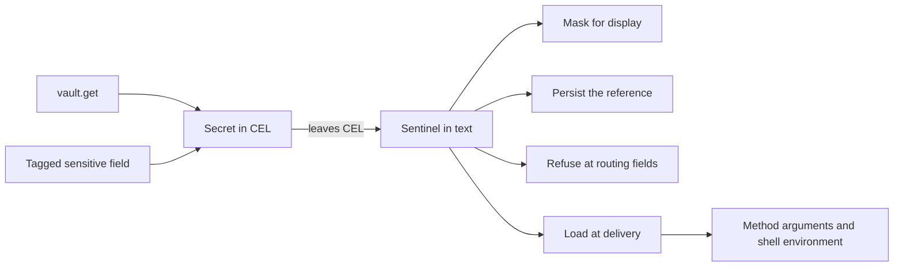

# Typed Secrets for Expressions

**Status:** implementation plan. Phase 0 and Phase 1.1 have shipped
(swamp-club#3510, swamp-club#3511, swamp-club#3512). This revision replaces the
earlier engine-2 plan, and [Why this design](#why-this-design) says what
changed. Until Phase 4 ships, [expressions](./expressions.md) describes current
behavior.

## Outcome

Inside an expression, a secret is a `Secret` value. It holds a reference to
where the secret lives, never the secret itself. Expressions can pass a secret
along, join it with text, and test it against `null`. Any other operation on a
secret fails with an error that contains no value.

Outside an expression, a secret travels as a sentinel: text that stands for the
reference. Swamp loads the plaintext only when it delivers a value to a trusted
consumer, such as a method or the shell environment. Everything swamp writes
holds the reference or a mask.

This is the current expression engine with three changes:

1. Sentinels stand for references instead of values, and loading moves to
   delivery.
2. `vault.get` and sensitive-field reads produce `Secret` values instead of a
   sentinel string or plaintext.
3. Persisted forms are built from sentinels instead of by searching text for
   known values.



## Why this design

The earlier plan ran a second expression engine beside the current one. It
loaded plaintext into CEL so that `==` and `size` could work on secrets, and it
added a new persisted codec. Those three choices needed per-repository engine
selection, a journaled migration across shared datastores, reader guards
released before any writer, a CEL-to-CEL lowering compiler, and loaded and
unloaded secret states. They made up more than half of that plan.

This plan makes none of those choices:

- No skill, design doc or example in this repository compares or measures a
  `vault.get` value. Today such a comparison runs against the sentinel text, so
  no working expression depends on it.
- With no plaintext in CEL, no CEL operation can disclose a secret. Refusing
  operations needs registered overloads, not a compiler.
- The current persisted form already stores references by path and keeps
  reference-looking data inert. Current binaries write and read it.
- Every behavior change is a refusal with a stable code, so no expression
  silently changes meaning. That includes the comparisons cel-js answers without
  calling a handler (Section 4.3) and a reference to a missing key (Section
  3.4). The change ships in place with release notes instead of as an opt-in
  engine.

## 1. Scope and success criteria

### 1.1 Security contract

The contract covers known secrets: values from `vault.get`, and fields that a
record's `_swamp.sensitiveFields` tag names.

1. Expression evaluation never holds secret plaintext. CEL source, bindings and
   results carry `Secret` values or sentinels.
2. Swamp loads plaintext only to deliver it at a boundary that Section 7.1
   allows. Each load runs under the run's vault access scope. The one other read
   is the existence probe in Section 3.4, which discards the value at once.
3. Evaluated caches, run records, run indexes, output records, reports, events,
   logs and dispatch records hold references, sentinels or masks. They never
   hold secret plaintext. Swamp decides this from the sentinel, not by searching
   for known values.
4. A field that refuses secrets rejects a secret anywhere in its value before
   any secret is loaded.
5. Swamp never puts a secret in the command text of its own `command/shell`
   invocation. That is `sh -c` on POSIX and `powershell.exe -Command` on
   Windows. Secrets reach the shell through the child environment.
6. Any operation on a secret other than passing it along, joining it with text
   or comparing it with `null` fails with a value-free error. This holds inside
   `||`, `&&`, `exists` and `all`, and for the comparisons cel-js answers
   without a handler (Section 4.3).
7. Reference-looking text that arrives as data stays data. The inert-data rule
   in [expressions](./expressions.md) is unchanged.

Remote dispatch is the one exception to items 2 and 3 until Phase 5 (Section 9).

Plaintext exists in vault storage and vault providers, in a step's loaded bag
during its delivery attempt, and in trusted consumers. The trusted consumers are
methods, pre-flight checks, `readResource` and shell child processes. Extensions
and scripts can transform, send or log what they receive, and this plan does not
sandbox them. `SecretRedactor` stays as defense in depth for their output. It
ignores values shorter than three characters, so it cannot replace the rules
above.

### 1.2 Starting point

As of the commit in the header:

- `vault.get` is not a CEL function. `resolveVaultExpressions` finds each call
  with a regular expression and reads the value into the step's
  `VaultSecretBag`. It then replaces the call with a sentinel string literal
  before CEL runs. CEL works on the sentinel, so `vault.get(...) == 'x'`
  compares the sentinel text and `size()` measures it.
- Some expression-facing accessors resolve tagged sensitive fields to plaintext
  (`resolveSensitiveVaultRefs`) and some return the stored reference text.
  Plaintext inside CEL can reach names, tags, guard results and error text.
- Keeping plaintext out of persisted files and identifiers relies on searching
  text for the values a run recorded (`RunSensitiveValues`,
  `VaultSecretBag.sentinelizeText`). Values shorter than three characters are
  never recorded. A transformed value, such as a substring, is not found.
- Remote dispatch carries plaintext in the arguments, in `secretValues` and in
  the bag entries. The baseline in swamp-club#3512 pins this path. The
  disclosures it found are tracked in swamp-club#3525 to swamp-club#3530.

### 1.3 First-release boundaries

In scope:

- String secrets from `vault.get` and from tagged sensitive fields.
- Joining secrets with text, with `+` in CEL and by template interpolation.
- Every expression-facing accessor (Section 6.1) and data query (Section 6.2).
- Local behavior runs, workflows, child workflows, resume, and the caches that
  `evaluate` writes.
- Remote dispatch of references (Phase 5).

Out of scope, each its own issue if it is needed:

- Comparing or measuring a secret in an expression. A later design can add it by
  loading at a point read.
- Non-string secrets. A sensitive output stored as JSON text keeps today's
  string-on-read behavior.
- Treating literal inputs that a schema marks sensitive as secrets. Today's
  handling of literal sensitive arguments is unchanged.
- Evaluating `vault.get` in a `forEach` iteration scope. `vault` stays a runtime
  root, so today's limitation remains. A later change can lift it, because
  `vault.get` no longer reads anything.
- Cancellation of vault provider reads, resume drift detection, and changes to
  the pre-flight check API.

`env.*` is unchanged and is not a secret source.

Other CEL environments keep their contracts. These are the extension CEL factory
(`createExtensionCelEnvironment`, `packages/testing/_cel_environment.ts`), the
grant-condition environment and the datastore config resolver. Only the internal
evaluator and the expression-facing query view register `Secret`.

## 2. Implementation decisions

| Area                       | Decision                                                                                                                                                                                                                                     |
| -------------------------- | -------------------------------------------------------------------------------------------------------------------------------------------------------------------------------------------------------------------------------------------- |
| Representation in CEL      | One registered `Secret` type. It holds a vault reference, a sensitive-field reference, or an ordered list of text and references. It never holds plaintext.                                                                                  |
| Representation outside CEL | A sentinel in text, which a `VaultSecretBag` maps to its reference. Everything else stays plain JSON.                                                                                                                                        |
| `vault.get`                | A real CEL function, `vault.get(string, string): Secret`. It reads nothing. Legacy bare-token arguments become quoted strings before parsing.                                                                                                |
| Loading                    | Only at delivery, through `VaultService.get` under the run's `RunVaultAccess`. One read per reference per attempt. An existence check keeps a missing key failing at evaluation, reading a value only when the provider has no other answer. |
| Operations                 | Passing along, concatenation and comparison with `null`. Everything else is refused, including container comparisons that cel-js answers without a handler.                                                                                  |
| Accessors                  | Every expression-facing accessor returns tagged fields as `Secret` values and reads no vault.                                                                                                                                                |
| Identifiers                | Names, tags, labels and data-name suffixes keep the `sensitive-<vault>.<key>` stand-in. Step identities keep `sensitive-<index>`. Task selectors, placement, paths, `workingDir` and environment keys refuse secrets.                        |
| Shell                      | Today's environment-variable placement for `run`. The two cases that paste a value into the command become refusals.                                                                                                                         |
| Persistence                | `sensitiveFormat: 1` and `writtenReferences`, unchanged. Entries come from sentinels.                                                                                                                                                        |
| Rollout                    | One engine, changed in place. Changes are refusals with stable codes. `validate` reports static cases early, and release notes list them all. There is no repository marker and no migration command.                                        |
| Remote                     | Phase 5. Dispatch carries sentinels and references, and the worker loads each value over the data plane.                                                                                                                                     |

## 3. Representation and loading

### 3.1 The `Secret` value

cel-js decides a value's type by exact constructor identity. `Secret` is one
class, registered with `registerType("Secret", { ctor, fields: {} })`.

A `Secret` holds one of these:

- A vault reference, which is a vault name and key, from `vault.get`.
- A sensitive-field reference, which is the vault name and key in the stored
  reference text, marked as data origin.
- A composition, which is an ordered list of text and references, from
  concatenation.

Each instance is a Proxy over a frozen, empty `Secret` object. Its state lives
in a module-private `WeakMap` keyed by the proxy. The `ownKeys` and
`getOwnPropertyDescriptor` traps throw. The `get` trap answers `constructor`,
and for `toString`, `toJSON`, `valueOf` and `Symbol.toPrimitive` it returns
functions that throw. `structuredClone` of a Proxy throws. Code that mishandles
a `Secret` therefore fails, instead of turning it into `{}` or text. Every trap
and function that throws records a fault first (Section 4.3).

Only module-owned factories create instances. Nothing recognizes a `Secret` by
its shape. If Phase 1 shows that cel-js cannot use the Proxy, the fallback is a
plain class with private fields. A macro range over a dyn secret is then empty
instead of an error, so the container rule in Section 4.3 adds comprehension
macros to the operations it covers.

### 3.2 Sentinels outside CEL

Outside CEL a secret is a sentinel, text of the form
`__SWAMP_VSEC_<prefix>_<n>__`. A `VaultSecretBag` maps each sentinel to its
reference, an encoding and a data-origin flag. Each bag draws a 128-bit random
prefix, so data cannot guess a sentinel. Today's prefix has 32 bits.

The CEL adapter converts at its boundary:

- A `Secret` that leaves CEL becomes its sentinel. A composition becomes its
  text with a sentinel for each reference.
- A string bound into CEL that holds the evaluation's sentinels becomes a
  `Secret`. This covers inputs, `self.item`, deferred parent bindings and other
  values the engine produced in an earlier pass.

The conversion runs before the adapter's own post-processing (`coerceBigInts`,
`unwrapOptional`). It also converts a `Secret` inside an Optional. No code
outside the CEL adapter sees a `Secret`. Everything else stays plain JSON, so
the existing walkers, clones and codecs need no change.

Sentinels sit only in literal text. Spliced text is never evaluated, so a
sentinel cannot end up inside an expression. A sentinel-shaped string with
another prefix is ordinary text.

### 3.3 Loading at delivery

Swamp loads a secret only when it delivers it:

- The method execution service loads the sentinels in a step's arguments once
  per attempt, before pre-flight checks. The checks and the method share that
  loaded bag as `context.vaultSecrets`.
- The shell behavior uses the loaded bag (Section 7.2).
- `readResource` keeps resolving tagged fields itself.
- Until Phase 5, the orchestrator loads a remote step's bag before dispatch.

A load calls `VaultService.get(vault, key, "expression:vault-resolve")` inside
the run's ambient `RunVaultAccess`. The principal's grants and the workflow's
`vaults:` list both apply. A sentinel is not a grant. The reserved
`_token-secrets` vault is refused, as rehydration refuses it today. A retry is a
new attempt and loads again. Each loaded value is registered with the run's
`SecretRedactor`.

A load failure fails the step before any check or method runs. The error names
the vault, the key and the authored location, never a value. Vault refresh keeps
its configured fallback to a stale value. Refresh diagnostics never include the
refresh command's stdout or stderr, or an arbitrary cause.

A step that a guard skips loads nothing.

### 3.4 Existence check

Today a reference to a missing or unauthorized key fails the run when the
expression is evaluated, because the eager read fails. Loading at delivery would
make that failure disappear wherever nothing delivers the reference, such as a
guard `vault.get('prod', 'MISSING') != null`. An existence check keeps it, and
reads no value wherever the provider can answer without one.

- **What is checked.** Every `vault.get` reference with literal arguments in the
  expression is checked before evaluation, whichever branch runs, as the eager
  read does today. References built from non-literal arguments, and
  sensitive-field references the evaluation selects from records, are recorded
  in the evaluation's ambient context. They are checked after evaluation, before
  its result is used. A guard result is used only after its references pass.
- **How.** The check runs under the run's `RunVaultAccess` and authorizes `read`
  on the vault and key, as a load would. It then asks the provider, in order:
  1. A provider that implements the optional `VaultExistenceProvider.has(key)`
     answers directly, and its answer is final.
  2. Otherwise a key that `list()` returns exists. `list()` returns key names
     only. Its absence proves nothing, because the provider contract does not
     tie `get` to `list`: a provider can accept key forms it does not list, page
     or truncate its listing, or not support listing at all.
  3. A key that `list()` does not return, or a provider whose `list()` fails,
     gets one keyed `get`, as the eager read does today. The probe registers the
     value with the run's `SecretRedactor` and drops it. The value never enters
     a bag, CEL or a delivery.

  Results are cached for the run, per reference and per listed vault, so a vault
  is listed at most once per run. A key removed later fails at load.
- **Failure.** A missing key fails with `secret_reference_unavailable`, naming
  the vault, the key and the authored location. An unauthorized key fails with
  the access error a load would raise. A probe that fails fails the step with
  the provider's error, exactly as the eager read does today. A key fails the
  check only where the eager read would have failed it.

Every CEL entry point runs the check, including `swamp behavior evaluate` and
`swamp workflow evaluate`, so they still report a missing or unauthorized key.
Phase 2 adds `has` to every built-in provider that can answer it without reading
a value, so probes are left to extension providers and to keys their listing
omits.

## 4. CEL semantics

### 4.1 Required runtime behavior

Let `S` be a `Secret`, single or composed.

| Operation                                                                          | Result                                                |
| ---------------------------------------------------------------------------------- | ----------------------------------------------------- |
| `S + string`, `string + S`, `S + S`, template interpolation                        | A composed `Secret`                                   |
| A list or map that holds `S`, and field selection on an ordinary container         | Structure and leaves kept                             |
| `S == null`, `null == S` and their `!=` forms                                      | `false` for `==`, `true` for `!=`                     |
| `S == x`, `x == S` and `!=` for any other `x`, including two secrets               | Refused                                               |
| `size`, conversions such as `int` and `string`, string functions, `matches` on `S` | Refused                                               |
| `S` as a map key, a macro range, a `data.query` predicate or a regex pattern       | Refused                                               |
| A container that holds `S`, interpolated into text                                 | Refused. Pass the container as a structured argument. |
| `type(S)`                                                                          | `Secret`                                              |
| `has(S.x)`, `S.?x`                                                                 | No field is exposed                                   |
| `S in list`, list or map equality with a secret element                            | Refused (Section 4.3, item 5)                         |

A `Secret` exists only where a field holds a stored reference, so it is never
`null`. Comparing it with `null` needs no value and loads nothing. A tagged
field that is null stays null (Section 6.1). A presence check such as
`data.latest('db', 'main').attributes.password != null` therefore gives today's
answer, and so does `has()` on the record.

A refusal happens when the operation runs, so an unselected branch refuses
nothing. `vault.get` reads nothing, so evaluation order and branch selection
cannot change what is loaded.

### 4.2 Dependency facts that determine the design

The Phase 1.1 suite pins these facts about cel-js 7.6.1
(`src/infrastructure/cel/cel_js_pins/`). A dependency upgrade must pass it.

1. Async custom function inputs are awaited. Derived `!=`, container `isEqual`,
   and `listIncludes` consume equality-handler returns synchronously, and a
   rejecting async handler can leave unobserved promises. Equality handlers must
   therefore be synchronous. A getter that returns a Promise reaches member
   access as an unsupported value.
2. Container equality and membership short-circuit on identity and type, and
   never call a `Secret == string` overload for their elements. Direct dyn
   equality with no matching overload falls back to identity without calling any
   handler. A fault that only handlers record cannot see either case.
3. A missing-overload error at run time, or an error a handler throws, is
   absorbed by `||`, `&&`, `exists` or `all` when the other operand decides the
   result. A statically detectable type error, and an error while building a
   macro's range, are not absorbed.
4. `==` creates derived `!=` and mirrored mixed-type equality, so register `==`
   only. A `Secret == dyn` overload overlaps its own mirror when both operands
   are secrets. Addition is not mirrored, so each operand order needs its own
   registration. The `map` type alias is valid in custom signatures, but a
   parameterized type spelled with a comma is not. Overlapping built-in list and
   map registrations are not a reliable override. A custom binary overload marks
   every use of its operator maybe-async, and so does a function registered
   without `{ async: false }`.
5. cel-js decides a value's type by exact constructor identity. `fields: {}`
   hides fields from selection, indexing, `has()` and `.?`. Comprehension macros
   fall back to `Object.keys`, so a dyn value whose state is private yields an
   empty range instead of an error. A statically typed custom variable is not a
   comprehension range.
6. `cel.bind(v, vault, v.get(...))` can call a registered receiver through an
   alias. Receiver typing does not enforce scope or effect restrictions.
7. Parsed programs contain mutable checker and comprehension state. Successful
   concurrent examples are evidence for a test case, not a concurrency contract.
8. `size(string)` counts code points. Ordinary `matches` uses JavaScript RegExp.

How they shape the design:

- Refusing handlers are synchronous, and no getter returns a Promise (fact 1).
- No handler sees a container comparison, so an expression-level rule refuses
  them (fact 2, Section 4.3 item 5).
- A refusal records a fault, so absorption cannot hide it (fact 3).
- Overloads follow the registration rules, and synchronous entry points must
  stay synchronous with them in place (fact 4).
- The Proxy turns a macro range over a secret into an error (fact 5).
- Aliasing `vault` is harmless, because `vault.get` reads nothing (fact 6).
- The design adds no state to shared programs (fact 7).
- Fact 8 no longer affects the design. Its pin stays as an upgrade alarm.

### 4.3 Refusal

Refusal uses registrations. It does not rewrite expressions.

1. **Run time.** The internal environment registers a refusing overload for
   `Secret` on every built-in operator, function and conversion that accepts a
   string or a dyn value. Every overload is synchronous, and functions use
   `{ async: false }`. Equality is one refusing `Secret == T` overload for each
   type cel-js can name in a signature, `Secret` among them, and a
   `Secret == null` overload that answers `false`. `!=` and the mirrored operand
   order come from each (fact 4). A single `Secret == dyn` cannot serve, because
   it overlaps its own mirror when both operands are secrets (fact 4).
2. **Absorption.** Every refusing overload, and every throwing trap in Section
   3.1, records a fault in the evaluation's ambient context before it throws.
   The evaluator enters that context with `AsyncLocalStorage`, as
   `RunVaultAccess` does. A recorded fault fails the evaluation even when `||`,
   `&&`, `exists` or `all` absorbed the error.
3. **Macros.** Building a macro range over a `Secret` calls its `ownKeys` trap,
   which throws. cel-js does not absorb range errors.
4. **Before a run.** `vault.get` has the static return type `Secret`.
   `swamp behavior validate` and `swamp workflow validate` type-check
   expressions in the same environment, with a `Secret == null` overload in
   place of the refusing ones. A comparison with `null` passes there, and any
   other operation on a `vault.get` result is a check-time error. Secrets from
   records are dyn values, so their misuse shows up only at run time.
5. **Containers.** cel-js answers `in` and list or map equality without calling
   any handler (fact 2). They cannot reveal a value, because a `Secret` holds
   none, but they would answer by identity: a guard
   `data.latest('db', 'main').attributes.password in ['', 'changeme']` would
   become always false. An expression-level rule refuses them instead:
   - Before evaluation, the evaluator scans the parsed expression for a
     container comparison: an `in`, or an `==` or `!=` with no operand that is a
     scalar literal or `null`. A scalar compared with a container is `false`
     today and after, so it needs no rule.
   - During evaluation, the fault context records each `Secret` that enters it:
     from `vault.get`, from a binding, or when CEL reads it out of a record,
     list or map. The accessor adapter (Section 6.1) and the boundary conversion
     put each secret-valued property and element behind a getter that records
     it. Selecting another field records nothing, and neither does map key
     membership, which never reads values.
   - An evaluation that has a container comparison and records a `Secret` fails
     with `secret_operation_unsupported`, after any absorption.

   The rule over-refuses. `vault.get('v', 'k') != null && self.item in ['a']`
   fails, although the secret never reaches `in`. The refusal is loud and names
   the expression. Moving the comparison into its own expression, such as an
   input, avoids it. A later change can narrow the rule if cel-js gains a
   container-equality hook.

A fitness test lists the internal environment's built-in operators, functions
and conversions. It fails when one that accepts a string or a dyn value has no
`Secret` refusal, so a built-in that a dependency upgrade adds needs a decision.
Phase 1 decides whether the list comes from cel-js or from a maintained list
pinned against the dependency. For `==`, the type list is maintained, because
cel-js does not export its type table.

### 4.4 `vault.get`

`vault` is a receiver type with one method, `get(string, string): Secret`. The
method builds a reference and reads nothing. Section 3.4 checks that the key
exists.

Arguments are ordinary CEL, and a `Secret` argument is refused. Before parsing,
the template scanner rewrites legacy bare-token arguments into quoted strings.
It rewrites only tokens that today's grammar reads as literal names, which are
those `isDynamicVaultArgument` rejects. `vault.get(my-vault, KEY)` keeps
working, and `prod-vault` is never parsed as subtraction. A bare token with a
`.` is already CEL.

This retires the regular-expression rewrite (`resolveVaultExpressions`,
`findVaultGetCalls`). It also retires the rule that refuses any other read of
the `vault` namespace (`assertNoUnresolvedVault`).

## 5. Evaluation passes

The pass structure is unchanged. Each pass evaluates the expressions it can,
splices the results into text, and leaves the rest for a later pass. `vault` and
`env` stay runtime roots.

- A result that holds a `Secret` leaves CEL as a sentinel. A partly evaluated
  string carries the sentinel to the next pass, as it carries a sentinel today.
- Values bound into CEL turn their sentinels back into `Secret` values. A later
  expression that reads `inputs.x` or `self.item` sees a `Secret`, not sentinel
  text.
- A guard or assert predicate whose result holds a secret is refused. A secret
  in an assert message is masked.
- A `forEach` collection may hold secrets. Each item binds as a `Secret`. A
  secret in a step identity becomes `sensitive-<index>`, as today.
- Child workflows keep today's deferred parent bindings. A value that crosses
  into another run carries its references, and that run issues its own
  sentinels.
- Every CEL entry point converts at the boundary. These are the run-start, step
  and runtime passes, `forEach` expansion and step names, guards, asserts,
  `swamp behavior evaluate`, `swamp workflow evaluate` and validation.

The run-start pass reads data for steps that a guard may later skip. Those reads
now return references and load nothing.

## 6. Sensitive data and arguments

### 6.1 Structured accessors

One adapter turns the tagged fields of a trusted data record into `Secret`
values. The tag is `_swamp.sensitiveFields`, either `"*"` or a list of
dot-paths. Every expression-facing accessor uses the adapter:

- `data.latest` and `data.version`, in own-namespace, wildcard and
  cross-namespace forms.
- `findBySpec`, `findByTag`, and `data.query` records and projections.
- Live and reconstructed `steps.<name>.outputs`, child outputs a parent can see,
  and `model.<name>.resource`.

The adapter replaces the expression-facing calls to `resolveSensitiveVaultRefs`.
It reads no vault, so the synchronous property views can use it. For JSON
resources `.content` and `.attributes` are the same object and carry the same
`Secret` values.

An absent tag means no sensitive fields. Some records fail with
`secret_reference_invalid` before they reach CEL. That happens for a malformed
tag, an unsafe path, or a tagged non-null value that is not a stored reference.
A stored reference is the anchored text `${{ vault.get('v', 'k') }}`. A tagged
value that is absent or null stays that way. Reference-looking text outside a
tagged path stays ordinary text.

Extension `readResource` is a trusted plaintext API. It keeps resolving tagged
fields, including the legacy resource-schema fallback for untagged records.
Expression-facing accessors add no fallback. The accessors live in
`src/domain/expressions/model_resolver.ts`,
`src/domain/data/data_record_mapper.ts` and
`src/domain/workflows/step_output_resolver.ts`.

### 6.2 Expression-facing queries

`DataQueryService` evaluates predicates and projections in its own synchronous
CEL environment. The expression-facing query view registers `Secret` there with
the same refusals. It wraps tagged attributes before any predicate or projection
runs, because wrapping only the returned value is not enough.

A predicate cannot operate on a secret. A projection can return a `Secret` or a
container of them. The view returns them to the calling expression without
cloning them.

Errors propagate. Query filtering must not turn a refusal or a malformed
reference into `false`, a missing row or `null`. The raw `swamp data query`
command keeps returning stored reference text. Raw content of non-JSON resources
and files is unchanged.

### 6.3 Method arguments and checks

At the execution boundary the method execution service does three things:

1. It refuses a secret anywhere in a field marked
   `.meta({ secrets: "refuse" })`, across the merged global and method
   arguments. The new metadata sits beside `sensitive`, and the walker that
   reads `sensitive` reads it too (`findValuesWithMetadata`). A field marked
   both `sensitive` and `refuse` is a schema error.
2. It loads the step's sentinels for the attempt (Section 3.3).
3. It resolves sentinels in method and global arguments, then merges and
   validates them as today. Global arguments with unresolved expressions stay
   excluded.

Pre-flight checks run on the orchestrator before a local method. They receive
resolved `globalArgs`, and method arguments with sentinels in
`unresolvedMethodArgs`, as [behaviors](../primitives/behaviors.md) documents.
Checks stay skipped for remote placement.

The existing refusal to save literal sensitive global arguments is unchanged.
The boundary lives in `src/domain/models/method_execution_service.ts`.

## 7. Destinations and shell behavior

### 7.1 Destination contract

| Destination                                                                            | Policy                                                                                                                                               |
| -------------------------------------------------------------------------------------- | ---------------------------------------------------------------------------------------------------------------------------------------------------- |
| Method arguments, `context.globalArgs`, orchestrator pre-flight checks, `readResource` | Plaintext at the trusted extension boundary, loaded at delivery. Checks see method arguments with sentinels, as today.                               |
| Shell `env` values                                                                     | Plaintext in the child environment. A value with an embedded NUL is refused without echoing it.                                                      |
| Shell `run`, `workingDir`, environment keys                                            | `run` keeps environment-variable placement (Section 7.2). `workingDir` and environment keys refuse secrets.                                          |
| Other fields with `.meta({ secrets: "refuse" })`                                       | Refuse a secret anywhere in the value.                                                                                                               |
| Tags, labels, names, data-name suffixes, task selectors, placement, paths              | Tags, labels, names and data-name suffixes get the `sensitive-<vault>.<key>` stand-in, as today. Task selectors, placement and paths refuse secrets. |
| Guards/assert predicates                                                               | A result that holds a secret is refused.                                                                                                             |
| Assert messages, logs, reports, previews, history, telemetry, events                   | Sentinels are masked as `***`. Errors carry no value. Output redaction stays.                                                                        |
| Evaluated caches, run records, run index, pending scopes                               | The persisted form in Section 8.1.                                                                                                                   |
| Auto-definitions                                                                       | Each sentinel is written as its reference text.                                                                                                      |
| Lease, pending-dispatch, and worker records; serve audit; `run_tracker` payloads       | References and masks only. Error strings are masked.                                                                                                 |
| Protected worker delivery                                                              | Plaintext only in worker memory, for the current dispatch attempt (Phase 5).                                                                         |

Keep one implementation per destination family, shared by the CLI, libswamp,
workflows, serve and workers. Beyond the caches and run records, the sinks found
at review time are these: the `step_skipped` event and debug log (raw
`guardResult`), `stepRun.error` and `assertResult`, `failureReason`,
`.runs-index.json` (`inputs`, `tags`, `failureReason`), `outputs/*.yaml`
(`error`), the step-lease `error` (the worker's unredacted `result.error`), the
worker's debug log of runner stderr, `run_tracker.db` pending-run payloads,
control-plane wait records, `_catalog.db` tags, the serve audit WAL and store at
each detail level, the CLI command audit, and on v3 every record's copy in
`commits.db` and `_blobs/`. The checked-in inventory,
integration/secret_sink_inventory.json, is the list every phase gate is measured
against. Its rules test fails when this section or the code names a destination
the inventory lacks.

### 7.2 Shell

The shell behavior has two strategies: POSIX `sh -c` and Windows PowerShell 5.1
`powershell.exe -NoProfile -Command`. `run` keeps today's placement. Each
sentinel in `run` becomes a double-quoted environment-variable reference,
`"${__SWAMP_VAULT_N}"` on POSIX and `"$env:__SWAMP_VAULT_N"` on PowerShell. The
loaded value goes in the child environment. Generated names must not collide
with authored environment keys.

Today two cases paste a value into the command, with a warning event. One is a
data-origin value inside a here-document with a quoted delimiter. The other is
any value inside PowerShell single quotes. Both become refusals. A `vault.get`
inside POSIX single quotes keeps today's behavior: the reference stays literal
and a warning is emitted.

`workingDir` carries `.meta({ secrets: "refuse" })`, and the shell behavior
refuses a secret in an environment key. Swamp supplies secrets only through the
environment. A script that traces, prints, or passes a value into another
program's arguments is responsible for that. Examples should use a tool's own
environment or stdin credential interface:

```yaml
methods:
  execute:
    arguments:
      env:
        PGPASSWORD: ${{ vault.get('prod', 'DB_PASS') }}
      run: psql --host=db --username=app --dbname=app --command='select 1'
```

Placement uses the existing quote-context scanner: `resolveForShell`,
`resolveForPowerShell`, `classifyShellPositions` and `getQuoteContext` in
`src/domain/vaults/`.

## 8. Persistence and resume

### 8.1 Persisted form

The persisted form is unchanged: `sensitiveFormat: 1` and its
`writtenReferences` list. Each entry names a path, an occurrence, a vault and
key, an encoding and a data-origin flag
(`src/domain/secrets/persisted_sensitive_form.ts`).

What changes is where entries come from. `toPersistedForm` replaces each
sentinel with its reference text, `${{ vault.get('v', 'k') }}`, and takes the
entry from the bag. It no longer searches for recorded values.
`rehydratePersistedForm` issues a sentinel in a new bag for each entry and no
longer reads the vault. Reference text that no entry names stays inert data.

New writes produce `raw` entries. Entries in existing files keep their encoding,
and delivery applies it. `json` escapes the value. `number` and `boolean`
restore the scalar, or fail when the vault now holds something else.

Current binaries write and read this format. No reader guard has to ship first,
and the format version does not change.

### 8.2 Durable state and current values

Persisted runs hold references. Vault values can rotate, and sensitive-output
keys can be reused. Resume, retry and `--last-evaluated` load current values
under current authorization. Completed steps are not rerun to reproduce an old
value.

Every persisted copy uses the persisted form. That covers evaluated caches, run
records, the run index, output records, the data catalog and control-plane
records. On v3 it also covers the commit log, blobs and read model. Environment
values stay out of evaluated caches, as today.

## 9. Serve and workers

Until Phase 5, remote dispatch keeps today's protocol. The orchestrator loads
the step's bag and ships its entries with the resolved arguments. For runs that
serve executes itself, serve audit follows Section 7.1 from Phase 3.

Phase 5 removes plaintext from dispatch:

- Dispatch carries the arguments with sentinels in place. Its bag entries carry
  a reference, an encoding and a data-origin flag. It carries no `secretValues`,
  no entry values and no resolved arguments. Step leases, pending-dispatch
  records, the bootstrap stdin frame and control frames carry no plaintext.
- The runner loads each reference through a protected data-plane POST route,
  authenticated with the per-dispatch credential. Serve answers only for
  references in that dispatch's bag. It answers under the dispatching run's
  `RunVaultAccess`, and only while the attempt holds its lease. Completion,
  revocation, reassignment and expiry end access, including for reads in flight.
  Replies carry `Cache-Control: no-store`. Serve audit records only metadata for
  this route, at every detail level.
- The worker builds the loaded bag in memory and runs the step through the same
  method execution service as a local run. Arguments are merged and validated
  once, on the worker.
- `REMOTE_PROTOCOL_VERSION` goes up by one. Enrollment and dispatch already
  require an exact match, so serve and workers upgrade together.
- The dispatch's own bag becomes the allowlist. A dynamic reference no longer
  turns the allowlist off, and a workflow step's references reach serve
  unresolved. This resolves swamp-club#3529.
- `readResource` keeps its own authorization and uses the same route for tagged
  fields.

Redaction stays after the trusted boundary. Worker result errors and runner
stderr are sanitized before they reach logs or lease records. Off loopback,
serve keeps requiring TLS and an auth mode (`assertOffLoopbackSecurity`).

## 10. Compatibility and rollout

### 10.1 What changes for users

There is one expression engine, changed in place. No repository marker selects
it, and there is no migration command. Every behavior change is a refusal with a
stable code, so no expression silently changes meaning.

| Expression or value                                                                 | Today                                                         | After                                                                             |
| ----------------------------------------------------------------------------------- | ------------------------------------------------------------- | --------------------------------------------------------------------------------- |
| `==`, `size`, a conversion or a string function on a `vault.get` result             | Works on the sentinel text, or fails                          | `validate` reports a type error. A run fails with `secret_operation_unsupported`. |
| The same operations on a tagged sensitive field                                     | Work on plaintext                                             | `secret_operation_unsupported`                                                    |
| A container that holds a secret, interpolated into text                             | Delivered inside the JSON text                                | `secret_operation_unsupported`                                                    |
| A secret in a task selector, placement value, path, `workingDir` or environment key | Used as plaintext                                             | `secret_destination_refused`                                                      |
| A guard or assert predicate whose result holds a secret                             | Truthiness of plaintext or sentinel text                      | `secret_destination_refused`                                                      |
| A value in a quoted here-document or in PowerShell single quotes                    | Pasted into the command, with a warning                       | `secret_destination_refused`                                                      |
| A malformed sensitive-fields tag or stored reference                                | Treated as absent, or left as text                            | `secret_reference_invalid`                                                        |
| List or map equality, or `in`, in an expression that reads a secret                 | Compares plaintext or sentinel text, or works                 | `secret_operation_unsupported`, even when the secret is not an operand            |
| `vault.get` of a missing key, in an expression whose result nothing delivers        | The eager read fails the run                                  | `secret_reference_unavailable` (Section 3.4)                                      |
| A secret in a name, tag, label or data-name suffix                                  | The `sensitive-<vault>.<key>` stand-in, found by value search | The same stand-in, taken from the sentinel                                        |
| `== null` or `!= null` on a secret                                                  | Works                                                         | Unchanged                                                                         |
| `vault.get(my-vault, KEY)`                                                          | Literal names                                                 | Unchanged                                                                         |

The extension API does not change (Section 6.3). `context.vaultSecrets` holds
the loaded bag.

### 10.2 Diagnostics

`swamp behavior validate` and `swamp workflow validate` report static misuse.
That covers a type error on a `vault.get` result, and a container comparison in
an expression that calls `vault.get`. Findings name the file, the expression
location and the code, never a value. Dynamic misuse fails at run time with the
same codes. No new doctor command is needed.

### 10.3 Release

Phases 3 and 4 are built behind an internal option that only tests set. The
release that ends Phase 4 turns the new path on for every entry point and
removes the option. Its release notes carry the table in Section 10.1. Phases 2
and 5 ship on their own.

## 11. Delivery phases

Phases are dependency gates, not estimates. Each is one or more reviewable PRs
with their own tests. A phase is done when its exit criteria pass and the
inventory entries it gates are clean. Phase 5 depends only on Phase 2, so it can
proceed alongside Phases 3 and 4.

### Phase 0: baseline (shipped)

- The sink inventory and the allowed-boundary canary tests (swamp-club#3511).
  The prohibited-sink scans for the current engine run black-box in swamp-uat.
  Each baseline exception there names the phase that removes it.
- The remote secret-path baseline (swamp-club#3512,
  `integration/remote_secrets_baseline_*`). It runs in this repository because
  its sinks sit between serve, the worker supervisor and the runner, where a
  black-box scan cannot separate the hops. It is in-process apart from one
  supervisor test that spawns a runner fixture, not the CLI. It pins current
  behavior for Phase 5 and is not a zero-plaintext gate. Each disclosure it pins
  has its own issue.

### Phase 1: CEL feasibility on the pinned dependency

Phase 1.1 (swamp-club#3510, shipped) pins the facts in Section 4.2.

Phase 1.2 pins what this design relies on:

- cel-js recognizes the Proxy-based `Secret` by its constructor. Building a
  macro range over it fails, and the failure is not absorbed.
- The refusing overload set covers every built-in that accepts a string or a dyn
  value, including `==` between two secrets. The `==` overloads name every type
  cel-js accepts in a signature and answer a comparison with `null` in both
  operand orders. Adding `Secret == Secret` beside `Secret == dyn` does not
  remove the overlap, so the enumerated set is the only shape.
- A fault recorded in the ambient context survives absorption by `||`, `&&`,
  `exists` and `all`, across asynchronous evaluation.
- Synchronous entry points still return synchronous results with the `Secret`
  registrations in place.
- `vault.get`, with the static return type `Secret`, gives check-time errors in
  the validation environment, except for a comparison with `null`.
- The container rule in Section 4.3 refuses every case the fact 2 pins answer by
  identity. cel-js reads a record field, a list element and a map value through
  ordinary property access, so a getter records the secret on selection and on
  container traversal, and not on map key membership or on selecting another
  field.

**Exit:** each refusal is observed, or the fallback in Section 3.1 is recorded
with the container rule covering macros.

### Phase 2: sentinels hold references

- `VaultSecretBag` entries hold a reference, an encoding and a data-origin flag.
  A load step fills values at delivery (Section 3.3).
- `resolveVaultExpressions` issues a sentinel for the reference and stops
  reading the vault. Data-origin sentinels record the source that
  `RunSensitiveValues` already holds for each value.
- The existence check (Section 3.4) for every reference
  `resolveVaultExpressions` finds, with `VaultExistenceProvider` and `has` on
  each built-in provider that can answer without reading a value. It ships with
  this phase because this phase stops the eager read.
- The sentinel prefix grows to 128 random bits.
- `toPersistedForm` takes entries from sentinels. The value search stays only
  for plaintext that data reads still bring into CEL.
- Until Phase 5, the orchestrator loads the bag before a remote dispatch.

**Exit:** no bag holds plaintext before delivery. A counting vault sees one read
per reference per attempt. A step that a guard skips makes no `vault.get` read.
A missing or unauthorized key fails at evaluation exactly where the eager read
failed it, and a key the eager read resolved never fails the check. A key that
`has` or a listing confirms is checked with no value read. Refresh diagnostics
carry no value. Existing suites pass unchanged.

### Phase 3: local behavior execution

Behind the internal option:

- The `Secret` type, the boundary conversion, the refusals, the container rule
  and the fault context.
- The existence check for references from non-literal arguments and from
  selected sensitive fields.
- `vault.get` as a CEL function, with bare-token rewriting. It replaces the
  regular-expression rewrite on this path.
- The accessor adapter for `data.*` and `model.*.resource`.
- `.meta({ secrets: "refuse" })`, the identifier stand-ins and refusals, and the
  shell refusals.
- Masking in reports, events, logs and errors.
- `swamp behavior evaluate` writes its cache through the boundary conversion.
- The `validate` diagnostics.

**Exit:** trusted local consumers receive the exact value of every canary class.
Every Phase 3 entry in the inventory stays clean. Refusals happen before any
load. Non-secret behavior is unchanged.

### Phase 4: workflows, queries and resume

- Sentinels across passes, bindings into CEL, guards and asserts, `forEach`
  items and identities, and child workflow bindings.
- Live and reconstructed `steps.*.outputs` and child outputs through the
  adapter.
- The query view (Section 6.2).
- Resume, retry and `--last-evaluated` through `rehydratePersistedForm`, which
  stops reading the vault. `swamp workflow evaluate` writes its cache through
  the boundary conversion.
- Masking in run events, run records and the run index.

Then turn the path on for every entry point and remove the internal option.
Delete the regular-expression rewrite, the value search, and the
expression-facing plaintext resolution of tagged fields.

**Exit:** every Phase 4 entry in the inventory stays clean for live, resumed,
child, cross-namespace, set-read and projected data. A step that a guard skips
makes no vault read. Resume loads current values and reruns no completed step.

### Phase 5: remote references

Implement Section 9. Update [remote-execution](./remote-execution.md), and the
remote baseline tests, which change on purpose. Then delete the plaintext
dispatch fields.

**Exit:** dispatch and control frames, the runner bootstrap, lease records, logs
and failure files hold no plaintext. Only the protected data-plane replies and
trusted consumers carry it. Protocol mismatches fail at enrollment and dispatch.
Revoked, reassigned, expired and forged credentials cannot read a value.
swamp-uat passes on the supported OS and shell targets with matching serve and
worker versions.

## 12. Verification strategy

### 12.1 Test matrix

| Suite                   | Evidence                                                                                                                                                                                                                                                                  |
| ----------------------- | ------------------------------------------------------------------------------------------------------------------------------------------------------------------------------------------------------------------------------------------------------------------------- |
| CEL conformance         | Every exposed operator, function and macro class on single and composed secrets. Both operand orders, nesting, selected and unselected branches, and absorption. Each container comparison the fact 2 pins list, and the over-refusal case in Section 4.3.                |
| Value properties        | Composition, the boundary conversion round trip, Optional, failing clone and stringify, and sentinel uniqueness.                                                                                                                                                          |
| Access and loading      | Principal grants, the workflow `vaults:` list, one read per reference per attempt, refresh, retry and rotation. The existence check through `has`, a listed key, an unlisted key that `get` resolves, and a failing `list()`, with reads counted and no value in any bag. |
| Accessor integration    | Full records, selected scalars, nested lists and maps, wildcard and cross-namespace reads, set reads, live and reconstructed outputs, child outputs and malformed tags.                                                                                                   |
| Delivery integration    | Exact method, check and shell inputs on both shell strategies, refusals before any load, and both output modes.                                                                                                                                                           |
| Persistence             | Every cache, run, index, output and checkpoint seam round-trips through `writtenReferences`. Existing files read back.                                                                                                                                                    |
| Characterization corpus | Non-secret behavior is unchanged. Each row in Section 10.1 has an expected result.                                                                                                                                                                                        |
| Architecture fitness    | The sink inventory rules, the refusal coverage test in Section 4.3, and no `Secret` import outside the CEL adapter, the accessor adapter and the query view.                                                                                                              |
| swamp-uat               | Compiled-binary journeys, prohibited-sink scans, shell platforms and protocol mismatch.                                                                                                                                                                                   |

### 12.2 Canary oracle

Canaries are synthetic secrets, fresh for each run
(`integration/canary_values.ts`). The classes are: empty, one character, two
characters, one astral character (two UTF-16 code units), BMP Unicode, astral
Unicode, quotes, a backslash, LF and CRLF newlines, reference-shaped text,
sentinel-shaped text, placeholder-shaped text, and text equal to the mask.

Check exact delivery at every allowed boundary. Scan every prohibited sink in
the inventory, including the configured datastore and temporary execution
locations, not only the local `.swamp/` directory. Look for escaped and encoded
forms wherever an operation could produce them, because a missing whole canary
alone is not enough. Assert vault read counts and zero deliveries at refusing
destinations. Refusals before load make zero reads. Vault storage, protected
data-plane traffic and trusted consumers are left out of the zero-plaintext
scan. Test their authorization and lifetime instead.

Prohibited-sink scans run black-box against the compiled binary in swamp-uat.
Allowed boundaries and protected traffic are tested in-process here, as is the
remote baseline from Phase 0. A current-engine baseline exception never waives a
later gate.

### 12.3 Repository conventions

Unit tests stay in-process beside their source. Integration tests wire real
components with temporary storage, and port-0 servers for infrastructure
adapters. Use `withMockedCommand`, `withMockedFetch`, `withMockedEnv` and
`waitFor`. Tests in this repository spawn no CLI subprocesses and change no
process-wide environment. CLI acceptance belongs in swamp-uat. Test
interruptions with injected barriers, not sleeps. Before each PR, run the
verification workflows in `agent-constraints/verification-conventions.md`.

## 13. Source map

| Concern                              | Current implementation                                                                                                                                                                                                           |
| ------------------------------------ | -------------------------------------------------------------------------------------------------------------------------------------------------------------------------------------------------------------------------------- |
| CEL environments and coercion        | `src/infrastructure/cel/cel_evaluator.ts`, `src/domain/expressions/cel_grammar.ts`, `cel_runtime.ts`                                                                                                                             |
| Pinned cel-js behavior (Section 4.2) | `src/infrastructure/cel/cel_js_pins/`                                                                                                                                                                                            |
| Expression passes and templates      | `src/domain/expressions/expression_evaluation_service.ts`, `available_expression_resolver.ts`, `definition_expression_pass.ts`, `expression_parser.ts`, `expression_scanner.ts`, `src/domain/workflows/expression_evaluators.ts` |
| Vault rewrite and dynamic arguments  | `src/domain/expressions/model_resolver.ts` (`resolveVaultExpressions`), `vault_reference_extractor.ts`                                                                                                                           |
| Sentinels and shell placement        | `src/domain/vaults/vault_secret_bag.ts`, `shell_context_scanner.ts`, `src/domain/models/command/shell/shell_model.ts`                                                                                                            |
| Vault access scope                   | `src/domain/vaults/run_vault_access.ts`, `vault_service.ts`                                                                                                                                                                      |
| Sensitive values and persisted form  | `src/domain/secrets/run_sensitive_values.ts`, `persisted_sensitive_form.ts`, `secret_redactor.ts`, `src/domain/expressions/persisted_evaluation.ts`, `src/domain/workflows/persisted_workflow.ts`                                |
| Sensitive fields and schema metadata | `src/domain/models/data_writer.ts`, `zod_field_metadata.ts`, `sensitive_output_vault.ts`, `src/domain/data/data_record_mapper.ts`, `src/domain/workflows/step_output_resolver.ts`                                                |
| Queries                              | `src/domain/data/data_query_service.ts`                                                                                                                                                                                          |
| Method boundary and checks           | `src/domain/models/method_execution_service.ts`, `method_context.ts`, `model.ts`                                                                                                                                                 |
| Workflow execution and forEach       | `src/domain/workflows/execution_service.ts`, `for_each_expansion_service.ts`, `src/libswamp/workflows/evaluate.ts`                                                                                                               |
| Remote execution                     | `src/domain/remote/protocol.ts`, `src/serve/dispatch_service.ts`, `src/serve/data_plane.ts`, `src/worker/remote_method_context.ts`                                                                                               |
| Sink inventory and canaries          | `integration/secret_sink_inventory.json`, `secret_sink_inventory_rules_test.ts`, `canary_values.ts`, `secret_canary_boundaries_test.ts`                                                                                          |
| Remote baseline                      | `integration/remote_secrets_baseline_harness.ts`, `remote_secrets_baseline_*_test.ts`                                                                                                                                            |

Implementation PRs update this map as they add seams.
