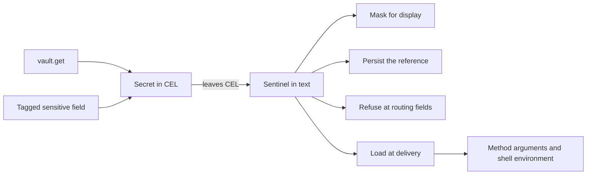

# Typed Secrets for Expressions

**Status:** implementation plan. Phases 0, 1 and 2 have shipped
(swamp-club#3510, swamp-club#3511, swamp-club#3512, swamp-club#3551,
swamp-club#3557, swamp-club#3558, swamp-club#3562), and Phases 3.1 to 3.4
(swamp-club#3619, swamp-club#3625, swamp-club#3626, swamp-club#3627) behind
the internal option. This revision replaces the earlier engine-2 plan, and
[Why this design](#why-this-design) says what changed. Until Phase 4 ships,
[expressions](./expressions.md) describes current behavior.

## Outcome

Inside an expression, a secret is a `Secret` value. It holds a reference to
where the secret lives, never the secret itself. Expressions can pass a secret
along, join it with text, and test it against `null`. Any other operation on a
secret fails with an error that contains no value.

Outside an expression, a secret travels as a sentinel: text that stands for the
reference. Swamp loads the plaintext only when it delivers a value to a trusted
consumer, such as a method or the shell environment. Everything swamp writes
holds the reference or a mask.

This is the current expression engine with three changes:

1. Sentinels stand for references instead of values, and loading moves to
   delivery.
2. `vault.get` and sensitive-field reads produce `Secret` values instead of a
   sentinel string or plaintext.
3. Persisted forms are built from sentinels instead of by searching text for
   known values.



## Why this design

The earlier plan ran a second expression engine beside the current one. It
loaded plaintext into CEL so that `==` and `size` could work on secrets, and it
added a new persisted codec. Those three choices needed per-repository engine
selection, a journaled migration across shared datastores, reader guards
released before any writer, a CEL-to-CEL lowering compiler, and loaded and
unloaded secret states. They made up more than half of that plan.

This plan makes none of those choices:

- No skill, design doc or example in this repository compares or measures a
  `vault.get` value. Today such a comparison runs against the sentinel text, so
  no working expression depends on it.
- With no plaintext in CEL, no CEL operation can disclose a secret. Refusing
  operations needs registered overloads, not a compiler.
- The current persisted form already stores references by path and keeps
  reference-looking data inert. Current binaries write and read it.
- Every change to how an expression evaluates is a refusal with a stable code,
  so no expression silently changes meaning. That includes the comparisons
  cel-js answers without calling a handler (Section 4.3) and a reference to a
  missing key (Section 3.4). The change ships in place with release notes
  instead of as an opt-in engine.

## 1. Scope and success criteria

### 1.1 Security contract

The contract covers known secrets: values from `vault.get`, and fields that a
record's `_swamp.sensitiveFields` tag names.

1. Expression evaluation never holds secret plaintext. CEL source, bindings and
   results carry `Secret` values or sentinels.
2. Swamp loads plaintext only to deliver it at a boundary that Section 7.1
   allows. Each load runs under the run's vault access scope. The one other read
   is the existence probe in Section 3.4, which discards the value at once.
3. Evaluated caches, run records, run indexes, output records, reports, events,
   logs and dispatch records hold references, sentinels or masks. They never
   hold secret plaintext. Swamp decides this from the sentinel, not by searching
   for known values.
4. A field that refuses secrets rejects a secret anywhere in its value before
   any secret is loaded.
5. Swamp never puts a secret in the command text of its own `command/shell`
   invocation. That is `sh -c` on POSIX and `powershell.exe -Command` on
   Windows. Secrets reach the shell through the child environment.
6. Any operation on a secret outside the allowed set in Section 4.1 fails with a
   value-free error. This holds inside `||`, `&&`, `exists` and `all`, and for
   the comparisons cel-js answers without a handler (Section 4.3).
7. Reference-looking text that arrives as data stays data. The inert-data rule
   in [expressions](./expressions.md) is unchanged.

Remote dispatch is the one exception to items 2 and 3 until Phase 5 (Section 9).

Plaintext exists in vault storage and vault providers, in a step's loaded bag
during its delivery attempt, and in trusted consumers. The trusted consumers are
methods, pre-flight checks, `readResource`, `readModelData` and shell child
processes. Extensions and scripts can transform, send or log what they receive,
and this plan does not sandbox them. `SecretRedactor` stays as defense in depth
for their output. It ignores values shorter than three characters, so it cannot
replace the rules above.

### 1.2 Starting point

As of the commit in the header:

- `vault.get` is not a CEL function. `resolveVaultExpressions` finds each call
  with a regular expression and reads the value into the step's
  `VaultSecretBag`. It then replaces the call with a sentinel string literal
  before CEL runs. CEL works on the sentinel, so `vault.get(...) == 'x'`
  compares the sentinel text and `size()` measures it.
- Some expression-facing accessors resolve tagged sensitive fields to plaintext
  (`resolveSensitiveVaultRefs`) and some return the stored reference text.
  Plaintext inside CEL can reach names, tags, guard results and error text.
- Keeping plaintext out of persisted files and identifiers relies on searching
  text for the values a run recorded (`RunSensitiveValues`,
  `VaultSecretBag.sentinelizeText`). Values shorter than three characters are
  never recorded. A transformed value, such as a substring, is not found.
- Remote dispatch carries plaintext in the arguments, in `secretValues` and in
  the bag entries. The baseline in swamp-club#3512 pins this path. The
  disclosures it found are tracked in swamp-club#3525 to swamp-club#3530.

### 1.3 First-release boundaries

In scope:

- String secrets from `vault.get` and from tagged sensitive fields.
- Joining secrets with text, with `+` in CEL and by template interpolation.
- Every expression-facing accessor (Section 6.1) and data query (Section 6.2).
- Local behavior runs, workflows, child workflows, resume, and the caches that
  `evaluate` writes.
- Remote dispatch of references (Phase 5).

Out of scope, each its own issue if it is needed:

- Comparing or measuring a secret in an expression. A later design can add it by
  loading at a point read.
- Non-string secrets. A sensitive output stored as JSON text keeps today's
  string-on-read behavior.
- Treating literal inputs that a schema marks sensitive as secrets. Today's
  handling of literal sensitive arguments is unchanged.
- Evaluating `vault.get` in a `forEach` iteration scope. `vault` stays a runtime
  root, so today's limitation remains. A later change can lift it, because
  `vault.get` no longer reads anything.
- Cancellation of vault provider reads, resume drift detection, and changes to
  the pre-flight check API.

`env.*` is unchanged and is not a secret source.

Other CEL environments keep their contracts. These are the extension CEL factory
(`createExtensionCelEnvironment`, `packages/testing/_cel_environment.ts`), the
grant-condition environment, the workflow-run history filter
(`workflow_run_filter.ts`, which binds only persisted-form inputs and tags) and
the datastore config resolver. Only the internal evaluator and the
expression-facing query view register `Secret`.

## 2. Implementation decisions

| Area                       | Decision                                                                                                                                                                                                              |
| -------------------------- | --------------------------------------------------------------------------------------------------------------------------------------------------------------------------------------------------------------------- |
| Representation in CEL      | One registered `Secret` type. It holds a vault reference, a sensitive-field reference, or an ordered list of text and references. It never holds plaintext.                                                           |
| Representation outside CEL | A sentinel in text, which a `VaultSecretBag` maps to its reference. Everything else stays plain JSON.                                                                                                                 |
| `vault.get`                | A real CEL function, `vault.get(string, string): Secret`. It reads nothing. Legacy bare-token arguments become quoted strings before parsing.                                                                         |
| Loading                    | Only at delivery, through `VaultService.get` under the run's `RunVaultAccess`. One load per reference per attempt. An existence check keeps a missing key failing at evaluation (Section 3.4).                        |
| Operations                 | The allowed set in Section 4.1: passing along, concatenation, comparison with `null`, and `has()` or `.?`. Everything else is refused, including container comparisons that cel-js answers without a handler.         |
| Accessors                  | Every expression-facing accessor returns tagged fields as `Secret` values and reads no vault.                                                                                                                         |
| Identifiers                | Names, tags, labels and data-name suffixes keep the `sensitive-<vault>.<key>` stand-in. Step identities keep `sensitive-<index>`. Task selectors, placement, paths, `workingDir` and environment keys refuse secrets. |
| Shell                      | Today's environment-variable placement for `run`. The two cases that paste a value into the command become refusals.                                                                                                  |
| Persistence                | `sensitiveFormat: 1` and `writtenReferences`, unchanged. Entries come from sentinels.                                                                                                                                 |
| Rollout                    | One engine, changed in place. Changes are refusals with stable codes. `validate` reports static cases early, and release notes list them all. There is no repository marker and no migration command.                 |
| Remote                     | Phase 5. Dispatch carries sentinels and references, and the worker loads each value over the data plane.                                                                                                              |

## 3. Representation and loading

### 3.1 The `Secret` value

cel-js decides a value's type by exact constructor identity. `Secret` is one
class, registered with `registerType("Secret", { ctor, fields: {} })`.

A `Secret` holds one of these:

- A vault reference, which is a vault name and key, from `vault.get`.
- A sensitive-field reference, which is the vault name and key in the stored
  reference text, marked as data origin.
- A composition, which is an ordered list of text and references, from
  concatenation.

Each instance is a Proxy over a frozen, empty `Secret` object. Its state lives
in a module-private `WeakMap` keyed by the proxy. The `ownKeys` and
`getOwnPropertyDescriptor` traps throw. The `get` trap answers `constructor`,
and for `toString`, `toJSON`, `valueOf` and `Symbol.toPrimitive` it returns
functions that throw. Every other key, including `then` and the `Symbol`
inspection hooks, returns `undefined` and records no fault, so awaiting a
`Secret` or inspecting it in a debugger is harmless. `structuredClone` of a
Proxy throws. Code that mishandles a `Secret` therefore fails, instead of
turning it into `{}` or text. Every trap and function that throws records a
fault first (Section 4.3).

Only module-owned factories create instances. Nothing recognizes a `Secret` by
its shape. `Deno.inspect` prints the class name and reads nothing, unless it is
asked to show the proxy. Phase 1.2 showed that cel-js uses the Proxy (Section
11), so the fallback, a plain class with private fields with the container rule
extended to comprehension macros, was not needed.

### 3.2 Sentinels outside CEL

Outside CEL a secret is a sentinel, text of the form
`__SWAMP_VSEC_<prefix>_<n>__`. A `VaultSecretBag` maps each sentinel to its
reference, an encoding and a data-origin flag. Each bag draws a 128-bit random
prefix, so data cannot guess a sentinel.

The CEL adapter converts at its boundary:

- A `Secret` that leaves CEL becomes its sentinel. A composition becomes its
  text with a sentinel for each reference.
- A string bound into CEL that holds the evaluation's sentinels becomes a
  `Secret`. This covers inputs, `self.item`, deferred parent bindings and other
  values the engine produced in an earlier pass.

The conversion runs before the adapter's own post-processing (`coerceBigInts`,
`unwrapOptional`). It also converts a `Secret` inside an Optional. No code
outside the CEL adapter sees a `Secret`. Everything else stays plain JSON, so
the existing walkers, clones and codecs need no change.

Two rules keep that true:

- **One bag registry per run.** Every pass, including the run-start pass and
  workflow-level evaluation, issues sentinels into a run-scoped registry
  (`SecretBagRegistry`), and a step's bag is a view of it. A load resolves any
  sentinel the run issued, so a `Secret` from an earlier pass is never
  delivered as literal sentinel text. The registry travels with the run's
  `RunSensitiveValues`, so its boundary is the parent-child run tree: a child
  workflow issues into its parent's registry under prefixes of its own, while
  `context.runModel` keeps a registry of its own. Rehoming between bags
  (`SanitizedTaskOverlay.forStep`) covers vault-origin entries as well as
  data-origin ones, and what a bag ships to a worker stays the entries it
  issued plus those its step's arguments reference.
- **New objects at the boundary.** The accessor adapter and the binding
  conversion build new objects. They never wrap or mutate a context, a cached
  record or a live output in place (`data_writer.ts` mutates in place today), so
  no `Secret` reaches `steps.*` contexts, deferred bindings or a
  `structuredClone`.

Sentinels sit only in literal text. Spliced text is never evaluated, so a
sentinel cannot end up inside an expression. A sentinel-shaped string with
another prefix is ordinary text.

### 3.3 Loading at delivery

Swamp loads a secret only when it delivers it:

- The method execution service loads the sentinels in a step's arguments once
  per attempt, before pre-flight checks. The checks and the method share that
  loaded bag as `context.vaultSecrets`.
- The shell behavior uses the loaded bag (Section 7.2).
- `readResource` keeps resolving tagged fields itself.
- Until Phase 5, the orchestrator loads a remote step's bag before dispatch.

Some code resolves sentinels inline today, through
`resolveRuntimeExpressionsInData` and `resolveAllExpressionsInData`, which call
`VaultSecretBag.resolveDeep`. Phase 2 turns each of these into a load under the
same rules. That keeps its behavior unchanged until the phase that refuses or
masks the destination:

| Inline resolution                                                                                       | Destination (Section 7.1)                                  | Loads until                                |
| ------------------------------------------------------------------------------------------------------- | ---------------------------------------------------------- | ------------------------------------------ |
| Pre-flight checks in `swamp behavior validate` (`src/libswamp/models/validate.ts`)                      | Pre-flight checks, a trusted consumer                      | Always. Phase 3 uses the shared load step. |
| Placement and task selectors (`execution_service.ts`)                                                   | Refuses secrets                                            | Phase 4                                    |
| Child workflow references (`execution_service.ts`)                                                      | Refuses secrets                                            | Phase 4                                    |
| Deferred task targets, `inputs` and `globalArgs` (`resolveRecordExpression`, `resolveScalarExpression`) | Targets refuse secrets. Records issue into the step's bag. | Phase 4                                    |
| Assert message interpolation (`execution_service.ts`)                                                   | Masked                                                     | Phase 4                                    |
| `resolveVaultExpressionsInDefinition`, `resolveVaultExpressionsInData` (deprecated)                     | The caller's                                               | Phase 4, which deletes them                |

A new inline caller of `resolveDeep`, or a new direct `evaluateAsync` caller
outside the passes in Section 5, needs a row here.

A load calls `VaultService.get(vault, key, "expression:vault-resolve")` inside
the run's ambient `RunVaultAccess`. The principal's grants and the workflow's
`vaults:` list both apply. A sentinel is not a grant. The reserved
`_token-secrets` vault answers to that access as it did to the eager read: serve
refuses it to a principal that is not an access admin before any provider call,
and only rehydration refuses it by name. A load reads through the vault service
the existence check asked, the evaluator's, so a refresh hook refreshes on load
as it did on the eager read. One attempt is one call of the method execution
service; a retry is a new attempt and loads again. The loaded values are
resolved into a copy of the step's definition: the object the caller passed
keeps its sentinels, so a second delivery of the same instance loads again and
starts from them, as a freshly evaluated definition does. Each loaded value is
registered with the run's `SecretRedactor`.

A load failure fails the step before any check or method runs. The error names
the vault, the key and the authored location, never a value. Vault refresh keeps
its configured fallback to a stale value. Refresh diagnostics never include the
refresh command's stdout or stderr, or an arbitrary cause.

A step that a guard skips loads nothing.

### 3.4 Existence check

Today a reference to a missing or unreadable key fails the run when the
expression is evaluated, because the eager read fails. Loading at delivery would
make that failure disappear wherever nothing delivers the reference, such as a
guard `vault.get('prod', 'MISSING') != null`. An existence check keeps it.

- **`vault.get` references.** Before the expression runs, the evaluator
  evaluates the arguments of every `vault.get` call in it, whichever branch
  would run, as `resolveVaultArg` does today, and with today's rules for which
  arguments it accepts. An argument that fails to evaluate fails the expression,
  as today. Each resulting reference is checked.
- **Sensitive-field references.** Today the accessor resolves every tagged field
  of a record it returns, and re-throws only an access denial; a missing key or
  an unavailable vault leaves the reference text in place
  (`ModelResolver.resolveRecordVaultRefs`). The check keeps exactly that. The
  accessor adapter records the references in each record it returns, and after
  evaluation, before the result is used, each is authorized under the run's
  `RunVaultAccess` with no provider call. A missing key fails only if the
  reference is delivered, at its load (Section 10.1). Phase 3.3 implements
  this on the typed path: the adapter records every reference of each record
  it adapts, selected or not, in the evaluation's fault context; after the
  boundary conversion of the result, which adapts records the expression
  returned without selecting into them, the evaluator authorizes each distinct
  reference through `VaultService.authorizeRead`, sequentially and uncached,
  and a denial fails the evaluation as the read-time denial does with the
  option off. A typed evaluation with no vault scope fails closed; with a
  scope but no ambient `RunVaultAccess` the check passes, as the option-off
  read does outside a run. On the asynchronous path release precedes
  authorization, so a denial leaves the value-less entries release issued in
  the run's registry; nothing delivers them, and a load authorizes again. The
  synchronous `evaluate` fails closed on any recorded reference, naming
  `evaluateAsync`, because the check is asynchronous: it reads the whole
  result as release would first, so a record the expression returned without
  selecting into it is adapted too, even behind a sentinel bound from the
  context, and the refusal comes before release issues any sentinel. Phase 4
  gives the synchronous passes (`forEach` expansion, step names) an
  authorization step of their own, for example in `prepare`, before it
  enables them. With the option off the accessors still read tagged fields,
  and that read authorizes each reference under the run's `RunVaultAccess`
  and re-throws a denial.
- **How, for `vault.get`.** Every check authorizes `read` on the vault and key
  under the run's `RunVaultAccess`, as a load would, so a grant revoked mid-run
  fails the next check. It then asks the provider:
  1. A provider that implements the optional `VaultExistenceProvider.has(key)`
     answers from it. The contract of `has` is that `get(key)` would succeed
     under the same provider credentials, so presence in a listing or a describe
     call is not enough. A conformance suite in `packages/testing/` holds
     providers to that, and a built-in provider implements `has` only where its
     API can answer it without reading the value.
  2. Any other provider gets one keyed `get`, the read the eager read does
     today. This probe registers the value with the run's `SecretRedactor` and
     drops it. The value never enters a bag, CEL or a delivery.

  Only a positive answer is cached, for the run and per reference, on the run's
  `SecretBagRegistry`: a child workflow shares it, while a resume and
  `context.runModel` ask again. Checks of one reference in flight at once
  share one answer, so parallel steps probe once. A key removed later fails at
  load. Authorization is never cached.
- **Failure.** A missing key fails with `secret_reference_unavailable`, naming
  the vault, the key and the authored location. An unauthorized key fails with
  the access error a load would raise. A probe that fails fails the step with
  the provider's error, as the eager read does today. A key fails the check
  exactly where today's eager read or record resolution would have failed it. A
  guard result is used only after its references pass.

A **load** reads a value for delivery (Section 3.3). A **probe** reads one only
for this check. Read counts in exit criteria and tests count loads unless they
say otherwise. A reference costs at most one probe per run, and none on a
provider with `has`. A refusal before delivery makes zero loads, though a probe
may already have run. Today one eager read serves both purposes, so a provider
without `has` sees one extra read per delivered reference per run. That matters
when a read has an effect, such as minting a dynamic credential. Such a provider
should implement `has`, and the release notes say so (Section 10.3).

The check runs wherever a `vault.get` call is evaluated
(`checkSecretReference`, from `resolveVaultExpressions`): the runtime pass that
behavior runs, workflow steps, `context.runModel` and the inline resolutions in
Section 3.3 go through. `swamp behavior evaluate` and `swamp workflow evaluate`
defer `vault.get` as a runtime expression and evaluate none, so they read
nothing, as before, and guards, asserts and `forEach` bind no `vault` in the
current engine. From Phase 3, where `vault.get` is a CEL function, every entry
point that evaluates one runs the check. Phase 3.2 implements this in the
test-only `CelEvaluator.evaluateAsync` path, with `EvaluationScope.secretBag`
and `EvaluationScope.vault` supplying the issuing registry, vault service,
probe redactor and authored field path. It checks all direct calls before
executing the expression, including unselected branches. The synchronous API
refuses direct vault calls before I/O and directs callers to `evaluateAsync`;
expressions without vault calls remain synchronous. Missing check scope fails
closed. The checker retains its unavailable/access-denied codes and provider
failures, and its registry owns the positive/in-flight cache.

## 4. CEL semantics

### 4.1 Required runtime behavior

Let `S` be a `Secret`, single or composed.

The **allowed set** is passing `S` along, concatenation (`+` and template
interpolation), comparison with `null`, and `has()` or `.?`, which expose no
field. Every other operation is refused. Sections 1.1, 2 and 4.3 refer to this
set.

| Operation                                                                          | Result                                                |
| ---------------------------------------------------------------------------------- | ----------------------------------------------------- |
| `S + string`, `string + S`, `S + S`, template interpolation                        | A composed `Secret`                                   |
| A list or map that holds `S`, and field selection on an ordinary container         | Structure and leaves kept                             |
| `S == null`, `null == S` and their `!=` forms                                      | `false` for `==`, `true` for `!=`                     |
| `S == x`, `x == S` and `!=` for any other `x`, including two secrets               | Refused                                               |
| `size`, conversions such as `int` and `string`, string functions, `matches` on `S` | Refused                                               |
| `S` as a map key, a macro range, a `data.query` predicate or a regex pattern       | Refused                                               |
| A container that holds `S`, interpolated into text                                 | Refused. Pass the container as a structured argument. |
| `type(S)`                                                                          | `Type<Secret>`, which reveals nothing                 |
| `has(S.x)`, `S.?x`                                                                 | No field is exposed                                   |
| `S in list`, list or map equality with a secret element                            | Refused (Section 4.3, item 5)                         |

A `Secret` exists only where a field holds a stored reference, so it is never
`null`. Comparing it with `null` needs no value and loads nothing. A tagged
field that is null stays null (Section 6.1). A presence check such as
`data.latest('db', 'main').attributes.password != null` therefore gives today's
answer, and so does `has()` on the record.

A refusal happens when the operation runs, so an unselected branch refuses
nothing. `vault.get` reads nothing, so evaluation order and branch selection
cannot change what is loaded.

### 4.2 Dependency facts that determine the design

The Phase 1.1 suite pins these facts about cel-js 7.6.1
(`src/infrastructure/cel/cel_js_pins/`). The Phase 1.2 suite beside it
(`cel_js_secret_*_pin_test.ts`) pins how cel-js treats the production `Secret`
of Section 3.1 and the refusal inventory of Section 4.3; its observations are
listed under Phase 1.2 in Section 11. A dependency upgrade must pass both.

1. Async custom function inputs are awaited. Derived `!=`, container `isEqual`,
   and `listIncludes` consume equality-handler returns synchronously, and a
   rejecting async handler can leave unobserved promises. Equality handlers must
   therefore be synchronous. A getter that returns a Promise reaches member
   access as an unsupported value.
2. Container equality and membership short-circuit on identity and type, and
   never call a `Secret == string` overload for their elements. Direct dyn
   equality with no matching overload falls back to identity without calling any
   handler. A fault that only handlers record cannot see either case.
3. A missing-overload error at run time, or an error a handler throws, is
   absorbed by `||`, `&&`, `exists` or `all` when the other operand decides the
   result. A statically detectable type error, and an error while building a
   macro's range, are not absorbed.
4. `==` creates derived `!=` and mirrored mixed-type equality, so register `==`
   only. A `Secret == dyn` overload overlaps its own mirror when both operands
   are secrets. Addition is not mirrored, so each operand order needs its own
   registration. The `map` type alias is valid in custom signatures, but a
   parameterized type spelled with a comma is not. Overlapping built-in list and
   map registrations are not a reliable override. A custom binary overload marks
   every use of its operator maybe-async, and so does a function registered
   without `{ async: false }`.
5. cel-js decides a value's type by exact constructor identity. `fields: {}`
   hides fields from selection, indexing, `has()` and `.?`. Comprehension macros
   fall back to `Object.keys`, so a dyn value whose state is private yields an
   empty range instead of an error. A statically typed custom variable is not a
   comprehension range.
6. `cel.bind(v, vault, v.get(...))` can call a registered receiver through an
   alias. Receiver typing does not enforce scope or effect restrictions.
7. Parsed programs contain mutable checker and comprehension state. Successful
   concurrent examples are evidence for a test case, not a concurrency contract.
8. `size(string)` counts code points. Ordinary `matches` uses JavaScript RegExp.

How they shape the design:

- Refusing handlers are synchronous, and no getter returns a Promise (fact 1).
- No handler sees a container comparison, so an expression-level rule refuses
  them (fact 2, Section 4.3 item 5).
- A refusal records a fault, so absorption cannot hide it (fact 3).
- Overloads follow the registration rules, and synchronous entry points must
  stay synchronous with them in place (fact 4).
- The Proxy turns a macro range over a secret into a recorded fault (fact 5).
  cel-js absorbs the range error like a handler error, so the fault is what
  fails the evaluation (Phase 1.2).
- `vault` stays usable only as the receiver of a direct `vault.get(...)` call,
  so every reference is a call the existence check finds (fact 6, Section 4.4).
- The design adds no state to shared programs (fact 7).
- Fact 8 no longer affects the design. Its pin stays as an upgrade alarm.

### 4.3 Refusal

Refusal uses registrations. It does not rewrite expressions.

1. **Run time.** The internal environment registers a refusing overload for
   `Secret` wherever a `Secret` can reach a built-in operator, function or
   conversion, or one of swamp's own registrations. The refusal inventory
   (`src/infrastructure/cel/cel_js_secret_refusal_inventory.ts`) classifies
   every secret-capable position, a receiver or a parameter typed `string`,
   `dyn`, a type variable, or a list, map or optional of anything, as one of five
   dispositions: a refusal, a named delivery (`dyn(dyn)`, `cel.bind`, the
   optional accessors `of`, `value` and `orValue`, and `model.method` inputs,
   Section 4.5), an argument walk (the vary list, below), a container (`size`
   and `type` of a list or map, the `join` receiver, the comprehension macros
   over a list, and `hasValue` and `or` on an optional, which reveal nothing),
   or a type name (`type(S)`, which cel-js registers itself and which answers
   `Type<Secret>`). The
   refusals are the full cross product over a signature's refusal positions,
   because one overload per position leaves a call with two secrets to a
   missing-overload error that records no fault. Every operator is covered
   against every type cel-js or swamp can name, `null` included, so arithmetic
   or a comparison on a secret records a fault whatever the other operand is.
   Two built-ins have no registrable refusal. `in` overlaps the built-in at
   evaluation (`Secret in list`, `Secret in map`); item 5 covers it. `join` on
   a list that holds a secret fails with cel-js's own
   `invalid_list_element_type` before any handler runs, and a `list<dyn>.join`
   overload never intercepts it; it records no fault and reveals nothing, and
   stays a known unrecorded failure. A few more failures on a `Secret` record
   no fault, so `||`, `&&`, `exists` and `all` can absorb them: a `Secret` in a
   parameter that is not secret-capable, such as the `int` of `substring`,
   meets a missing-overload error; a `Secret` as a logical operand, a ternary
   condition or a macro predicate result is not a `bool`; and selecting or
   indexing a `Secret` finds no field. Each answers exactly as today's
   sentinel text answers, a string in the same place, so no expression changes
   meaning, and none reveals anything. Every
   overload is synchronous, and functions use `{ async: false }`. Equality is
   one refusing `Secret == T` overload for each type cel-js can name in a
   signature, `Secret` and swamp's own namespace types among them, and a
   `Secret == null` overload that answers `false`. `!=` and the mirrored operand
   order come from each (fact 4). A single `Secret == dyn` cannot serve, because
   it overlaps its own mirror when both operands are secrets (fact 4).
2. **Absorption.** Every refusing overload, and every throwing trap in Section
   3.1, records a fault in the evaluation's ambient context before it throws.
   The evaluator enters that context with `AsyncLocalStorage`, as
   `RunVaultAccess` does. A recorded fault fails the evaluation even when `||`,
   `&&`, `exists` or `all` absorbed the error.
3. **Macros.** Building a macro range over a `Secret` calls its `ownKeys` trap,
   which records a fault and throws. cel-js absorbs that error under `||`,
   `&&`, `exists` and `all` like a handler error, so the recorded fault is what
   fails the evaluation (item 2). Fact 3 is about an error while evaluating the
   range expression, such as a list literal, which is not absorbed; iterating a
   range value whose `ownKeys` throws is.
4. **Before a run.** `vault.get` has the static return type `Secret`.
   `swamp behavior validate` and `swamp workflow validate` type-check
   expressions in the same environment, with the allowed set's overloads
   (Section 4.1) in place of the refusing ones. The allowed set passes there,
   and any other operation on a `vault.get` result is a check-time error, with
   three escapes: a dyn operand (an unlisted variable, or `dyn(...)`) and a
   map literal keyed by the result check as valid and are refused only at run
   time, and `type()` checks as valid and answers the type name at run time,
   which reveals nothing. `has()` on a call result fails the check for a
   reason of its own, `invalid_macro_argument`, although `has()` is in the
   allowed set. Secrets from records are dyn values, so their misuse shows up
   only at run time.
5. **Containers.** cel-js answers `in` and list or map equality without calling
   any handler (fact 2). They cannot reveal a value, because a `Secret` holds
   none, but they would answer by identity: a guard
   `data.latest('db', 'main').attributes.password in ['', 'changeme']` would
   become always false. An expression-level rule refuses them instead:
   - Before evaluation, the evaluator scans the parsed expression for a
     container comparison: an `in`, or an `==` or `!=` with no operand that is a
     scalar literal or `null`. A scalar compared with a container is `false`
     today and after, so it needs no rule.
   - During evaluation, the fault context records each `Secret` that enters it:
     from `vault.get`, from a binding, or when CEL reads it out of a record,
     list or map. The accessor adapter (Section 6.1) and the boundary conversion
     put each secret-valued property and element behind a getter that records
     it. Selecting another field records nothing. Map key membership on a plain
     object does record: cel-js reads the value to tell an absent key from an
     undefined one, and deep type inference reads a container's first entry,
     so `'z' in attrs` records a secret that is the first attribute. `has()`
     and `.?` on a field read the value and record it too.
   - An evaluation that has a container comparison and records a `Secret` fails
     with `secret_operation_unsupported`, after any absorption. Recording stops
     when evaluation ends. The boundary conversion of the result reads getters
     too, but what it reads is not recorded, so returning a record with tagged
     fields beside an unrelated `in` is not refused.

   The rule over-refuses. `vault.get('v', 'k') != null && self.item in ['a']`
   fails, although the secret never reaches `in`, and so does
   `vault.get('v', 'k') != null && inputs.a == self.item` with two strings, and
   `'z' in attrs && self.item in ['a']` when the first attribute is a secret.
   The refusal is loud and names the expression. Moving the comparison into its
   own expression, such as an input, avoids it. A later change can narrow the
   rule if cel-js gains a container-equality hook.

A fitness test (`integration/cel_secret_refusal_coverage_rules_test.ts`)
lists every place a `Secret` can reach and fails when a position has no
disposition in the inventory, so a built-in that a dependency upgrade adds
needs a decision. The built-in functions come from cel-js itself, through
`Environment.getDefinitions()`. The built-in operators and the `==` type list
are maintained tables pinned against the dependency, because the registry
keeps its operator list private and the package does not export its type
table.

The same test covers swamp's own registrations in the internal environment and
the query view, such as the `data`, `file` and `model` namespaces, through a
maintained list it keeps equal to the source. Each string, dyn or `list<dyn>`
parameter either has a `Secret` refusal that records a fault, or is a named
delivery (`model.method` inputs, Section 4.5), or is an argument walk. Without
that, a `Secret` argument would meet a missing-overload error that records no
fault, and `||` could absorb it. A `Secret` in the vary list of `data.latest`,
`data.version` or `data.listVersions` is the argument walk: no signature can
refuse a list element, so the handler walks the list and refuses with
`secret_destination_refused`, because a lookup key cannot use the stand-in that
a data-name suffix gets. The test proves the inventory is complete, and its
production half (Phase 3.1) proves that `getDefinitions()` on the internal
environment, with the option on, holds exactly the function refusals the
inventory yields for it, and with the option off what it held before.
`getDefinitions()` lists no operators, so the operator refusals are proven
through the evaluator. The query view's half moves with Section 6.2 into
Phase 4.

### 4.4 `vault.get`

`vault` is a receiver type with one method, `get(string, string): Secret`. The
method builds a reference and reads nothing. Section 3.4 checks that the key
exists.

Arguments are CEL expressions, with the legacy literal-name rule applied
first: a bare token without `.` is a literal, including numeric-looking tokens
and punctuation. `vault.get(my-vault, KEY)` keeps working. Quoted and backtick
arguments retain their raw interiors, including backslashes, because the legacy
resolver did not decode CEL escapes in names. `vault_call_syntax.ts` rewrites
only direct call arguments outside strings/comments and maps normalized offsets
back to authored text, including the existing hyphenated-model rewrite. The
module sits below the template scanner to avoid a parser import cycle.

The shared AST walk finds direct root calls and rejects other free uses of
`vault`. Aliases such as `cel.bind(v, vault, v.get(...))`,
`dyn(vault).get(...)` and `[vault].map(m, m.get(...))` stay refused. Calls whose
arguments depend on surrounding comprehension or `cel.bind` locals are refused:
up-front evaluation does not introduce local-binding semantics. Effectful
`model.method` calls inside arguments are refused before any checks or argument
evaluation, including aliased receivers, so checking cannot run an effect that
short-circuit evaluation would skip or reorder it ahead of the outer expression.
A `Secret`
argument is refused inside the fault/boundary scope before string conversion or
result release.

Phase 3.2 checks each pair once per call site, then binds a private receiver
holding that checked pair and its authored location. Runtime calls reuse those
arguments, so a changing getter cannot switch reference identity after checking.
The receiver creates a `Secret`, records a Secret read for the container rule,
and performs no provider I/O. Its types and refusal signatures are registered
only with the internal option enabled.

The AST records feed static extraction, model/workflow validation, foreign-root
attribution, vault removal checks and the dispatch allowlist; parse-only
`freeRoots` uses the same normalization. Until production rollout, an option-off
compatibility filter retains exactly the calls accepted by `findVaultGetCalls`,
including malformed-call attribution and the legacy resolver's treatment of
shadowed names. New typed syntax therefore cannot widen remote authorization.
`resolveVaultExpressions` and its matcher remain the production execution path;
typed evaluation bypasses that replacement path.

### 4.5 Effectful functions

`model.method(model, method, inputs)` runs a method through a synthetic step. It
is the internal environment's effectful function, and any swamp function with an
effect follows the same four rules:

1. **Effect gate.** Before it starts any work, the function checks the
   evaluation's fault context. It refuses if a fault is already recorded, or if
   the expression has a container comparison and a `Secret` is already recorded
   (Section 4.3 item 5). An absorbed refusal therefore cannot let an effect run
   that today's short-circuit would have skipped, as in
   `attrs.mode == 'frozen' || model.method('prod', 'deploy', {})`.
2. **Routing arguments refuse secrets.** The model and method names are routing
   values, like task selectors. A `Secret` there is refused with a recorded
   fault.
3. **Inputs are a delivery.** The call converts `inputs` at the CEL boundary, so
   each `Secret` becomes a sentinel in the synthetic step's bag. The step loads
   it under its own attempt, as Section 3.3 loads method arguments. No `Secret`
   reaches the step delegate, step creation or persistence. This is what happens
   today, where the sentinel reaches the step and the bag resolves it. Until
   this conversion lands (Phase 3.5), the internal option refuses a `Secret`
   anywhere in `inputs` with `secret_destination_refused`, before the delegate
   starts, and hands the delegate a plain copy of the rest.
4. **Results go through the accessor adapter.** `model.method` returns the
   step's latest resource or its raw result. Tagged fields in it become `Secret`
   values through the adapter in Section 6.1, as `data.latest` returns them, so
   reference text never comes back as a comparable string.

## 5. Evaluation passes

The pass structure is unchanged. Each pass evaluates the expressions it can,
splices the results into text, and leaves the rest for a later pass. `vault` and
`env` stay runtime roots.

- A result that holds a `Secret` leaves CEL as a sentinel. A partly evaluated
  string carries the sentinel to the next pass, as it carries a sentinel today.
- Values bound into CEL turn their sentinels back into `Secret` values. A later
  expression that reads `inputs.x` or `self.item` sees a `Secret`, not sentinel
  text.
- A guard or assert predicate whose result holds a secret is refused. A secret
  in an assert message is masked.
- A `forEach` collection may hold secrets. Each item binds as a `Secret`. A
  secret in a step identity becomes `sensitive-<index>`, as today.
- Child workflows keep today's deferred parent bindings. A value that crosses
  into another run carries its references, and that run issues its own
  sentinels.
- Every CEL entry point converts at the boundary. These are the run-start, step
  and runtime passes, `forEach` expansion and step names, guards, asserts,
  `swamp behavior evaluate`, `swamp workflow evaluate` and validation.
- `context.runModel` (`model_invocation_service.ts`) evaluates and delivers a
  nested invocation with its own bag. It is an entry point and a delivery under
  Sections 3.3 and 5, and moves with Phase 3.
- Webhook trigger inputs (`trigger_input_resolver.ts`) are evaluated with no
  bag. That evaluation binds no `vault` and refuses a `Secret` result with
  `secret_destination_refused`, so no sentinel is persisted as orphan run-input
  text.

The run-start pass reads data for steps that a guard may later skip. Those reads
now return references and load nothing.

## 6. Sensitive data and arguments

### 6.1 Structured accessors

One adapter turns the tagged fields of a trusted data record into `Secret`
values. The tag is `_swamp.sensitiveFields`, either `"*"` or a list of
dot-paths. Every expression-facing accessor uses the adapter:

- `data.latest` and `data.version`, in own-namespace, wildcard and
  cross-namespace forms: a record of the reader's own namespace is adapted
  whichever form reached it, and a record of another namespace is returned as
  stored, its tag unread, as [datastores](./datastores.md) and swamp-club#3306
  require. That namespace's tags must not choose which of this repository's
  secrets are read, and its references name vaults this repository does not
  have, so its reference text is ordinary text.
- `findBySpec`, `findByTag`, and `data.query` records and projections.
- Live and reconstructed `steps.<name>.outputs`, child outputs a parent can see,
  and `model.<name>.resource`.

The adapter replaces the expression-facing calls to `resolveSensitiveVaultRefs`.
It reads no vault, so the synchronous property views can use it. For JSON
resources `.content` and `.attributes` are the same object and carry the same
`Secret` values. It builds new objects: each tagged leaf is a getter that
answers one `Secret` and counts a read for the container rule, untagged values
are carried as they are, and the record, the context and the model map are
never mutated. The model map is viewed lazily, so the `model.<name>.resource`
loaders fire only when CEL reads them, and a model indexed by name and by id
reads one view.

An absent tag means no sensitive fields. Under the star value every field is
sensitive at any depth: the writer stores each top-level field as a reference
or leaves it null, and a container appears only where a schema marks a parent
and a child inside it sensitive, holding the child's reference, so every leaf
at any depth must be absent, null or a stored reference. A path list is walked
through own properties only, as the writer walks it. Some records fail with
`secret_reference_invalid` before they reach CEL. That happens for a malformed
tag, an unsafe path, or a tagged non-null value that is not a stored reference.
A stored reference is the anchored text `${{ vault.get('v', 'k') }}`. A tagged
value that is absent or null stays that way. A tagged path that is a strict
prefix of another tagged path may hold a container instead: the writer stores
a child's reference inside its parent when both are marked sensitive, in either
order, and such a container holds nothing but its tagged descendants, so an
untagged leaf inside it is refused too. The refusal names the accessor, the
model, the record id, the version and the field path, never the data name,
which a vary suffix can fill from a resolved secret, and never a value.
Reference-looking text outside a tagged path stays ordinary text.
Records a workflow step merges into `model.<name>.resource` with resolved
plaintext under their tag (`fromResourceHandle`) fail with
`secret_reference_invalid` on the typed path until Phase 4 keeps live records
as references.

Phase 3.3 (swamp-club#3626) ships the adapter for `data.latest`,
`data.version`, `findBySpec`, `findByTag` and `model.<name>.resource` behind
the internal option (`src/infrastructure/cel/sensitive_record_adapter.ts`,
applied in the typed environment's accessor handlers and in the typed
bindings, so a namespace instance built earlier is adapted all the same). A
`Secret` it creates leaves CEL as a value-less data-origin entry of the run's
registry (`DataReferenceEntry`, `VaultSecretBag.addDataReference`), which
`SecretLoader` loads at delivery like a vault reference. `data.query`, step
outputs and `model.method` results are Phases 4 and 3.5.

Extension `readResource` is a trusted plaintext API. It keeps resolving tagged
fields, including the legacy resource-schema fallback for untagged records.
Expression-facing accessors add no fallback. The accessors live in
`src/domain/expressions/model_resolver.ts`,
`src/domain/data/data_record_mapper.ts` and
`src/domain/workflows/step_output_resolver.ts`.

### 6.2 Expression-facing queries

`DataQueryService` evaluates predicates and projections in its own synchronous
CEL environment. The expression-facing query view registers `Secret` there with
the same refusals. It wraps tagged attributes before any predicate or projection
runs, because wrapping only the returned value is not enough.

A predicate cannot operate on a secret. A projection can return a `Secret` or a
container of them. The view returns them to the calling expression without
cloning them. It converts or skips each `Secret` before its own `coerceBigInts`
walk, as Section 3.2 does, so selecting `attributes.password` does not trip the
`ownKeys` trap.

Errors propagate. Query filtering must not turn a refusal or a malformed
reference into `false`, a missing row or `null`. The raw `swamp data query`
command keeps returning stored reference text. Raw content of non-JSON resources
and files is unchanged.

### 6.3 Method arguments and checks

At the execution boundary the method execution service does three things:

1. It refuses a secret anywhere in a field marked
   `.meta({ secrets: "refuse" })`: in the global arguments against their
   schema, then in the merged arguments against the method's schema. The
   merged arguments are the ones `unresolvedMethodArgs` carries, the raw
   method arguments over the raw global arguments that hold no unresolved
   expression, so a field reaches the policy whichever side it was authored
   under, and a type with no `globalArguments` schema is covered too. The
   metadata sits beside `sensitive`, and the walker that reads `sensitive`
   reads it too (`findValuesWithMetadata`); only the exact value `refuse`
   means anything, since `.meta()` is a free-form bag. A field marked both
   `sensitive` and `refuse` is a schema error at registration. A method may
   add destinations its schema cannot express through the optional
   `refuseSecretDestinations` hook on its definition, called after the
   schema-marked refusals, for a local placement only (a remotely placed step
   runs its body on a worker; Phase 5 owns it), with the same merged
   arguments and a value-free view of the run's secrets (`SecretOccurrences`:
   each sentinel's position, reference and origin, never a value). The shell
   behavior uses the hook (Section 7.2). Every refusal reads the run's
   sentinels, so a refused attempt reads no vault, and the error names the
   destination, the reference and where it was written or read.
2. It loads the step's sentinels for the attempt (Section 3.3).
3. It resolves sentinels in method and global arguments, then merges and
   validates them as today. Global arguments with unresolved expressions stay
   excluded. The merge of item 1, built before the resolution wrote values
   into the global arguments and with the values validation parsed laid under
   its non-secret globals, is what the checks and the method receive as
   `unresolvedMethodArgs`, with or without the option, so a shell `run`
   authored under `globalArguments` keeps its sentinels for the placement
   fill (before swamp-club#3627 that merge was built from the resolved
   definition, and such a `run` reached the command line as plaintext). The
   refusal of a literal sensitive global argument stays where it lives, in
   the create and save paths.

Pre-flight checks run on the orchestrator before a local method. They receive
resolved `globalArgs`, and method arguments with sentinels in
`unresolvedMethodArgs`, as [behaviors](../primitives/behaviors.md) documents.
Checks stay skipped for remote placement.

The existing refusal to save literal sensitive global arguments is unchanged.
The boundary lives in `src/domain/models/method_execution_service.ts`.

## 7. Destinations and shell behavior

### 7.1 Destination contract

| Destination                                                                                                                    | Policy                                                                                                                                                                          |
| ------------------------------------------------------------------------------------------------------------------------------ | ------------------------------------------------------------------------------------------------------------------------------------------------------------------------------- |
| Method arguments, `context.globalArgs`, orchestrator pre-flight checks, `readResource`, `readModelData`, `model.method` inputs | Plaintext at the trusted extension boundary, loaded at delivery. Checks see method arguments with sentinels, as today.                                                          |
| Shell `env` values                                                                                                             | Plaintext in the child environment. A value with an embedded NUL is refused without echoing it.                                                                                 |
| Shell `run`, `workingDir`, environment keys                                                                                    | `run` keeps environment-variable placement (Section 7.2). `workingDir` and environment keys refuse secrets.                                                                     |
| Other fields with `.meta({ secrets: "refuse" })`                                                                               | Refuse a secret anywhere in the value.                                                                                                                                          |
| Tags, labels, names, data-name suffixes, task selectors, placement, paths, child workflow references                           | Tags, labels, names and data-name suffixes get the `sensitive-<vault>.<key>` stand-in, as today. Task selectors, placement, paths and child workflow references refuse secrets. |
| Guards/assert predicates                                                                                                       | A result that holds a secret is refused.                                                                                                                                        |
| Assert messages, logs, reports, previews, history, telemetry, events                                                           | Sentinels are masked as `***`. Errors carry no value. Output redaction stays.                                                                                                   |
| Evaluated caches, run records, run index, pending scopes                                                                       | The persisted form in Section 8.1.                                                                                                                                              |
| Auto-definitions                                                                                                               | Each sentinel is written as its reference text.                                                                                                                                 |
| Lease, pending-dispatch, and worker records; serve audit; `run_tracker` payloads                                               | References and masks only. Error strings are masked.                                                                                                                            |
| Protected worker delivery                                                                                                      | Plaintext only in worker memory, for the current dispatch attempt (Phase 5).                                                                                                    |

Keep one implementation per destination family, shared by the CLI, libswamp,
workflows, serve and workers. Beyond the caches and run records, the sinks found
at review time are these: the `step_skipped` event and debug log (raw
`guardResult`), `stepRun.error` and `assertResult`, `failureReason`,
`.runs-index.json` (`inputs`, `tags`, `failureReason`), `outputs/*.yaml`
(`error`), the step-lease `error` (the worker's unredacted `result.error`), the
worker's debug log of runner stderr, `run_tracker.db` pending-run payloads,
control-plane wait records, `_catalog.db` tags, the serve audit WAL and store at
each detail level, the CLI command audit, and on v3 every record's copy in
`commits.db` and `_blobs/`. The checked-in inventory,
integration/secret_sink_inventory.json, is the list every phase gate is measured
against. Its rules test fails when this section or the code names a destination
the inventory lacks.

### 7.2 Shell

The shell behavior has two strategies: POSIX `sh -c` and Windows PowerShell 5.1
`powershell.exe -NoProfile -Command`. `run` keeps today's placement. Each
sentinel in `run` becomes a double-quoted environment-variable reference,
`"${__SWAMP_VAULT_N}"` on POSIX and `"$env:__SWAMP_VAULT_N"` on PowerShell. The
loaded value goes in the child environment. Generated names must not collide
with authored environment keys.

Today two cases paste a value into the command, with a warning event. One is a
data-origin value inside a here-document with a quoted delimiter. The other is a
data-origin value inside PowerShell single quotes (`resolveForPowerShell`). Both
become refusals: the shell behavior's `refuseSecretDestinations` hook plans the
placement from references alone (`planShellPlacement`,
`planPowerShellPlacement`) and refuses before the load; the fill after the
load (`resolveForShell`, `resolveForPowerShell`) is the same plan with values,
and still pastes with the warning when the option is off. A `vault.get` inside
single quotes keeps today's behavior on both shells: the reference stays
literal and a warning is emitted. A `vault.get` inside a here-document with a
quoted delimiter also stays literal, with no warning, as before.

`workingDir` carries `.meta({ secrets: "refuse" })`, and the shell behavior
refuses a secret in an environment key, from the merged arguments, so `run`,
`env` and `workingDir` authored under `globalArguments` are covered. Generated
environment names skip the authored `env` keys, case-insensitively on
PowerShell. The shell resolves its command and checks the child environment
before it borrows the run's locks and before the launch, so a refusal is an
error of the step with no result or log written; a value holding a NUL fails
there with `shell_environment_value_refused`, naming the authored variable or
the vault and key, never the value. Swamp supplies secrets only through the
environment. A script that traces, prints, or passes a value into another
program's arguments is responsible for that. Examples should use a tool's own
environment or stdin credential interface:

```yaml
methods:
  execute:
    arguments:
      env:
        PGPASSWORD: ${{ vault.get('prod', 'DB_PASS') }}
      run: psql --host=db --username=app --dbname=app --command='select 1'
```

Placement uses the existing quote-context scanner: `resolveForShell`,
`resolveForPowerShell`, `classifyShellPositions` and `getQuoteContext` in
`src/domain/vaults/`.

## 8. Persistence and resume

### 8.1 Persisted form

The persisted form is unchanged: `sensitiveFormat: 1` and its
`writtenReferences` list. Each entry names a path, an occurrence, a vault and
key, an encoding and a data-origin flag
(`src/domain/secrets/persisted_sensitive_form.ts`).

What changes is where entries come from. `toPersistedForm` replaces each
sentinel with its reference text, `${{ vault.get('v', 'k') }}`, and takes the
entry from the run's bag registry. It no longer searches for recorded values.
Every caller passes the registry, including run records
(`WorkflowRun.toPersistedData`) and direct execution (`direct_execution.ts`),
and only sentinels with a prefix the registry issued are looked up. Text with
any other prefix is data and is written as it is, as Section 3.2 says. A
sentinel with one of the run's prefixes and an unknown index fails the write.
`rehydratePersistedForm` issues a sentinel in a new bag for each entry and no
longer reads the vault. Reference text that no entry names stays inert data.

New writes produce `raw` entries. Entries in existing files keep their encoding,
and delivery applies it. `json` escapes the value. `number` and `boolean`
restore the scalar, or fail when the vault now holds something else.

Current binaries write and read this format. No reader guard has to ship first,
and the format version does not change.

### 8.2 Durable state and current values

Persisted runs hold references. Vault values can rotate, and sensitive-output
keys can be reused. Resume, retry and `--last-evaluated` load current values
under current authorization. Completed steps are not rerun to reproduce an old
value.

Every persisted copy uses the persisted form. That covers evaluated caches, run
records, the run index, output records, the data catalog and control-plane
records. On v3 it also covers the commit log, blobs and read model. Environment
values stay out of evaluated caches, as today.

## 9. Serve and workers

Until Phase 5, remote dispatch keeps today's protocol. The orchestrator loads
the step's bag and ships its entries with the resolved arguments. For runs that
serve executes itself, serve audit follows Section 7.1 from Phase 3.

Phase 5 removes plaintext from dispatch:

- Dispatch carries the arguments with sentinels in place. Its bag entries carry
  a reference, an encoding and a data-origin flag. It carries no `secretValues`,
  no entry values and no resolved arguments. Step leases, pending-dispatch
  records, the bootstrap stdin frame and control frames carry no plaintext.
- The runner loads each reference through a protected data-plane POST route,
  authenticated with the per-dispatch credential. Serve answers only for
  references in that dispatch's bag. It answers under the dispatching run's
  `RunVaultAccess`, and only while the attempt holds its lease. Completion,
  revocation, reassignment and expiry end access, including for reads in flight.
  Replies carry `Cache-Control: no-store`. Serve audit records only metadata for
  this route, at every detail level.
- The worker builds the loaded bag in memory and runs the step through the same
  method execution service as a local run. Arguments are merged and validated
  once, on the worker.
- `REMOTE_PROTOCOL_VERSION` goes up by one. Enrollment and dispatch already
  require an exact match, so serve and workers upgrade together.
- The dispatch's own bag becomes the allowlist. A dynamic reference no longer
  turns the allowlist off, and a workflow step's references reach serve
  unresolved. This resolves swamp-club#3529.
- `readResource` keeps its own authorization and uses the same route for tagged
  fields.

Redaction stays after the trusted boundary. Worker result errors and runner
stderr are sanitized before they reach logs or lease records. Off loopback,
serve keeps requiring TLS and an auth mode (`assertOffLoopbackSecurity`).

## 10. Compatibility and rollout

### 10.1 What changes for users

There is one expression engine, changed in place. No repository marker selects
it, and there is no migration command. Every change to how an expression
evaluates is a refusal with a stable code, so no expression silently changes
meaning. The last two rows are the changes that reach a trusted consumer or a
delivery instead of an expression.

| Expression or value                                                                                                       | Today                                                         | After                                                                             |
| ------------------------------------------------------------------------------------------------------------------------- | ------------------------------------------------------------- | --------------------------------------------------------------------------------- |
| `==`, `size`, `type`, a conversion or a string function on a `vault.get` result                                           | Works on the sentinel text, or fails                          | `validate` reports a type error. A run fails with `secret_operation_unsupported`. |
| The same operations on a tagged sensitive field                                                                           | Work on plaintext                                             | `secret_operation_unsupported`                                                    |
| A container that holds a secret, interpolated into text                                                                   | Delivered inside the JSON text                                | `secret_operation_unsupported`                                                    |
| A secret in a task selector, placement value, path, `workingDir`, environment key, or `model.method` model or method name | Used as plaintext                                             | `secret_destination_refused`                                                      |
| A guard or assert predicate whose result holds a secret                                                                   | Truthiness of plaintext or sentinel text                      | `secret_destination_refused`                                                      |
| A data-origin value in a quoted here-document or in PowerShell single quotes                                              | Pasted into the command, with a warning                       | `secret_destination_refused`                                                      |
| A malformed sensitive-fields tag or stored reference                                                                      | Treated as absent, or left as text                            | `secret_reference_invalid`                                                        |
| An own-namespace tagged field read by `data.version`, `findBySpec`, `findByTag`, a wildcard `data.latest` or `model.<name>.resource` | The stored reference text                                     | A `Secret`, as `data.latest` returns it                                           |
| A tagged field the run's vault access refuses, in any record those readers return, including a set read where the expression uses another record | The reference text is returned                                | The evaluation fails with the access error, before its result is used            |
| `in`, or `==` or `!=` with no scalar-literal or `null` operand, in an expression that reads a secret                      | Compares plaintext or sentinel text, or works                 | `secret_operation_unsupported`, even when the secret is not an operand            |
| `vault.get` of a missing key, in an expression whose result nothing delivers                                              | The eager read fails the run                                  | `secret_reference_unavailable` (Section 3.4)                                      |
| A secret in a name, tag, label or data-name suffix                                                                        | The `sensitive-<vault>.<key>` stand-in, found by value search | The same stand-in, taken from the sentinel                                        |
| `== null` or `!= null` on a secret                                                                                        | Works                                                         | Unchanged                                                                         |
| `vault.get(my-vault, KEY)`                                                                                                | Literal names                                                 | Unchanged                                                                         |
| A pre-flight check reading a tagged data field in its method arguments                                                    | Can see the plaintext                                         | A sentinel, as for a `vault.get` value. The value is in `context.vaultSecrets`.   |
| Delivering a tagged data field whose vault key is missing or whose vault is down                                          | The reference text is delivered                               | The load fails the step with `secret_reference_unavailable` or the provider error |

The extension API does not change (Section 6.3). `context.vaultSecrets` holds
the loaded bag.

### 10.2 Diagnostics

`swamp behavior validate` and `swamp workflow validate` report static misuse.
That covers a type error on a `vault.get` result, and a container comparison in
an expression that calls `vault.get`. Findings name the file, the expression
location and the code, never a value. Dynamic misuse fails at run time with the
same codes. No new doctor command is needed.

### 10.3 Release

Phases 3 and 4 are built behind an internal option that only tests set. The
release that ends Phase 4 turns the new path on for every entry point and
removes the option. Turning it on waits for swamp-club#3635, which reserves the
`_swamp.` tag prefix so that only the vaulting step writes
`_swamp.sensitiveFields`: the accessor adapter trusts own-namespace tags. A
catalog pull already stores only the pulled namespace's rows
(swamp-club#3636), so a foreign export cannot pose as the reader's own
namespace. It also waits for the query view of Section 6.2 (Phase 4): until
then `data.query` returns tagged fields as reference text on the typed path
and authorizes nothing. Its release notes carry the table in Section 10.1. The Phase 2
release notes say that a provider without `has` gets one probe read at
evaluation as well as its load at delivery. Phases 2 and 5 ship on their own.

## 11. Delivery phases

Phases are dependency gates, not estimates. Each is one or more reviewable PRs
with their own tests. A phase is done when its exit criteria pass and the
inventory entries it gates are clean. Phase 5 depends only on Phase 2, so it can
proceed alongside Phases 3 and 4.

### Phase 0: baseline (shipped)

- The sink inventory and the allowed-boundary canary tests (swamp-club#3511).
  The prohibited-sink scans for the current engine run black-box in swamp-uat.
  Each baseline exception there names the phase that removes it.
- The remote secret-path baseline (swamp-club#3512,
  `integration/remote_secrets_baseline_*`). It runs in this repository because
  its sinks sit between serve, the worker supervisor and the runner, where a
  black-box scan cannot separate the hops. It is in-process apart from one
  supervisor test that spawns a runner fixture, not the CLI. It pins current
  behavior for Phase 5 and is not a zero-plaintext gate. Each disclosure it pins
  has its own issue.

### Phase 1: CEL feasibility on the pinned dependency

Phase 1.1 (swamp-club#3510, shipped) pins the facts in Section 4.2.

Phase 1.2 (swamp-club#3551, shipped) pins what this design relies on, in
`cel_js_secret_*_pin_test.ts` beside the Phase 1.1 suite, with the refusal
inventory in `cel_js_secret_refusal_inventory.ts` and the coverage fitness test
in `integration/cel_secret_refusal_coverage_rules_test.ts`. It first observed a
`Secret` test fixture; since Phase 3.1 the pins observe the production `Secret`,
its registrations and its fault context, and the inventory lives in
`src/infrastructure/cel/`. Each claim, as observed on cel-js 7.6.1:

- cel-js recognizes the Proxy-based `Secret` by its constructor. Building a
  macro range over it records a fault and throws; cel-js absorbs the error like
  a handler error, so the fault is what fails the evaluation.
- A custom function sees, at its start, every fault recorded earlier in the same
  evaluation, across asynchronous evaluation, so the effect gate in Section 4.5
  holds.
- `{S: 1}`, `m[S]` and `S in m` record a fault through a Proxy trap, so a
  map-key refusal is visible under `||` even though a map literal calls no
  overload.
- An async custom function can return a `Secret`, and awaiting it reads `then`
  without a fault.
- The refusing overload set covers every built-in and every swamp registration
  a `Secret` can reach, including `==` between two secrets, as the full cross
  product over each signature's refusal positions. The `==` overloads name every
  type cel-js accepts in a signature and answer a comparison with `null` in both
  operand orders. Adding `Secret == Secret` beside `Secret == dyn` does not
  remove the overlap, so the enumerated set is the only shape. `in`, `join`
  on a list holding a secret, and `type(S)` have no registrable refusal.
- A fault recorded in the ambient context survives absorption by `||`, `&&`,
  `exists` and `all`, across asynchronous evaluation.
- Synchronous entry points still return synchronous results with the `Secret`
  registrations in place, although every operator use is marked maybe-async.
- `vault.get`, with the static return type `Secret`, gives check-time errors in
  the validation environment, except for the allowed set in Section 4.1 and
  three escapes: a dyn operand, a map literal keyed by the result and `type()`
  check as valid; `has()` on a call result fails as `invalid_macro_argument`.
- The container rule in Section 4.3 refuses every case the fact 2 pins answer by
  identity. cel-js reads a record field, a list element and a map value through
  ordinary property access, so a getter records the secret on selection and on
  container traversal. Selecting another field records nothing. Map key
  membership, `has()` and `.?` read the value and record it.

**Exit:** every refusal is observed. The Proxy stays, and the fallback in
Section 3.1 was not needed.

### Phase 2: sentinels hold references

Phase 2.2 (swamp-club#3558, shipped) is the structural half, done while values
are still read eagerly so the existing suites prove the refactor preserved
behavior: entries hold a reference, an encoding and a data-origin flag beside
the value; the run-scoped registry with each bag as a view of it, carried by
`RunSensitiveValues`; the 128-bit prefix; `toPersistedForm` from entries; and
provenance alignment by sentinel identity at the rehoming seam, with symmetric
value resolution elsewhere until 2.3. The dispatch schema validates the
sentinel format, so `REMOTE_PROTOCOL_VERSION` went to 5 with the longer
prefix, while the dispatch fields stayed as they are (Section 9). The load
step, the inline resolutions as loads and the existence check are 2.1 and 2.3.

Phase 2.3 (swamp-club#3562, shipped) is the behavioral half:
`resolveVaultExpressions` checks each reference and issues a sentinel that holds
no value; `SecretLoader` loads at delivery, in the method execution service once
per attempt and at each inline resolution; `sentinelResolverOf` gave way to
`sentinelStandInOf`, which stands a vault reference in for its identity and a
data entry for its value. "No bag holds plaintext before delivery" covers
`vault.get` values: a data entry keeps the value a data read brought into CEL
until Phase 4 makes data reads return references. The evaluate commands evaluate
no `vault.get`, so they read nothing (Section 3.4).

- `VaultSecretBag` entries hold a reference, an encoding and a data-origin flag.
  A load step fills values at delivery (Section 3.3).
- `resolveVaultExpressions` issues a sentinel for the reference and stops
  reading the vault. Data-origin sentinels record the source that
  `RunSensitiveValues` already holds for each value.
- The existence check (Section 3.4) for every reference
  `resolveVaultExpressions` finds, with `VaultExistenceProvider`, its
  conformance suite, and `has` on each built-in provider that can honor its
  contract. It ships with this phase because this phase stops the eager read.
- Each inline resolution in Section 3.3 becomes a load, so no destination
  receives a sentinel in place of the value it receives today.
- The sentinel prefix grows to 128 random bits.
- The run-scoped bag registry (Section 3.2). `toPersistedForm` callers pass it.
- Provenance alignment (`alignProvenance`, `SplicePair`) compares sentinels, not
  values, and `sentinelResolverOf` goes, because no `vault.get` entry holds a
  value before delivery.
- Each load registers its value with the run's log redactor.
  `extractSensitiveFieldValues` keeps registering every resolved string under a
  sensitive field, because literal values, `env.*` values and, until Phase 4,
  plaintext from data reads never become sentinels. Only a sentinel it finds is
  skipped, because its load registers the value.
- `toPersistedForm` takes entries from sentinels. The value search stays only
  for plaintext that data reads still bring into CEL.
- Until Phase 5, the orchestrator loads the bag before a remote dispatch.

**Exit:** no bag holds a `vault.get` value before delivery. A counting vault sees
one load per reference per delivery per attempt, and at most one probe per
reference per run. A step
that a guard skips makes no load. A missing or unauthorized key fails at
evaluation exactly where the eager read failed it, including a key a principal
can list but not read. A key that `has` confirms is checked with no value read.
Every inline resolution in Section 3.3 receives what it receives today. Refresh
diagnostics carry no value. Existing suites pass unchanged.

### Phase 3: local behavior execution

Behind the internal option:

- The `Secret` type, the boundary conversion, the refusals from the inventory
  (which moves to `src/infrastructure/cel/`), the container rule and the fault
  context.
- The existence check with up-front argument evaluation for `vault.get` as a CEL
  function, and the authorization check for sensitive-field references.
- `vault.get` as a CEL function, with bare-token rewriting. It replaces the
  regular-expression rewrite on this path.
- The accessor adapter for `data.*` and `model.*.resource`.
- `.meta({ secrets: "refuse" })`, the identifier stand-ins and refusals, and the
  shell refusals.
- Masking in reports, events, logs and errors.
- `swamp behavior evaluate` writes its cache through the boundary conversion.
- The `validate` diagnostics.
- `context.runModel` as an entry point and delivery (Section 5).
- The `model.method` rules in Section 4.5, and the production half of the
  refusal coverage test in Section 4.3.

Phase 3.1 (swamp-club#3619, shipped) is the core, behind the internal option
(`CelEvaluator` with `typedSecrets`, set only by tests): the production
`Secret`, its traps and its module-owned factories; the fault context; every
refusal the inventory yields for the internal environment, with the vary-list
walk and, until 3.5, a refusal of a `Secret` in `model.method` inputs; the
container rule, with an AST scan that decides scalar-ness; the boundary
conversion, which reads bindings through views that never fire a getter the
expression does not read; the codes `secret_operation_unsupported` and
`secret_destination_refused`; the Phase 1.2 pins on the production type; and
the production half of the coverage test. A data-origin reference with no
sentinel cannot leave CEL until 3.3 issues one. A fitness test keeps the `Secret` modules inside
`src/infrastructure/cel/` and the option out of production code.

Phase 3.2 (swamp-club#3625) adds the reference-only `vault.get` receiver and
up-front asynchronous checking described in Sections 3.4 and 4.4, still enabled
only by tests. Counting-provider integration tests cover has/probe paths,
concurrent positive checks, retry after failure, revocation, refusal without a
delivery load, and exact canary delivery after rotation through `SecretLoader`.
Accessors, destinations, production entry points, workflows/queries and remote
transport remain later slices.

Phase 3.3 (swamp-club#3626) adds the accessor adapter of Section 6.1 for
`data.latest`, `data.version`, `findBySpec`, `findByTag` and
`model.<name>.resource`; the strict tag reader and stored-reference parser
beside the writer (`readSensitiveFieldsTag`, `parseStoredVaultReference`); the
stored read option of `DataNamespace.latest`, which reads no vault; the
value-less data-origin registry entry the boundary issues and the loader loads
(`DataReferenceEntry`); and the post-release authorization of Section 3.4,
still enabled only by tests. Own-namespace records are adapted and foreign
records stay as stored, and a synchronous typed evaluation that reads a tagged
record fails closed. Counting-vault integration tests cover every accessor,
every canary class, denial and mid-run revocation before the result is used, a
missing key failing only at load, invalid records, and the option-off path,
`readResource` and raw content unchanged. Destinations (3.4), `model.method`
results (3.5), production entry points, workflows/queries and remote transport
remain later slices.

Phase 3.4 (swamp-club#3627) adds the destination policy of Sections 6.3 and 7.2
at the local method boundary, still enabled only by tests. The internal option
has two switches, set together by one test fixture and flipped in one place by
Phase 3.5: `CelEvaluatorOptions.typedSecrets` for the engine and
`SecretBagRegistry.typedSecrets` for the run's destinations, read by
`executeWorkflow`, the shell behavior, `RunSensitiveValues`, `SecretRedactor`
and the fitness test; Phase 4 removes both. The slice ships the `.meta({
secrets: "refuse" })` metadata and the registration-time conflict check
(`secret_destinations.ts`), the value-free `SecretOccurrences` view,
`SecretDestinationRefusedError`, the `refuseSecretDestinations` hook with the
shell's implementation, the value-free shell placement plan with generated names
that skip authored keys, the NUL rejection before the launch, sentinel-derived
stand-ins and masks in `RunSensitiveValues` and `SecretRedactor` (`hasSecrets`
counts an attached typed registry), and `executionErrorFrom` for value-free
output records. Integration tests wire the boundary from real components, with
the shell cases on the host shell and the argv read from `/proc` on Linux. Three
changes reach the option-off path, all stricter: a method boundary's failure
record is redacted of the values the run loaded; a shell resolution that fails
(a sentinel no load filled) fails the step before any result is written; and the
merge the checks and the method receive as `unresolvedMethodArgs` is built
before the resolution writes values into the global arguments, so a shell `run`
or `env` authored under `globalArguments` is placed through the environment
instead of reaching the command line as plaintext, an exposure that predates the
slice, with the values resolved into a copy of the definition so that the object
the caller passed keeps its sentinels for a second delivery (Section 3.3). A
redactor is created per run; one shared across runs would keep every typed
registry it is handed. Carried over: the shell result record's `command`
attribute is still the resolved command through the value redactor (a Phase 4
data-record gate), and generated `__SWAMP_VAULT_N` variables are not stripped
from a nested swamp's inherited environment. Entry points keep building untyped
registries until 3.5 wires them.

**Exit:** trusted local consumers receive the exact value of every canary class.
Every Phase 3 entry in the inventory stays clean. Refusals happen before any
load. Non-secret behavior is unchanged.

### Phase 4: workflows, queries and resume

- Sentinels across passes, bindings into CEL, guards and asserts, `forEach`
  items and identities, and child workflow bindings.
- Live and reconstructed `steps.*.outputs` and child outputs through the
  adapter.
- The query view (Section 6.2).
- Resume, retry and `--last-evaluated` through `rehydratePersistedForm`, which
  stops reading the vault. `swamp workflow evaluate` writes its cache through
  the boundary conversion.
- Masking in run events, run records and the run index.
- Webhook trigger inputs bind no `vault` and refuse a `Secret` result (Section
  5).
- The refusals and masks for the inline resolutions in Section 3.3: placement,
  task selectors and child workflow references refuse secrets, and assert
  messages mask them. Their Phase 2 loads go.

Then turn the path on for every entry point and remove the internal option.
Delete the regular-expression rewrite, the value search, and the
expression-facing plaintext resolution of tagged fields.

**Exit:** every Phase 4 entry in the inventory stays clean for live, resumed,
child, cross-namespace, set-read and projected data. A step that a guard skips
makes no vault read. Resume loads current values and reruns no completed step.

### Phase 5: remote references

Implement Section 9. Update [remote-execution](./remote-execution.md), and the
remote baseline tests, which change on purpose. Then delete the plaintext
dispatch fields.

**Exit:** dispatch and control frames, the runner bootstrap, lease records, logs
and failure files hold no plaintext. Only the protected data-plane replies and
trusted consumers carry it. Protocol mismatches fail at enrollment and dispatch.
Revoked, reassigned, expired and forged credentials cannot read a value.
swamp-uat passes on the supported OS and shell targets with matching serve and
worker versions.

## 12. Verification strategy

### 12.1 Test matrix

| Suite                   | Evidence                                                                                                                                                                                                                                                   |
| ----------------------- | ---------------------------------------------------------------------------------------------------------------------------------------------------------------------------------------------------------------------------------------------------------- |
| CEL conformance         | Every exposed operator, function and macro class on single and composed secrets. Both operand orders, nesting, selected and unselected branches, and absorption. Each container comparison the fact 2 pins list, and the over-refusal case in Section 4.3. |
| Value properties        | Composition, the boundary conversion round trip, Optional, failing clone and stringify, and sentinel uniqueness.                                                                                                                                           |
| Access and loading      | Principal grants, the workflow `vaults:` list, one read per reference per attempt, refresh, retry and rotation. The existence check through `has` and through a probe, with loads and probes counted separately, a revoked grant, and no value in any bag. |
| Accessor integration    | Full records, selected scalars, nested lists and maps, wildcard and cross-namespace reads, set reads, live and reconstructed outputs, child outputs and malformed tags.                                                                                    |
| Delivery integration    | Exact method, check and shell inputs on both shell strategies, refusals before any load, and both output modes.                                                                                                                                            |
| Persistence             | Every cache, run, index, output and checkpoint seam round-trips through `writtenReferences`. Existing files read back. Sentinel-shaped input text from another prefix persists as data.                                                                    |
| Characterization corpus | Non-secret behavior is unchanged. Each row in Section 10.1 has an expected result.                                                                                                                                                                         |
| Architecture fitness    | The sink inventory rules, the refusal coverage test in Section 4.3, and no `Secret` import outside the CEL adapter, the accessor adapter and the query view.                                                                                               |
| swamp-uat               | Compiled-binary journeys, prohibited-sink scans, shell platforms and protocol mismatch.                                                                                                                                                                    |

### 12.2 Canary oracle

Canaries are synthetic secrets, fresh for each run
(`integration/canary_values.ts`). The classes are: empty, one character, two
characters, one astral character (two UTF-16 code units), BMP Unicode, astral
Unicode, quotes, a backslash, LF and CRLF newlines, reference-shaped text,
sentinel-shaped text, placeholder-shaped text, and text equal to the mask.

Check exact delivery at every allowed boundary. Scan every prohibited sink in
the inventory, including the configured datastore and temporary execution
locations, not only the local `.swamp/` directory. Look for escaped and encoded
forms wherever an operation could produce them, because a missing whole canary
alone is not enough. Assert vault read counts and zero deliveries at refusing
destinations. Refusals before delivery make zero loads. Vault storage, protected
data-plane traffic and trusted consumers are left out of the zero-plaintext
scan. Test their authorization and lifetime instead.

Prohibited-sink scans run black-box against the compiled binary in swamp-uat.
Allowed boundaries and protected traffic are tested in-process here, as is the
remote baseline from Phase 0. A current-engine baseline exception never waives a
later gate.

### 12.3 Repository conventions

Unit tests stay in-process beside their source. Integration tests wire real
components with temporary storage, and port-0 servers for infrastructure
adapters. Use `withMockedCommand`, `withMockedFetch`, `withMockedEnv` and
`waitFor`. Tests in this repository spawn no CLI subprocesses and change no
process-wide environment. CLI acceptance belongs in swamp-uat. Test
interruptions with injected barriers, not sleeps. Before each PR, run the
verification workflows in `agent-constraints/verification-conventions.md`.

## 13. Source map

| Concern                                       | Current implementation                                                                                                                                                                                                                                                                                                                                                |
| --------------------------------------------- | --------------------------------------------------------------------------------------------------------------------------------------------------------------------------------------------------------------------------------------------------------------------------------------------------------------------------------------------------------------------- |
| CEL environments and coercion                 | `src/infrastructure/cel/cel_evaluator.ts`, `src/domain/expressions/cel_grammar.ts`, `cel_runtime.ts`                                                                                                                                                                                                                                                                  |
| Pinned cel-js behavior (Section 4.2)          | `src/infrastructure/cel/cel_js_pins/`, `integration/cel_secret_refusal_coverage_rules_test.ts`                                                                                                                                                                                                                                                                        |
| The `Secret` value (Section 3.1)              | `src/infrastructure/cel/secret_value.ts`, `secret_fault_context.ts` (the fault context)                                                                                                                                                                                                                                                                               |
| Refusals and the container rule (Section 4.3) | `src/infrastructure/cel/cel_js_secret_refusal_inventory.ts`, `secret_registrations.ts`, `container_comparison.ts`, `integration/cel_secret_refusal_coverage_rules_test.ts`                                                                                                                                                                                            |
| Boundary conversion (Section 3.2)             | `src/infrastructure/cel/secret_boundary.ts`, `cel_evaluator.ts` (`typedSecrets`, `EvaluationScope`), `integration/cel_secret_boundary_rules_test.ts`                                                                                                                                                                                                                  |
| Expression passes and templates               | `src/domain/expressions/expression_evaluation_service.ts`, `available_expression_resolver.ts`, `definition_expression_pass.ts`, `expression_parser.ts`, `expression_scanner.ts`, `src/domain/workflows/expression_evaluators.ts`                                                                                                                                      |
| Vault syntax and legacy execution           | `src/domain/expressions/vault_call_syntax.ts` (source map and AST calls), `vault_reference_extractor.ts` (compatibility filter), `model_resolver.ts` (`resolveVaultExpressions`, option off)                                                                                                                                                                                                                                                                |
| Typed vault receiver and checks (Section 4.4) | `src/infrastructure/cel/cel_vault_namespace.ts`, `cel_evaluator.ts`, `integration/typed_vault_get_test.ts`, `integration/vault_call_analysis_test.ts` |
| Accessor adapter (Section 6.1)                | `src/infrastructure/cel/sensitive_record_adapter.ts`, `cel_evaluator.ts` (typed accessor handlers, `withModelView`, `authorizeSensitiveReferences`), `src/domain/models/data_writer.ts` (`readSensitiveFieldsTag`, `parseStoredVaultReference`), `src/domain/expressions/model_resolver.ts` (`DataReadOptions`, `DataNamespace.namespace`), `integration/typed_data_secrets_test.ts` |
| Destination policy (Sections 6.3, 7.1)        | `src/domain/models/secret_destinations.ts` (`refuseSecretsInRefusingFields`, `refuseSecretDestinations`, `assertNoSensitiveRefuseConflict`, `SecretDestinationRefusedError`), `zod_field_metadata.ts` (`findFieldsWhere`), `src/domain/vaults/secret_occurrences.ts` (`SecretOccurrences`), `integration/typed_secret_destinations_test.ts` |
| Sentinels and shell placement | `src/domain/vaults/secret_bag_registry.ts` (`DataReferenceEntry`, `typedSecrets`), `vault_secret_bag.ts` (`addDataReference`, `planShellPlacement`, `planPowerShellPlacement`), `shell_context_scanner.ts`, `src/domain/models/command/shell/shell_model.ts` (`refuseShellSecretDestinations`), `shell_strategy.ts` (`planSecrets`) |
| Vault access scope                            | `src/domain/vaults/run_vault_access.ts`, `vault_service.ts`                                                                                                                                                                                                                                                                                                           |
| Existence check (Section 3.4)                 | `src/domain/vaults/secret_reference_check.ts` (`checkSecretReference`), `secret_reference_errors.ts`, `vault_provider.ts` (`VaultExistenceProvider`), `vault_service.ts` (`has`, `authorizeRead`), `secret_bag_registry.ts` (`confirmExists`), `packages/testing/vault_conformance.ts` (`assertVaultExistenceConformance`), `vault_test_context.ts` (`withExistence`) |
| Loading at delivery (Section 3.3)             | `src/domain/vaults/secret_loader.ts` (`SecretLoader`), `vault_secret_bag.ts` (`withLoaded`), `src/domain/models/method_execution_service.ts` (`executeWorkflow`), `src/domain/expressions/expression_evaluation_service.ts` (`secretLoader`, `resolveRuntimeExpressionsInData`)                                                                                       |
| Sensitive values and persisted form | `src/domain/secrets/run_sensitive_values.ts` (sentinel-derived masks and stand-ins), `persisted_sensitive_form.ts`, `secret_redactor.ts` (`maskSentinelsOf`), `src/domain/expressions/persisted_evaluation.ts`, `src/domain/workflows/persisted_workflow.ts` |
| Sensitive fields and schema metadata          | `src/domain/models/data_writer.ts`, `zod_field_metadata.ts`, `sensitive_output_vault.ts`, `src/domain/data/data_record_mapper.ts`, `src/domain/workflows/step_output_resolver.ts`                                                                                                                                                                                     |
| Queries                                       | `src/domain/data/data_query_service.ts`                                                                                                                                                                                                                                                                                                                               |
| Method boundary and checks | `src/domain/models/method_execution_service.ts` (`unresolvedArgumentsOf`), `method_context.ts`, `model.ts` (`refuseSecretDestinations`, `SecretDestinationArgs`), `model_output.ts` (`executionErrorFrom`) |
| Nested invocations and triggers               | `src/domain/models/model_invocation_service.ts`, `src/domain/workflows/trigger_input_resolver.ts`                                                                                                                                                                                                                                                                     |
| Workflow execution and forEach                | `src/domain/workflows/execution_service.ts`, `for_each_expansion_service.ts`, `src/libswamp/workflows/evaluate.ts`                                                                                                                                                                                                                                                    |
| Remote execution                              | `src/domain/remote/protocol.ts`, `src/serve/dispatch_service.ts`, `src/serve/data_plane.ts`, `src/worker/remote_method_context.ts`                                                                                                                                                                                                                                    |
| Sink inventory and canaries                   | `integration/secret_sink_inventory.json`, `secret_sink_inventory_rules_test.ts`, `canary_values.ts`, `secret_canary_boundaries_test.ts`                                                                                                                                                                                                                               |
| Remote baseline                               | `integration/remote_secrets_baseline_harness.ts`, `remote_secrets_baseline_*_test.ts`                                                                                                                                                                                                                                                                                 |

Implementation PRs update this map as they add seams.
